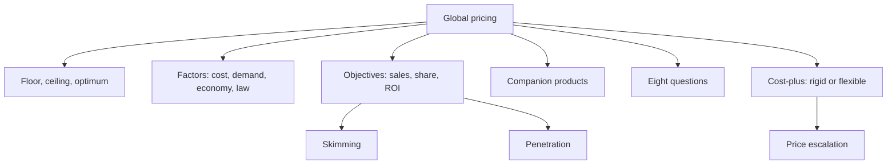

# MM-4: Pricing Basics, Objectives, Cost-Plus and Price Escalation

Covers: price floors, ceilings and optimum prices; factors that drive price; objectives; skimming vs penetration; companion products; the eight pricing questions; rigid vs flexible cost-plus; and a worked price escalation and price-back sum. **(class)** unless tagged. **The slides contain no pricing numbers.** The sums below are **illustrative (general)** and recomputed.

## Basic pricing concepts (class)
National markets differ, so the global marketer must develop **pricing systems and policies** that address:
- **Price floors**: the lowest viable price (covers cost).
- **Price ceilings**: the highest the market or regulator will accept.
- **Optimum prices**: the best price between floor and ceiling.
They must be consistent with global opportunities and constraints.

## Factors influencing pricing decisions (class)
| Factor | What it includes |
|---|---|
| **Cost considerations** | Production, shipping, tariffs, taxes; all costs must be covered while staying competitive |
| **Market demand** | Demand elasticity by market; high demand can carry a higher price, low demand needs competitive pricing |
| **Economic conditions** | Inflation, exchange rates, economic stability of the target market |
| **Legal and regulatory factors** | Local pricing laws, anti-dumping laws, price controls |

## Objectives and strategies (class)
- **Objectives:** unit sales, market share, return on investment.
- **Strategies** to achieve them: **penetration pricing** and **market skimming**.
| | Market skimming | Penetration pricing |
|---|---|---|
| Idea | Charge a **premium** price | Charge a **low** price to enter fast |
| When | Introduction stage of the product life cycle | To saturate the market before competitors imitate |
| Objective type on slide | **Financial** objectives | **Non-financial** objectives (share, volume) |
| Slide example | Sony camcorder advertisement | 1979 Sony Walkman |
Gap: slides give the pairing but no calculation. Pair skimming with ROI and penetration with share in answers.

## Companion products (class)
Products whose sale depends on the primary product: video games depend on the console (slide: X-Box and a sports game). The slide's line: **"If you make money on the blades you can give away the razors."** So the primary product can be priced low (or free) and the companion carries the margin.

## Eight questions for pricing goods that cross borders (class)
The slide heads this "Target Costing, 8 Questions".
1. Does the price reflect the product's quality?
2. Is the price competitive given local market conditions?
3. Penetration, skimming or another pricing objective?
4. What type of discount (trade, cash, quantity) and allowance (advertising, trade-in) for international customers? (slide says "trade-off"; the textbook term is trade-in **(general)**)
5. Should prices differ with market segment?
6. What options if costs rise or fall; is demand elastic or inelastic?
7. Will the host government see the prices as reasonable or exploitative?
8. Do the foreign country's dumping laws pose a problem?
Memory hook: Quality, Competition, Objective, Discounts, Segments, Costs and elasticity, Government view, Dumping law.

## Cost-plus pricing (class)
- **Cost-based pricing** rests on analysis of internal and external cost.
- **Selling price = total cost + profit** (price of one unit equals total unit cost plus desired profit).
- **Rigid cost-plus:** price is set without regard to the eight considerations (formula only).
- **Flexible cost-plus:** price is adjusted so it is competitive in the particular market.
Class caution: the slide heading says "Target Costing" but the content is cost-plus. **(textbook/general)** Target costing proper works backwards: target price minus desired margin gives allowable cost. The price-back sum below is that method. In the exam, give the class formula first and mention the textbook meaning in one line.

## Worked example 1: price escalation, ex-factory to shelf (illustrative)
An Indian maker exports a machine part. Ex-works (factory) price ₹10,000. All figures illustrative; mark-ups are on cost at each stage.
| Step | Item | Amount (₹) | Running total (₹) |
|---|---|---|---|
| 1 | Ex-works price | 10,000 | 10,000 |
| 2 | Packing, inland freight, documents (500) | 500 | **FOB 10,500** |
| 3 | Ocean freight | 1,200 | 11,700 |
| 4 | Marine insurance | 150 | **CIF 11,850** |
| 5 | Import duty at 10% of CIF | 1,185 | **Landed 13,035** |
| 6 | Importer mark-up 15% | 1,955 | 14,990 |
| 7 | Wholesaler mark-up 12% | 1,799 | 16,789 |
| 8 | Retailer mark-up 30% | 5,037 | 21,826 |
| 9 | Sales tax or VAT 18% (illustrative rate) | 3,929 (shown to the rupee; totals may differ by 1) | **25,754** |
Check: 13,035 × 1.15 × 1.12 × 1.30 × 1.18 = 25,754 (rounded to the rupee).
**Escalation ratio** = 25,754 ÷ 10,000 = **2.58 times**. Duties, freight and three layers of margin more than double the price.

### Shorter channel
If a large retailer imports directly (skip importer and wholesaler): 13,035 × 1.30 × 1.18 = **₹19,996**, ratio **2.00**. Cutting two intermediaries saves ₹5,758 (25,754 minus 19,996) per unit at the shelf.

### Price-back (target costing method) **(general)**
Local competitor retail price including tax: ₹20,000. Work backwards:
| Step | Calculation | Result (₹) |
|---|---|---|
| Remove tax | 20,000 ÷ 1.18 | 16,949 |
| Remove retailer 30% | ÷ 1.30 | 13,038 |
| Remove wholesaler 12% | ÷ 1.12 | 11,641 |
| Remove importer 15% | ÷ 1.15 | **10,123 landed** |
| Remove duty 10% | ÷ 1.10 | 9,202 CIF |
| Remove freight and insurance 1,350 | 9,202 minus 1,350 | 7,852 FOB |
| Remove packing and documents 500 | 7,852 minus 500 | **7,352 ex-works** |
Decision line: to match a ₹20,000 shelf price through the long channel, the exporter needs an ex-works price of about ₹7,352, a cut of **26.5%** from ₹10,000. Options: shorter channel, cheaper freight, sourcing, lower margin, or accept a premium position. State the assumption that mark-up rates are as given.

## Worked example 2: rigid vs flexible cost-plus (illustrative)
Unit total cost ₹8,000; desired profit 20% on cost.
1. Rigid: 8,000 × 1.20 = **₹9,600** ex-works. Add export costs, duty and margins and the shelf price is far above the local rival if the rival sells cheaper.
2. Flexible: check against the eight questions. If the market price band is lower, accept a thinner margin (marginal-cost pricing for a new market) or reposition as a premium brand (skimming) if quality supports it.
Decision line: the formula gives the floor; the market sets the ceiling.

## 5-mark skeleton: "Explain skimming and penetration pricing with examples"
Definitions (2); stage and objective for each (2); slide examples Sony camcorder and 1979 Walkman (1).

## 10-mark skeleton: "Discuss the factors and approaches in global pricing"
Floors, ceilings, optimum (1); four factors (3); objectives and strategies (2); eight questions summary (2); rigid vs flexible cost-plus (1); one-line decision (1).

## What to remember
- Floors, ceilings and optimum prices; four factors: cost, demand, economy, law.
- Skimming: premium, introduction stage, financial objectives. Penetration: low, fast entry, non-financial objectives.
- Companion products: razor and blade logic.
- Selling price = total cost + profit; rigid ignores the eight questions, flexible adapts to the market.
- Price escalation compounds freight, duty, margins and tax; the example gives 2.58 times.

## Concept map

## Flashcards
Q: What three price levels must a global pricing system address?
A: Price floors, price ceilings and optimum prices.
Q: List the four factors influencing global pricing decisions.
A: Cost considerations, market demand, economic conditions, and legal and regulatory factors.
Q: What are the three pricing objectives named on the slide?
A: Unit sales, market share and return on investment.
Q: Define market skimming and give the slide example.
A: Charging a premium price, often at the introduction stage; Sony camcorder advertisement.
Q: Define penetration pricing and give the slide example.
A: A low price to enter fast and saturate the market before imitation; 1979 Sony Walkman.
Q: What is a companion product?
A: A product whose sale depends on a primary product, such as video games depending on a console ("give away the razors, make money on the blades").
Q: State the cost-plus formula and the difference between rigid and flexible.
A: Selling price = total cost + profit; rigid ignores the eight considerations, flexible adjusts to market competitiveness.
Q: In the illustrative sum, what is the escalation ratio and why?
A: 2.58 times (₹10,000 to ₹25,754) from freight, insurance, 10% duty, three mark-ups and 18% tax.
Q: What ex-works price matches a ₹20,000 shelf price in the same chain?
A: About ₹7,352, a 26.5% cut from ₹10,000.
