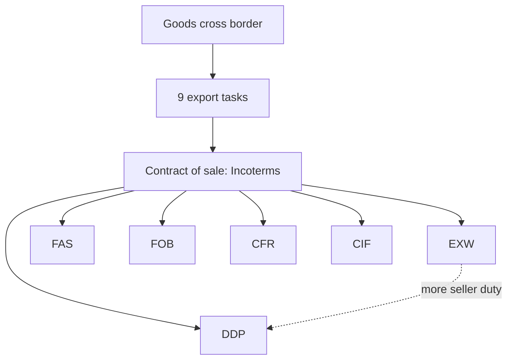

# MM-5: Export Tasks, Incoterms and the SolarBright Case

Covers: the nine tasks when goods cross a border, why the sales contract decides who does them, the six Incoterms on the slide, two slide statements to correct, and the SolarBright pricing-and-Incoterms case. **(class)** unless tagged.

## Tasks when goods cross borders (class)
1. Obtain export licence if required.
2. Obtain currency permit.
3. Pack goods for export.
4. Transport goods to the place of departure.
5. Prepare a land bill of lading (the slide's wording; "inland" is the usual term **(general)**).
6. Complete customs export papers.
7. Prepare customs or consular invoices (slide says "customs or invoices").
8. Arrange ocean freight and preparation.
9. Obtain marine insurance and a certificate of the policy.
**Who performs each task depends on the terms of the sale.** Every commercial transaction rests on a contract of sale and its trade terms. These are the **Incoterms (International Commercial Terms)**.

## Incoterms on the slides (class)
| Term | Slide meaning | Seller's position |
|---|---|---|
| **Ex-works (EXW)** | Seller places goods at the buyer's disposal at the time specified; buyer takes delivery at the seller's premises and bears all risks and expenses from there | Minimum obligation |
| **FAS** (free alongside ship), named port | Seller places goods alongside the vessel and pays all charges up to that point | Pays to quayside |
| **FOB** (free on board) | Seller's responsibility does not end until goods are actually placed aboard ship | Pays to loading on ship |
| **CFR** (cost and freight) | Slide: "seller is not responsible at any point outside of factory" (see correction below) | Pays freight to destination port |
| **CIF** (cost, insurance, freight), named port of destination | Slide: risk of loss or damage passes to the buyer once goods have passed the ship's rail | Pays freight and insurance to destination port |
| **Delivery duty paid (DDP)** | Seller delivers to a named place in the import country with all costs, including duties, paid | Maximum obligation |
Order of seller burden, least to most: **EXW, FAS, FOB, CFR, CIF, DDP** **(general)**.

### Corrections to two slide statements
- **CIF risk point.** The slide says risk passes when goods "have passed the ship's rail". That is the old (Incoterms 2000) wording. Under later editions risk passes when goods are **on board** the vessel at the port of shipment. Give the slide wording as the class answer and add one line on the current rule. **[VERIFY]** the edition (Incoterms 2020 is current as of my knowledge).
- **CFR.** The slide's sentence is wrong as a definition: it contradicts the term's own name. Under CFR the seller **pays cost and freight to the named destination port**, but risk still passes to the buyer on board at origin. Write the slide's one-liner if the question quotes it, then the correct definition.
- Also **(general)**: FAS, FOB, CFR and CIF are for sea and inland waterway transport only; EXW and DDP suit any mode.

## Worked example 1: quote ladder for one shipment (illustrative)
Using the ex-works sum from MM-4: ex-works ₹10,000; packing, inland freight and documents ₹500; ocean freight ₹1,200; insurance ₹150; import duty ₹1,185 (10% of CIF). Customs clearance charges ignored for simplicity.
| Quote term | Seller's quoted price (₹) | Buyer still pays (₹) |
|---|---|---|
| EXW | 10,000 | 500 + 1,200 + 150 + 1,185 = 3,035 |
| FOB | 10,500 | 1,200 + 150 + 1,185 = 2,535 |
| CFR | 11,700 | 150 + 1,185 = 1,335 |
| CIF | 11,850 | 1,185 |
| DDP | 13,035 | 0 (import clearance excluded) |
Check: every row sums to the same total for the buyer, 13,035. Only **who carries which cost and risk** changes, not the total cost of the chain.
Decision line: a higher quote under DDP is not a higher real price; it buys the buyer certainty. Pick the term by who can arrange freight, insurance and clearance cheaper and with less risk.

## Worked example 2: SolarBright, balance pricing against Incoterms (exam layout)
Case (slide 31): **SolarBright**, an Indian maker of affordable solar panels, enters **Brazil, Germany and Kenya** and must set price strategy while negotiating Incoterms (shipping, insurance and tariff responsibilities). Question: prioritise affordability, premium positioning or risk-sharing in logistics?
No figures are given. The answer is a reasoned plan; market facts are **(general)** assumptions to be stated.
| Step | Content |
|---|---|
| 1. State the aim | Affordable brand, so cost and landed price decide competitiveness |
| 2. Market view (assumptions) | Germany: quality-sensitive, regulated, strong local rivals, so price on proof of quality, not lowest price. Brazil: import taxes can be heavy and landed cost rises quickly **[VERIFY]** current tariff. Kenya: price-sensitive, development-finance and off-grid demand, so affordability and simple logistics |
| 3. Pricing strategy | Brazil and Kenya: penetration (MM-4) with cost-plus checked against the local price band. Germany: flexible cost-plus, priced on par with the quality set, not a cheap-entry price |
| 4. Incoterms | Kenya: FOB or CFR so SolarBright controls freight cost and quotes a clear landed price; buyer clears import. Germany: CIF or DAP **(general)** with documented compliance, since buyers expect reliability. Brazil: avoid DDP unless the tax regime is understood; DDP exposes the seller to import-tax changes |
| 5. Risk-sharing | The farther the term from EXW, the more the seller carries. Insure on CIF, price the risk in the quote |
| 6. Currency | Quote in a stable currency where possible (see MM-6) |
Decision line: **do not choose one of the three**. Set price positioning per market (affordability in Kenya and Brazil, quality-led in Germany), and let the Incoterm follow the seller's ability to manage freight, insurance and import tax in each market. State that the call is judgemental.

## 5-mark skeleton: "Explain any four Incoterms"
One line each on EXW, FOB, CIF, DDP (4); one sentence that terms decide who does the nine export tasks (1).

## What to remember
- Nine export tasks; the sales contract (Incoterms) decides who does them.
- EXW is minimum seller burden, DDP maximum; FAS, FOB, CFR, CIF in between.
- Quote ladder: only responsibility and risk shift; the buyer's total landed cost stays the same.
- Two slide slips: CIF risk "ship's rail" (older wording) and the CFR definition.
- SolarBright: pricing per market, Incoterm by ability to manage logistics risk.

## Concept map

## Flashcards
Q: Why do Incoterms matter?
A: The sales contract's trade terms decide who performs the export tasks (licence, packing, transport, customs, freight, insurance) and who bears the risk.
Q: Define ex-works.
A: Seller places goods at the buyer's disposal at his own premises; buyer takes delivery there and bears all risks and expenses from that point.
Q: Define delivery duty paid.
A: Seller delivers to a named place in the import country with all costs, including duties, paid.
Q: Define FAS.
A: Free alongside ship at a named port; seller places goods alongside the vessel and pays all charges up to that point.
Q: Define FOB.
A: Seller's responsibility continues until the goods are actually placed aboard the ship.
Q: What does CIF cover and what is the slide's risk point?
A: Cost, insurance and freight to the named destination port; slide says risk passes at the ship's rail (current rule: on board at origin port).
Q: What is wrong with the slide's CFR line?
A: It says the seller is not responsible anywhere outside the factory; under CFR the seller pays cost and freight to the destination port, with risk passing on board at origin.
Q: In the quote ladder, why does the buyer's total not change across terms?
A: The same freight, insurance and duty are paid either by the seller (priced into the quote) or by the buyer; only responsibility and risk move.
Q: What is the SolarBright answer in one line?
A: Price by market (affordability in Kenya and Brazil, quality-led in Germany) and choose the Incoterm by who can manage freight, insurance and import tax best.
