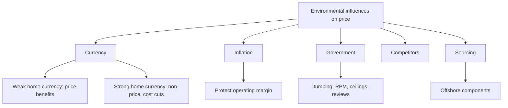

# MM-6: Environmental Influences on Pricing

Covers: the five environmental influences on global prices, the weak-currency and strong-currency playbook (slide table), inflation and operating margins, government rules, competitor behaviour and sourcing as a price tool. **(class)** unless tagged. The slide cites textbook pages 370 to 375.

## The five influences (class)
1. Currency fluctuations.
2. Inflationary environment.
3. Government controls, subsidies and regulations.
4. Competitive behaviour.
5. Sourcing.

## Currency fluctuations: the slide table (class)
"Domestic currency" means the exporter's home currency (the rupee for an Indian firm).
| No. | When domestic currency is **weak** | When domestic currency is **strong** |
|---|---|---|
| 1 | Stress price benefits | Engage in non-price competition by improving quality, delivery and after-sale service |
| 2 | Expand the product line and add more costly features | Improve productivity and engage in cost reduction |
| 3 | Shift sourcing to the domestic market | Shift sourcing outside the home country |
| 4 | Exploit market opportunities in all markets | Give priority to exports to countries with stronger currencies |
| 5 | Use full-costing, but employ marginal-cost pricing to penetrate new or competitive markets | Trim profit margins and use marginal-cost pricing |
| 6 | Speed repatriation of foreign-earned income and collections | Keep the foreign-earned income in the host country; slow down collections |
| 7 | Minimise expenditures in local or host-country currency | Maximise expenditures in local or host-country currency |
| 8 | Buy advertising, insurance, transportation and other services in the domestic market | Buy needed services abroad and pay for them in local currencies |
| 9 | Bill foreign customers in their own currency | Bill foreign customers in the domestic currency |
Logic to learn instead of 18 cells: **weak home currency = exports are cheap abroad, so stress price, grow, bring money home quickly and bill in the customer's (stronger) currency. Strong home currency = exports are dear abroad, so compete on non-price, cut cost, source abroad, trim margin, delay bringing money home, and bill in your own currency.**

### Worked example: a weak-rupee sum (illustrative)
Order of 1,000 units. Price USD 120 per unit. Unit cost ₹6,500. Rupee moves from ₹80 to ₹88 per USD.
| Step | At ₹80 | At ₹88 |
|---|---|---|
| Revenue per unit | 120 × 80 = ₹9,600 | 120 × 88 = ₹10,560 |
| Margin per unit | 9,600 minus 6,500 = ₹3,100 | 10,560 minus 6,500 = ₹4,060 |
| Order margin (1,000 units) | ₹31,00,000 | ₹40,60,000 |
Margin rises by ₹9,60,000 (₹40,60,000 minus ₹31,00,000), a 31% increase (960 ÷ 3,100, rounded).
Option: hold rupee revenue at ₹9,600 and cut the dollar price to 9,600 ÷ 88 = **USD 109.09**, a cut of **9.1%**, to win share (slide item 1: stress price benefits).
Decision line: a weak currency gives a choice between pocketing extra margin and buying market share with a lower dollar price. Pick by the objective (ROI or share, MM-4). If the rupee had strengthened instead, the same USD price would earn less, so non-price competition and cost cuts matter.

## Inflationary environment (class)
- Inflation: a **persistent upward change in price levels**.
- Causes on the slide: an **increase in the money supply**, or **currency devaluation** (imports cost more).
- Essential pricing requirement: **maintain operating margins**. Practical levers **(general)**: escalation clauses, shorter price validity, frequent repricing, pricing in a hard currency.

## Government controls, subsidies and regulations (class)
Policies and regulations affecting price: **dumping legislation, resale price maintenance legislation, price ceilings, general reviews of price levels**. Subsidies to local competitors lower their prices. See MM-7 for dumping and price fixing.

## Competitive behaviour (class)
- If competitors do **not** raise prices when costs rise, it is hard to adjust and protect margins.
- If competitors manufacture or **source in a lower-cost country**, you may have to cut prices to stay competitive.

## Sourcing as a strategic pricing tool (class)
Marketers of domestically made finished goods may move **offshore sourcing of certain components** to keep costs down and prices competitive. The slide's question (with a "Made in USA" image): **can you stay competitive while staying local?** Trade-off **(general)**: lower cost against loss of "made in" appeal, supply-chain risk and exchange exposure.

## Worked example: choose the response (exam layout)
Situation (illustrative): an Indian garment exporter faces a stronger rupee, rising wages at home and a rival sourcing cloth from a cheaper country.
| Step | Content |
|---|---|
| 1. Identify influences | Currency (strong rupee), inflation (cost rise), competitor behaviour (lower-cost sourcing) |
| 2. Apply the slide playbook | Strong currency: non-price competition, productivity, shift sourcing abroad, trim margins, bill in rupees where possible |
| 3. Check competitor | Rival's lower cost forces a price cut or a sourcing change |
| 4. Choose | Source fabric offshore where cheaper, protect operating margin, differentiate on quality and delivery |
| 5. Government check | Any local-content rule or price control that blocks offshore sourcing? |
Decision line: the aim is to protect **operating margin**, not to match price blindly. Make sourcing the main lever, currency the second.

## 5-mark skeleton: "Explain how currency fluctuations affect global pricing"
Weak currency actions: stress price benefits, marginal-cost pricing, bill in customer's currency (2); strong currency actions: non-price competition, cost cuts, offshore sourcing, trim margins (2); one-line logic (1).

## What to remember
- Five influences: currency, inflation, government, competitors, sourcing.
- Weak home currency: price benefits, expand, bill in the customer's currency. Strong: non-price competition, cost cuts, offshore sourcing, bill in your own currency.
- Inflation: persistent price rise; keep operating margins.
- Government: dumping law, resale price maintenance, price ceilings, price reviews.
- Competitors with lower-cost sourcing force a price response; offshore component sourcing is the counter.

## Concept map

## Flashcards
Q: Name the five environmental influences on global pricing.
A: Currency fluctuations, inflationary environment, government controls and regulations, competitive behaviour, and sourcing.
Q: What should an exporter do on price when its home currency is weak?
A: Stress price benefits, use marginal-cost pricing to penetrate new or competitive markets, and bill foreign customers in their own currency.
Q: What should an exporter do when its home currency is strong?
A: Compete on quality, delivery and service, cut costs, source abroad, trim margins, and bill in the domestic currency.
Q: Which way should collections move for a weak and a strong home currency?
A: Weak: speed repatriation of foreign earnings. Strong: keep earnings in the host country and slow collections.
Q: In the sum, a rupee fall from 80 to 88 per USD at USD 120 does what to unit revenue?
A: Raises it from ₹9,600 to ₹10,560, and unit margin from ₹3,100 to ₹4,060 at a ₹6,500 cost.
Q: What dollar price keeps rupee revenue at ₹9,600 after the fall to ₹88?
A: USD 109.09, a cut of 9.1%.
Q: Define inflation and its essential pricing requirement.
A: A persistent upward change in price levels (from higher money supply or devaluation); the key requirement is maintaining operating margins.
Q: Which government policies affect pricing on the slide?
A: Dumping legislation, resale price maintenance legislation, price ceilings and general reviews of price levels.
Q: Why use offshore sourcing as a pricing tool?
A: Moving some component sourcing offshore lowers costs so finished-product prices stay competitive, at the cost of local-content appeal.
