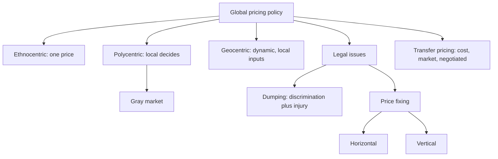

# MM-7: Global Pricing Policies, Gray Markets, Dumping, Price Fixing, Transfer Pricing

Covers: extension (ethnocentric), adaptation (polycentric) and geocentric pricing; gray market goods; dumping; horizontal and vertical price fixing; transfer pricing methods. **(class)** unless tagged. The slides give no figures, so each concept has a short illustrative sum.

## The three policy alternatives (class)
Pricing strategy can be built rationally and analytically or intuitively. Three policies:
| Policy | Other name | What it means | Weakness or strength |
|---|---|---|---|
| **Extension** | **Ethnocentric** | Per-unit price is the **same wherever the buyer is**. The importer absorbs freight and import duties | Fails to respond to each national market |
| **Adaptation** | **Polycentric** | Affiliate managers or independent distributors **set price as they see fit** | Sensitive to local conditions, but creates potential for **gray marketing** |
| **Geocentric** | | Intermediate course: more dynamic and proactive. Neither one fixed world price nor independent local decisions. Recognises **local costs, income levels, competition and local marketing strategy** | Needs coordination and information |
Memory hook: ethno = home rules, poly = many rules, geo = world view with local inputs.

### Worked example 1: extension pricing and the importer's burden (illustrative)
Ex-factory price ₹10,000 to every importer worldwide (extension). A buyer in a country with 10% duty and ₹1,350 freight and insurance pays: CIF = 10,000 + 500 + 1,350 = 11,850; duty 1,185; landed ₹13,035 (MM-4). A buyer in a country with 0% duty pays ₹11,850. The same factory price gives buyers very different landed costs. In a low-income market the high landed cost may make the product unaffordable. That is the failure to respond to local markets.

## Gray market goods (class)
- **Trademarked products exported from one country to another and sold there by unauthorised persons or organisations.**
- Occurs when: the product is in **short supply**; producers use **skimming** in some markets; goods carry **substantial mark-ups**.
- Linked to polycentric pricing (price gaps between markets create the arbitrage).
- Consequences **(general)**: erodes the authorised distributor's margin, damages brand price integrity, warranty and service disputes. Responses **(general)**: narrow price gaps across countries, differentiate product versions, control distributors by contract.

### Worked example 2: the gray market gap (illustrative)
Brand price in Market A (skimming) USD 100. Same product in Market B USD 60. Cost to move B to A (freight, duty and handling) USD 15.
Gray-market landed price in A = 60 + 15 = **USD 75**, which undercuts the authorised price by **USD 25 (25%)**.
Decision line: a price gap larger than the cost of moving the goods invites gray trade. Either close the gap below USD 15 or make the authorised offer worth more (warranty, service). Gaps below the transport cost are safe.

## Dumping (class)
- **Sale of an imported product at a price lower than normally charged in the domestic market or country of origin.**
- Slide rule (US): occurs when imports are priced at levels below **cost of production plus an 8% profit margin**, or **below levels prevailing in the producing countries**.
- **To prove dumping, both price discrimination and injury must be shown.**
- **[VERIFY]** the 8% figure (a US constructed-value convention on the slide) and how the Indian anti-dumping authority applies the idea **(general)**. Do not state 8% as a universal rule.

### Worked example 3: the dumping test (illustrative)
Production cost USD 100 per unit. Home-market price USD 110. Export price USD 95.
| Test | Calculation | Result |
|---|---|---|
| Constructed value | 100 × 1.08 = USD 108 | Export price 95 is below 108 |
| Home-market price | 110 | Export price 95 is below 110 |
Gap to constructed value: 108 minus 95 = USD 13 per unit (13.7% of the export price).
Decision line: price discrimination is shown, but dumping needs **injury** to the importing country's industry as well. State both limbs. Without injury, no anti-dumping duty.

## Price fixing (class)
- Representatives of two or more companies **secretly set similar prices**; **illegal because it is anticompetitive**.
- **Horizontal:** competitors in an industry that make and market the same product conspire to keep prices **high**.
- **Vertical:** a manufacturer conspires with wholesalers or retailers to ensure certain **retail prices** are maintained (links to resale price maintenance, MM-6).
Easy contrast: horizontal = same level (rivals); vertical = different levels (maker and retailer).

## Transfer pricing (class)
- **Pricing of goods, services and intangible property bought and sold by operating units or divisions of a company doing business with an affiliate in another jurisdiction.**
- Intra-corporate exchanges use three methods: **cost-based, market-based, negotiated** transfer pricing.
- Slide gives no tax angle. **(general)** Authorities require transfers at **arm's length** (price a third party would pay) because firms can shift profit to low-tax countries.

### Worked example 4: transfer price and group tax (illustrative)
Parent in Country L (tax 20%, illustrative) makes at cost 100 and sells to its subsidiary in Country H (tax 40%, illustrative), which sells to customers at 200 and has its own selling cost 20. Group pre-tax profit = 200 minus 100 minus 20 = 80 either way.
| | Transfer price 120 | Transfer price 160 |
|---|---|---|
| Parent profit | 20 | 60 |
| Parent tax at 20% | 4 | 12 |
| Subsidiary profit | 200 minus 120 minus 20 = 60 | 200 minus 160 minus 20 = 20 |
| Subsidiary tax at 40% | 24 | 8 |
| **Group tax** | **28** | **20** |
| Group after-tax profit | 52 | 60 |
Raising the transfer price moves profit to the low-tax country and saves 8. That is why tax authorities test for **arm's length** pricing; the saving can be reversed with penalties. Decision line: set the price by one of the three methods with documentation, not by tax gain alone.

## 5-mark skeleton: "Distinguish ethnocentric, polycentric and geocentric pricing"
One line and a flaw or benefit each (3); gray market link to polycentric (1); the geocentric inputs: costs, income, competition, local strategy (1).

## 10-mark skeleton: "Discuss legal and strategic issues in global pricing"
Three policies (3); gray markets (2); dumping with two limbs (2); price fixing horizontal vs vertical (2); transfer pricing (1).

## What to remember
- Ethnocentric: one price everywhere, importer absorbs freight and duty. Polycentric: local managers set price, risk of gray market. Geocentric: dynamic, uses local costs, income, competition and strategy.
- Gray market: genuine trademarked goods sold by unauthorised sellers, driven by price gaps and shortages.
- Dumping: export price below home price or below cost plus 8% (slide); needs price discrimination and injury.
- Price fixing is illegal: horizontal between rivals, vertical between maker and retailer.
- Transfer pricing: intra-company prices (cost, market, negotiated) that must be arm's length.

## Concept map

## Flashcards
Q: What is ethnocentric (extension) pricing and its drawback?
A: The same per-unit price everywhere, with the importer absorbing freight and duties; it fails to respond to each national market.
Q: What is polycentric (adaptation) pricing and its risk?
A: Affiliates or distributors set their own prices; sensitive to local conditions but creates potential for gray marketing.
Q: What does geocentric pricing recognise?
A: Local costs, income levels, competition and local marketing strategy, without one fixed world price or fully independent local prices.
Q: Define gray market goods and when they occur.
A: Trademarked products sold in another country by unauthorised sellers; occur with short supply, skimming in some markets and large mark-ups.
Q: In the illustration, when does a gray market arise?
A: When the price gap (USD 100 vs 60) exceeds the cost of moving goods (USD 15); gray landed price is USD 75, undercutting by USD 25.
Q: Define dumping and what must be proved.
A: Selling an import below the normal domestic or origin price; both price discrimination and injury must be shown.
Q: What is the slide's US dumping benchmark?
A: Price below production cost plus an 8% profit margin, or below prices in the producing country (verify before quoting).
Q: Contrast horizontal and vertical price fixing.
A: Horizontal: competitors secretly keep prices high; vertical: a manufacturer and its wholesalers or retailers keep retail prices at a set level.
Q: Define transfer pricing and name its three methods.
A: Pricing of goods, services and intangibles between a company's units in different jurisdictions; cost-based, market-based and negotiated.
Q: In the sum, how much tax does the higher transfer price save?
A: Group tax falls from 28 to 20, a saving of 8, which is why arm's-length rules apply.
