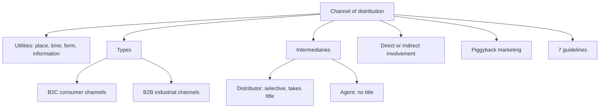

# MM-8: Global Marketing Channels and Intermediaries

Covers: the AMA definition, four channel utilities, B2C and B2B channels, distributor and agent, the consumer and industrial channel diagrams, piggyback marketing, direct vs indirect involvement and the seven guidelines for working with intermediaries. **(class)** unless tagged.

## Definition and purpose (class)
- The American Marketing Association defines a channel of distribution as **"an organised network of agencies and institutions that, in combination, perform all the activities required to link producers with users to accomplish the marketing task"**. (The slide drops the words "of" and "network of"; the sense is the same.)
- Global supply chains connect producers worldwide and use sophisticated logistics. Supermarkets and convenience stores are just two of many channel elements around the globe.
- **Distribution channels** are systems linking manufacturers to customers; **distribution** is the physical flow of goods through the channel. Channels are a coordinated group of individuals or firms that **add utility**.

### Four channel utilities
| Utility | Meaning |
|---|---|
| **Place** | Product available in a location convenient to the customer |
| **Time** | Available when the customer wants it |
| **Form** | Processed, prepared, in proper condition or ready to use |
| **Information** | Answers to questions and communication about product features and benefits |
Memory hook: P-T-F-I, "Please Take Fast Information".

## Terminology (class)
- **B2C:** consumer channels put products in the hands of people for their own use.
- **B2B:** industrial channels deliver products to manufacturers or organisations that use them as inputs or in daily operations.
- **Distributor:** a wholesale intermediary that typically carries product lines or brands on a **selective** basis (takes title **(general)**).
- **Agent:** an intermediary that negotiates transactions between two or more parties but **does not take title** to the goods.
Consumer and industrial channels are similar but have distinct differences.

## Consumer product channels (class, from the slide diagram)
Letters: M manufacturer, W wholesaler, R retailer, MSF manufacturer's sales force.
| Route | Path to customer |
|---|---|
| Direct, no intermediary | M straight to customers by internet, mail order or interactive TV; house party; door to door; consignment to part-time salespersons; manufacturer-owned stores |
| Short | M, MSF, R, customers |
| Agent route | M, agents or brokers, R, customers |
| Via wholesaler | M, MSF, W, R, customers |
| Mixed | M, MSF, then to R directly or through W |
| Traditional | M, W, R, customers |
Reading the diagram: more intermediaries means a longer channel, more margin layers (MM-4 price escalation), and less control.

## Industrial product channels (class, from the slide diagram)
Four routes: **M to customers directly over the internet; M with its own sales force (MSF) to customers, with or without a wholesaler; M to W to customers; M to a distributor or agent (D or A) to customers, with or without a wholesaler.** The industrial pattern leans on sales force and distributors or agents because products are technical and orders are large **(general)**.

## Piggyback marketing (class)
A channel innovation that has grown in popularity: **one manufacturer distributes its product by using another company's distribution channel.** It requires that the combined product lines be **complementary** and appeal to the **same customer**.

## Direct or indirect involvement (class)
| Mode | Meaning |
|---|---|
| **Direct involvement** | The company builds its own sales force or runs its own retail stores |
| **Indirect involvement** | The company uses independent agents, distributors and wholesalers |
Channel strategy must fit the company's **competitive position and marketing objectives within each national market**.
Trade-off **(general)**: direct gives control and data at high cost and slow reach; indirect gives speed and local knowledge with less control.

## Seven guidelines for working with intermediaries (class)
1. **Select** distributors; do not let them select you.
2. Look for distributors able to **develop markets**, not just those with a few good customer contacts.
3. Treat local distributors as **long-term partners**, not temporary entry vehicles.
4. Support entry by committing **money, managers and proven marketing ideas**.
5. From the start, **maintain control over marketing strategy**.
6. Ensure distributors give **detailed market and financial performance data**.
7. **Build links among national distributors** at the earliest opportunity.

## Worked example: choose a channel for a foreign market (exam layout)
Illustrative: an Indian small-appliance maker enters Kenya. No figures on the slide, so the answer is a structured choice.
| Step | Content |
|---|---|
| 1. Objectives | Reach, speed, margin and control, within cost |
| 2. Utilities needed | Place (towns beyond the capital), time (stock availability), form (assembled, tested), information (demo and after-sales) |
| 3. Options | Direct (own store, online) vs indirect (distributor, agent) vs piggyback on a complementary brand's network |
| 4. Compare | Direct: control and data, high fixed cost. Distributor: reach, local knowledge, lower fixed cost, margin sacrificed. Agent: lowest commitment, no title and no stocking. Piggyback: fast, cheap if the buyer segment matches |
| 5. Apply guidelines | Choose a distributor with market-development capability, tie to a long-term contract with data reporting, keep control of pricing and brand |
| 6. Recommend | Start with a distributor plus piggyback in the capital, add own online sales for data, review after a year |
Decision line: choose the channel that supplies the **four utilities at the lowest total cost while keeping control of marketing strategy**; start indirect and add direct involvement as volume grows. The call depends on volume and control needs, so state them.

## 5-mark skeleton: "Explain the guidelines for working with international intermediaries"
Select, do not be selected; market developers (1); long-term partners; support with money and managers (2); keep control, require data, link distributors (2).

## What to remember
- AMA: an organised network that links producers with users; channels create place, time, form and information utility.
- B2C vs B2B channels; distributor takes title selectively, agent does not take title.
- Direct involvement: own sales force or stores. Indirect: agents, distributors, wholesalers.
- Piggyback needs complementary lines and the same customer.
- Seven guidelines: select, developers, long-term, support, control, data, link.

## Concept map

## Flashcards
Q: Give the AMA definition of a channel of distribution.
A: An organised network of agencies and institutions that, in combination, perform all the activities required to link producers with users to accomplish the marketing task.
Q: Name the four channel utilities.
A: Place, time, form and information utility.
Q: Distinguish distributor and agent.
A: A distributor is a wholesale intermediary carrying lines or brands selectively; an agent negotiates transactions between parties but does not take title to the goods.
Q: What is piggyback marketing and what does it need?
A: One manufacturer distributing through another firm's channel; the combined lines must be complementary and appeal to the same customer.
Q: Define direct and indirect involvement in channels.
A: Direct: own sales force or own retail stores. Indirect: independent agents, distributors and wholesalers.
Q: What should channel strategy fit?
A: The company's competitive position and marketing objectives within each national market.
Q: State the first three intermediary guidelines.
A: Select distributors, do not let them select you; look for market developers, not just good contacts; treat them as long-term partners.
Q: State the last four intermediary guidelines.
A: Support entry with money, managers and ideas; maintain control over marketing strategy; require market and financial data; build links among national distributors early.
Q: How does channel length affect price?
A: Each intermediary adds a margin layer, so longer channels raise the shelf price (the MM-4 sum gives 2.58 times, or 2.00 with a direct-import retailer).
