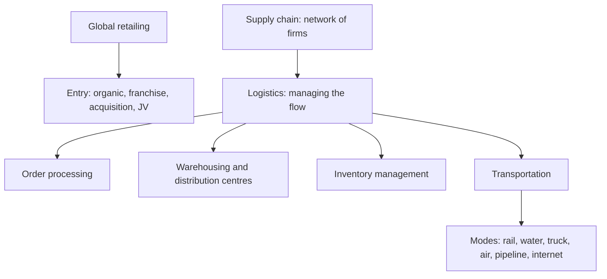

# MM-9: Global Retailing, Supply Chain and Physical Distribution

Covers: retail formats, four retail entry strategies, supply chain vs logistics, the four physical distribution functions (order processing, warehousing, inventory, transportation) and the transport-mode comparison table. **(class)** unless tagged.

## Global retailing (class)
Global retailing is **any retailing activity that crosses national boundaries**. Slide formats: department stores, specialty retailers, supermarkets, convenience stores, discount stores and warehouse clubs, hypermarkets, outlet stores.

### Four retail entry strategies
| Strategy | Slide meaning | When it fits |
|---|---|---|
| **Organic** | The company uses its own resources to open a store on a **greenfield** site or acquire one or more existing retail facilities | Control wanted and the firm has resources |
| **Franchise** | Appropriate when **barriers to entry are low** yet the market is **culturally distant** in consumer behaviour or retail structure | Local partners know the culture |
| **Chain acquisition** | Buy a company that has **multiple existing outlets** in the foreign country | Fast scale, higher cost |
| **Joint venture** | Advisable when **culturally distant, difficult-to-enter** markets are targeted | Share risk and local knowledge |
Link: these echo the entry modes in Unit 3 (franchising, joint venture).

## Supply chain and logistics (class)
- **Supply chain:** all the firms that perform support activities by **generating raw materials, converting them into components or finished products and making them available to customers**.
- **Logistics:** the management process that **integrates the activities of all companies to ensure efficient flow of goods through the supply chain**.
Easy contrast: supply chain = the network of firms; logistics = the management of the flow through it.

## Four functions of physical distribution (class)
| Function | Slide content |
|---|---|
| **Order processing** | **Order entry** (order entered into the information system); **order handling** (locating, assembling and moving products into distribution); **order delivery** |
| **Warehousing** | **Warehouses** store goods until sold; **distribution centres** efficiently receive goods from suppliers and fill orders for individual stores or customers |
| **Inventory management** | Ensures the company neither runs out of components or finished goods nor bears the expense and risk of **excess stock** |
| **Transportation** | The method or mode used to move products through domestic and global channels; common modes: **rail, truck, air, water** |
Memory hook: O-W-I-T.

## Transport modes, the slide table (class)
Read from the slide image. Ratings are the slide's.
| Mode | Reliability | Cost | Speed | Accessibility | Capability | Ease of tracing |
|---|---|---|---|---|---|---|
| Rail | average | average | average | average | high | low |
| Water | low | low | slow | low | high | low |
| Truck | high | varies | fast | high | high | high |
| Air | high | high | fast | low | moderate | high |
| Pipeline | high | low | slow | low | low | moderate |
| Internet | high | low | moderate to fast | moderate, increasing | low | high |
"Capability" means what the mode can carry (bulk, size) **(general)**. The Internet row applies to digital products.
**Channel strategy** (transport): analyse each shipping mode to find which mode, or **combination of modes**, will be effective and efficient in the situation.

### Worked example: choose a mode (exam layout, illustrative)
Case: ship 20 tonnes of tea from Kolkata to Hamburg (illustrative). Criteria: low cost and acceptable time; goods not perishable in a week.
| Step | Content |
|---|---|
| 1. Rank the criteria | Cost first, reliability second, speed third |
| 2. Screen by slide table | Air: cost high, capability moderate, wrong for 20 tonnes of low-value goods. Water: cost low, capability high, but slow, low reliability and low tracing. Rail and truck: cover inland legs only |
| 3. Build a combination | Truck or rail to port, water for the ocean leg, truck at destination |
| 4. Add mitigations **(general)** | Book through a forwarder with tracking, buffer inventory for delay, insure cargo (CIF terms, MM-5) |
| 5. When to switch | Use air for urgent small lots, such as samples or a promotion deadline |
Decision line: mix modes rather than pick one. Water carries the bulk cheaply and slowly; truck and rail supply access; air is for urgent exceptions, and the extra air cost is justified only when the delay cost exceeds it.

## Worked example: retail entry choice (exam layout)
Illustrative: a European homeware retailer looks at India, a culturally distant market with restrictions on some retail forms **[VERIFY]** the current FDI rules in retail.
| Step | Content |
|---|---|
| 1. Cultural distance | High, in consumer behaviour and retail structure |
| 2. Barriers | Regulatory and real-estate barriers **(general)** |
| 3. Match slide guidance | Culturally distant and difficult to enter: **joint venture**; low barriers with cultural distance: **franchise** |
| 4. Compare alternatives | Organic: control, slow and costly. Acquisition: fast, may not exist or fit. Franchise: low capital, brand control risk |
| 5. Recommend | Joint venture with a local retailer first, scale with franchise outlets if the formula works |
Decision line: use the slide's rule (distant and hard to enter means JV) and name what would change the answer, for example a permissive rule that allows 100% ownership.

## 5-mark skeleton: "Explain the components of physical distribution"
Define supply chain and logistics (1); order processing (1); warehousing (1); inventory management (1); transportation modes (1).

## What to remember
- Global retailing crosses borders; four entry strategies: organic, franchise, chain acquisition, joint venture.
- Franchise for low barriers plus cultural distance; JV for culturally distant and hard-to-enter markets.
- Supply chain is the firms; logistics is the management of the flow.
- Physical distribution: order processing, warehousing, inventory, transportation.
- Transport: water cheap and slow, air fast and costly, truck flexible, rail average, pipeline low capability; mix modes.

## Concept map

## Flashcards
Q: Define global retailing and list the slide formats.
A: Any retailing activity crossing national boundaries; department stores, specialty retailers, supermarkets, convenience stores, discount stores and warehouse clubs, hypermarkets, outlet stores.
Q: Name the four global retailing strategies.
A: Organic, franchise, chain acquisition and joint venture.
Q: When is franchising appropriate in global retailing?
A: When barriers to entry are low but the market is culturally distant in consumer behaviour or retailing structure.
Q: When is a joint venture advisable?
A: When culturally distant, difficult-to-enter markets are targeted.
Q: Distinguish supply chain and logistics.
A: Supply chain is all the firms generating materials, converting them and making goods available; logistics is the management process integrating their activities for efficient flow.
Q: Name the four physical distribution functions.
A: Order processing, warehousing, inventory management and transportation.
Q: Differentiate a warehouse and a distribution centre.
A: A warehouse stores goods until sold; a distribution centre efficiently receives goods from suppliers and fills orders for individual stores or customers.
Q: How does air compare with water on the slide table?
A: Air: high reliability, high cost, fast, easy to trace, moderate capability. Water: low reliability, low cost, slow, high capability, low tracing.
Q: What is channel strategy in transportation?
A: Analysing each mode to find the mode or combination of modes that is effective and efficient.
