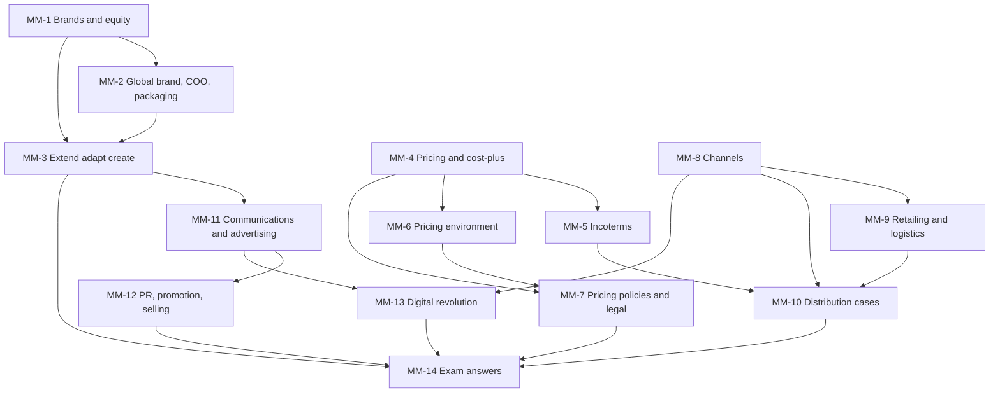

# International Marketing Unit 4: Global Marketing Mix Decisions, node map

ESE (assumed): 50 marks, 2 hours. Section A 3 of 5 × 5, Section B 2 of 3 × 10, Section C one compulsory 15-mark case. The **faculty slides are the single source**; textbook and general knowledge only fill gaps and are tagged **(general)**. Pricing and escalation figures are **illustrative**, since the slides carry no pricing numbers. MM-13 (digital) is mostly general knowledge because the deck has almost no slide content on it.

## Nodes

| Node | Topic | Deps | Minutes | Exam focus |
|---|---|---|---|---|
| MM-1 | Brands, Brand Equity and Local, International, Global | none | 30 | yes |
| MM-2 | Global Brand Building, Needs, Country of Origin, Packaging, Labelling | MM-1 | 30 | yes |
| MM-3 | Product Strategies: Extend, Adapt, Create | MM-1, MM-2 | 35 | yes |
| MM-4 | Pricing Basics, Objectives, Cost-Plus and Price Escalation | none | 45 | yes |
| MM-5 | Export Tasks, Incoterms and the SolarBright Case | MM-4 | 35 | yes |
| MM-6 | Environmental Influences on Pricing | MM-4 | 30 | yes |
| MM-7 | Global Pricing Policies, Gray Market, Dumping, Transfer Pricing | MM-4, MM-6 | 40 | yes |
| MM-8 | Global Marketing Channels and Intermediaries | none | 35 | yes |
| MM-9 | Global Retailing, Supply Chain and Physical Distribution | MM-8 | 35 | yes |
| MM-10 | Distribution Cases: Electronics in India and Nobel Biocare | MM-5, MM-8, MM-9 | 30 | yes |
| MM-11 | Global Communications, IMC and Advertising | MM-3 | 35 | yes |
| MM-12 | PR, Sales Promotion, Personal Selling and Special Forms | MM-11 | 30 | yes |
| MM-13 | Global Marketing and the Digital Revolution | MM-8, MM-11 | 30 | yes |
| MM-14 | Unit 4 Exam Answers (5, 10 and 15-mark case layouts) | MM-1 to MM-13 | 35 | yes |

Total reading time: about 475 minutes.

## Dependency graph

## Headline facts to know

- Brand equity: 7 benefits; inelastic to price rises, elastic to price cuts.
- Five product strategies: dual extension (Pepsi), product extension with communication adaptation (Coca-Cola), product adaptation with communication extension (McDonald's McAloo Tikki), dual adaptation, product invention (P&G).
- Illustrative price escalation: ex-works ₹10,000 becomes ₹25,754 on the shelf, ratio 2.58; shorter channel ratio 2.00; price-back from ₹20,000 needs ₹7,352 ex-works.
- Incoterms in order of seller burden: EXW, FAS, FOB, CFR, CIF, DDP.
- Weak home currency: stress price, bill in the customer's currency; strong: non-price competition, cost cuts, bill in your own.
- Dumping needs price discrimination and injury; gray market = genuine goods through unauthorised sellers.
- Channel utilities: place, time, form, information; 7 intermediary guidelines.
- Personal selling: 6 steps. Promotion localisation: 5 factors.

## Slide gaps and corrections
- Strategy 4 (dual adaptation) has no slide text; defined in MM-3 (general).
- Digital revolution topic has almost no slide content; MM-13 is mostly general knowledge.
- "Target Costing" slides are cost-plus pricing; noted in MM-4.
- Incoterms: CIF risk "ship's rail", the CFR definition and the FAS port (slide says destination; it is the port of shipment) need correction (MM-5).
- Maslow slide shows only the pyramid; product mapping is general (MM-2).

## Links
- [[International Marketing MOC]]
