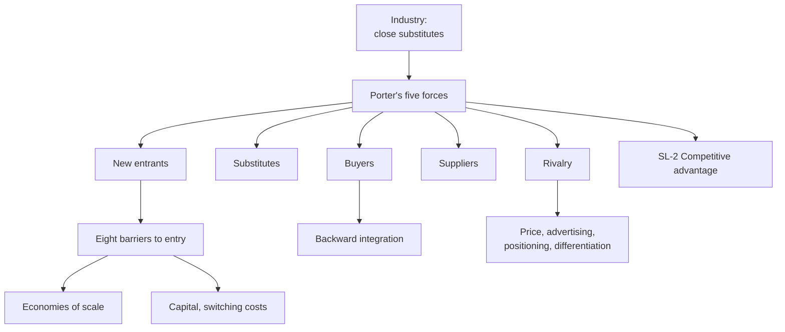

# SL-1 - Industry Analysis and Porter's Five Forces

Covers: the definition of an industry, the five forces diagram with its example factors, the eight barriers to entry, each of the five forces in the slide's words, a worked five-forces answer and the exam skeleton. **(class)**

## Where this fits in the ESE

ESE: 50 marks, 2 hours. Section A 3 of 5 x 5, Section B 2 of 3 x 10, Section C one compulsory 15-mark case. Porter's five forces is the single most likely 5 or 10-mark question from this unit, and it is the standard tool inside a case. The deck is titled Unit VI on its first slide; the plan treats it as Unit 5. **(plan)**

## Industry and the five forces (class)

**Industry (class):** a group of firms that produce products that are close substitutes for each other.

**Michael Porter** identifies **five forces** that influence competition in an industry. Industry analysis asks which forces are strong, because they decide how much profit the industry can keep.

The five forces (learn the order the slides teach):
1. Threat of new entrants
2. Threat of substitute products
3. Bargaining power of buyers
4. Bargaining power of suppliers
5. Rivalry among competitors

### The diagram: example factors per force (class)

| Force (diagram label) | Example factors on the slide |
|---|---|
| New market entrants | Entry ease and barriers; geographical factors; incumbents' resistance; new entrant strategy; routes to market |
| Supplier power | Brand reputation; geographical coverage; product or service level quality; relationships with customers; bidding processes and capabilities |
| Competitive rivalry | Number and size of firms; industry size and trends; fixed vs variable cost bases; product or service ranges; differentiation, strategy |
| Buyer power | Buyer choice; buyers' size and number; change cost and frequency; importance of the product or service; volumes, JIT scheduling |
| Product and technology development (the substitutes force) | Alternatives' price and quality; market distribution changes; fashion and trends; legislative effects |

Use these as the "factors to examine" list when the question gives you an industry.

## Force 1: threat of new entrants (class)

New entrants mean **downward pressure on prices and reduced profitability**. **Barriers to entry** determine the extent of the threat: the higher the barriers, the lower the threat.

### Barriers to entry (class), eight

| Barrier | Slide meaning |
|---|---|
| Economies of scale | Per-unit product costs decline as the absolute volume of production per period increases |
| Product differentiation | The extent of a product's perceived uniqueness |
| Capital requirements | Investment needed for manufacturing, R&D, advertising, field sales and service, etc. |
| Switching costs | Costs of changing suppliers or products |
| Distribution channels | Are there current distribution channels available with capacity? |
| Government policy | Are there regulations that restrict competitive entry? |
| Cost advantages independent of scale | Access to raw materials, a large pool of low-cost labour, favourable locations, government subsidies |
| Competitor response | How will the market react, in anticipation of increased competition? |

Memory aid: **E-P-C-S-D-G-C-C** (economies, product differentiation, capital, switching, distribution, government, cost advantage, competitor response). The first four are the headline barriers on the slide (they carry a marker); the last four are the "questions to ask" barriers.

**Worked numbers for economies of scale (illustrative, my own figures; the slide gives none).** Fixed cost ₹10,00,000 per period, variable cost ₹40 per unit.

| Output | Fixed cost per unit | Total cost per unit |
|---|---|---|
| 20,000 | 10,00,000 / 20,000 = ₹50 | 50 + 40 = ₹90 |
| 50,000 | 10,00,000 / 50,000 = ₹20 | 20 + 40 = ₹60 |
| 1,00,000 | 10,00,000 / 1,00,000 = ₹10 | 10 + 40 = ₹50 |

A new entrant selling 20,000 units has cost ₹90 against an incumbent's ₹60 at 50,000, a 33.3% cost gap ((90 - 60) / 90). Decision line: **scale is a barrier because a small entrant starts with a per-unit cost handicap, so it must either enter big (capital barrier) or accept losses.**

## Force 2: threat of substitute products (class)

The availability of substitute products **places limits on the prices market leaders can charge**. High prices induce buyers to switch to the substitute. The diagram's factors: alternatives' price and quality, distribution changes, fashion and trends, legislative effects.

Gap-fill **(general)**: a substitute performs the same function in a different way (a video call for a business flight), unlike a rival product within the same industry.

## Force 3: bargaining power of buyers (class)

On the slide, **buyers are manufacturers and retailers, not consumers**. Buyers seek to pay the lowest possible price. Buyers have leverage over suppliers when:
- they purchase in large quantities (supplier depends on the buyer);
- suppliers' products are commodities;
- the product is a significant portion of the buyer's costs;
- the buyer is willing and able to achieve **backward integration**.

## Force 4: bargaining power of suppliers (class)

Suppliers with leverage can raise prices high enough to affect their customers' profitability. Leverage accrues when:
- suppliers are large and few in number;
- their products are critical inputs, highly differentiated, or carry switching costs;
- few substitutes exist;
- suppliers are willing and able to sell the product themselves (forward integration, **(general)** term).

Mirror image to remember: buyer power rises with commodity products and large orders; supplier power rises with differentiated products and few suppliers.

## Force 5: rivalry among competitors (class)

All actions taken by firms in the industry to improve their positions and gain advantage over each other: **price competition, advertising battles, product positioning, differentiation**. The diagram adds: number and size of firms, industry size and trends, fixed vs variable cost bases, product ranges.

Gap-fill **(general)**: rivalry is usually fiercer when growth is slow, fixed costs are high (firms cut price to fill capacity), products are similar and exit barriers are high.

## Worked example: five-forces answer for an industry

*Illustrative and qualitative, no real company numbers. Industry: packaged biscuits in an emerging market a firm wants to enter. Scores 1 (weak force) to 5 (strong force) are my own illustration; the slides give no scoring scale, so state this in the exam (general).*

1. State the industry definition: firms making close substitutes.
2. Assess each force with a reason from the slide's factor list:

| Force | Score | Reason (slide factor) |
|---|---|---|
| New entrants | 4 | Low capital need, but distribution channels are held by incumbents; weak government barriers |
| Substitutes | 3 | Other snacks and home-made food limit price |
| Buyers | 4 | Large retail chains buy in volume; product is a near-commodity |
| Suppliers | 2 | Wheat and sugar are widely available; many suppliers |
| Rivalry | 4 | Many firms, price and advertising battles |

3. Total: 4 + 3 + 4 + 2 + 4 = 19. Average: 19 / 5 = **3.8**.
4. Decision line: **an average of 3.8 out of 5 means the industry is competitive and profit is under pressure. Enter only with a differentiated or focused offer (SL-2) and secure distribution first.**
5. Interpretation: the strongest forces (entrants, buyers, rivalry, all 4) tell the firm where to act: lock in retailer relationships, build a brand (a differentiation barrier) and avoid pure price war.

## 5-mark skeletons

*Q: Explain Porter's five forces.* Definition of industry and Porter (1); five forces, one line each with a factor (4).

*Q: Explain the barriers to entry.* Threat-of-entrants link to price and profit (1); eight barriers with slide meanings (4).

*Q: When do buyers and suppliers have bargaining power?* Buyer conditions (2.5); supplier conditions (2.5).

## What to remember

- Industry = firms making close substitutes; Porter's five forces: entrants, substitutes, buyers, suppliers, rivalry.
- New entrants cut prices and profit; barriers decide the threat: economies of scale, differentiation, capital, switching costs, distribution, government policy, cost advantages, competitor response.
- Substitutes cap the price market leaders can charge.
- Buyers (manufacturers and retailers) gain power from volume, commodity products, cost share and backward integration.
- Suppliers gain power when few and large, differentiated, few substitutes, and able to sell directly.
- Rivalry: price, advertising, positioning, differentiation. Always end with a decision line.

## Concept map

## Flashcards
Q: Define industry (class).
A: A group of firms that produce products that are close substitutes for each other.

Q: List Porter's five forces.
A: Threat of new entrants, threat of substitute products, bargaining power of buyers, bargaining power of suppliers, rivalry among competitors.

Q: Why are new entrants a threat?
A: They put downward pressure on prices and reduce profitability; barriers to entry decide how large the threat is.

Q: Name the eight barriers to entry on the slides.
A: Economies of scale, product differentiation, capital requirements, switching costs, distribution channels, government policy, cost advantages independent of scale, competitor response.

Q: What does the threat of substitutes do?
A: Limits the prices market leaders can charge; high prices push buyers to the substitute.

Q: Who are "buyers" in Porter's force 3 on the slide?
A: Manufacturers and retailers, not consumers.

Q: Four conditions that give buyers leverage?
A: Large-quantity purchases, commodity products, product is a large share of buyer cost, buyer able to integrate backward.

Q: Four conditions that give suppliers leverage?
A: Few large suppliers, critical or differentiated inputs or switching costs, few substitutes, ability to sell the product themselves.

Q: What does rivalry among competitors include?
A: Price competition, advertising battles, product positioning and differentiation.

Q: Fixed cost ₹10,00,000, variable ₹40. Total cost per unit at 20,000 and 50,000 units?
A: ₹90 and ₹60. The ₹30 gap is 33.3% of ₹90, showing economies of scale as a barrier.

## Sources
- Faculty deck Unit 5 (industry analysis, five-forces diagram, Forces 1 to 5, barriers to entry)
- Scale example and scoring scale: illustrative, my own
- Next node: [[International Marketing Unit 5 - SL-2 Competitive Advantage and Generic Strategies]]
- [[International Marketing Unit 5 - Strategy and Leadership MOC (Node Map)]]
