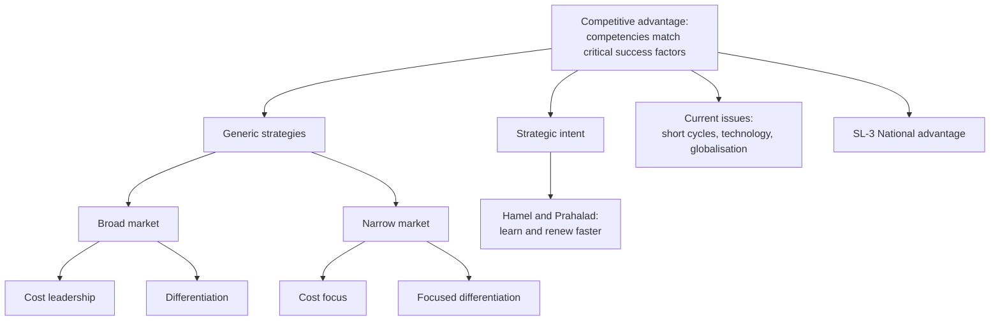

# SL-2 - Competitive Advantage and Generic Strategies

Covers: the definition of competitive advantage, the four generic strategies (2 x 2), strategic intent and the Hamel and Prahalad quote, global competition, and why advantage is harder to hold today. **(class)**

## Competitive advantage (class)

Competitive advantage is achieved when there is a **match between a firm's distinctive competencies and the factors critical for success within its industry**.

The slide says there are two ways to achieve it:
1. **Generic strategies**, four types.
2. **Strategic intent**, also four types.

Slide gap: the deck gives the four generic strategies in full but does not list the four types of strategic intent, only the Hamel and Prahalad quote. See the strategic intent section for the quote first and a (general) gap-fill of four approaches.

## Generic strategies: the 2 x 2 (class)

| | Low price | Premium price |
|---|---|---|
| **Broad market** | Cost leadership | Product differentiation |
| **Narrow market** | Cost focus | Focused differentiation |

Rule: the **scope** (broad or narrow) is the row; the **source of advantage** (low cost or uniqueness) is the column. Answer any "which strategy" question by asking: how wide is the target, and does the firm win on price or on uniqueness.

### Cost leadership (class)
- Based on the firm's position as the industry's **low-cost producer**.
- Must construct the **most efficient facilities**.
- Must obtain the **largest market share** so that per-unit cost is the lowest in the industry.
- Works **only if barriers exist** that stop competitors from reaching the same low costs.

### Product differentiation (class)
- A product with **actual or perceived uniqueness** in a broad market has a differentiation advantage.
- Extremely effective for **defending market position**.
- Extremely effective for **above-average financial returns**: unique products command a **premium price**.

### Cost focus (class)
- The firm's lower cost position lets it serve a **narrow target market at lower prices** than the competition.
- **Sustainability is the central issue.** It works if (a) competitors define their target market more broadly, and (b) competitors cannot define the segment even more narrowly.

### Focused differentiation (class)
- The product has actual uniqueness **and** a very narrow target market.
- Results from a **better understanding of customers' wants and desires**.
- Slide example: **high-end audio equipment**.

## Worked example: choosing and testing a generic strategy

*Illustrative figures, my own; no real firm. Two firms sell the same product. Firm L is a cost leader and Firm D differentiates.*

| Item per unit | Firm L (cost leader) | Firm D (differentiator) |
|---|---|---|
| Price | ₹60 | ₹80 |
| Cost | ₹50 | ₹62 |
| Profit | ₹10 | ₹18 |
| Margin on price | 10 / 60 = 16.7% | 18 / 80 = 22.5% |
| Volume (units) | 1,00,000 | 40,000 |
| Total profit | ₹10,00,000 | ₹7,20,000 |

Steps for the exam:
1. Name the strategy from the 2 x 2: L is broad and low price (cost leadership); D is broad and premium (differentiation).
2. State the condition that must hold. L needs barriers (scale: the earlier example had cost fall from ₹90 to ₹50 as volume rose from 20,000 to 1,00,000). D needs buyers who perceive uniqueness.
3. Compute: L earns ₹10 x 1,00,000 = ₹10,00,000; D earns ₹18 x 40,000 = ₹7,20,000.
4. Decision line: **D has the higher margin (22.5% against 16.7%) but L has the higher total profit (₹10,00,000 against ₹7,20,000). Both strategies can work; the firm should pick the one its competencies match. D wins only if it can keep a premium and defend against copying; L wins only if no rival can copy its scale.**
5. Interpretation: the slide's phrase "match between distinctive competencies and critical success factors" is the test. Do not call a strategy good in the abstract.

## Strategic intent (class)

The slide quotes **Gary Hamel and C.K. Prahalad**: "Few competitive advantages are long lasting. Keeping score of existing advantages is not the same as building new advantages. The essence of strategy lies in creating tomorrow's competitive advantages faster than competitors mimic the ones you possess today. An organization's capacity to improve existing skills and learn new ones is the most defensible competitive advantage of all."

How to use it in an answer:
- Generic strategies protect today's position; strategic intent is about **building tomorrow's advantage faster than rivals copy today's**.
- The most defensible advantage is the **capacity to learn and improve skills**.
- If asked for "four types of strategic intent", the slides do not list them. Safe answer: state the Hamel and Prahalad idea in full from the quote above, then add the four approaches below. Also (general) [VERIFY]: they describe strategy as "stretch and leverage", setting ambitions beyond current resources and then leveraging resources to reach them.
- Gap-fill **(general)** [VERIFY against Keegan and Green]: Hamel and Prahalad describe four approaches to competitive innovation: (1) building layers of advantage, (2) searching for loose bricks (gaps rivals leave unguarded), (3) changing the terms of engagement, (4) competing through collaboration.

## Global competition (class)

- Global competition occurs when a firm takes a **global view of competition** and sets about **maximising profits worldwide**.
- Effect on consumers is beneficial: **prices generally fall**.
- While creating value for consumers, it **can destroy the potential for jobs and profits**.

The national side of this (why some countries win in some industries) is the diamond in SL-3.

## Current issues in competitive advantage (class)

Market stability is undermined today by:
- short product life cycles;
- short product design cycles;
- new technologies;
- globalisation.

Result: **an escalation and acceleration of competitive forces.** Link this to strategic intent: when cycles are short, a static advantage is copied quickly, so the capacity to renew matters more than any one position.

## 5-mark skeletons

*Q: Explain the generic strategies for competitive advantage.* Definition of competitive advantage (1); 2 x 2 with four names (1); one line each with the condition or example (3).

*Q: Cost leadership vs differentiation.* Basis (1); requirements (2); price and return (1); risk or condition (1).

*Q: Explain strategic intent.* Hamel and Prahalad idea (2); build tomorrow's advantage faster than rivals mimic (2); learning as the most defensible advantage (1).

## What to remember

- Competitive advantage = match between distinctive competencies and critical success factors.
- Four generic strategies: cost leadership, differentiation (broad); cost focus, focused differentiation (narrow).
- Cost leadership needs the most efficient facilities, largest share and barriers; cost focus has a sustainability problem.
- Differentiation defends position and earns premium returns; focused differentiation comes from understanding customers (high-end audio).
- Strategic intent: build tomorrow's advantages faster than rivals copy today's; learning capacity is the most defensible. Gap-fill: layers of advantage, loose bricks, terms of engagement, collaboration.
- Short life and design cycles, new technology and globalisation accelerate competition.

## Concept map

## Flashcards
Q: Define competitive advantage (class).
A: Achieved when a firm's distinctive competencies match the factors critical for success within its industry.

Q: Name the four generic strategies.
A: Cost leadership and product differentiation (broad market); cost focus and focused differentiation (narrow market).

Q: What does cost leadership require?
A: The most efficient facilities, the largest market share for lowest per-unit cost, and barriers that stop rivals reaching the same cost.

Q: Why does product differentiation earn above-average returns?
A: Actual or perceived uniqueness lets the firm charge a premium price and defend its market position.

Q: What is the central issue for cost focus?
A: Sustainability: it works only if rivals define their target more broadly and cannot define the segment even more narrowly.

Q: Slide example of focused differentiation?
A: High-end audio equipment.

Q: Hamel and Prahalad: what is the most defensible competitive advantage?
A: An organisation's capacity to improve existing skills and learn new ones.

Q: Hamel and Prahalad's four approaches to competitive innovation (general, VERIFY against Keegan and Green)?
A: Building layers of advantage, searching for loose bricks, changing the terms of engagement, and competing through collaboration.

Q: What does the strategic intent quote say strategy is about?
A: Creating tomorrow's competitive advantages faster than competitors mimic those you hold today.

Q: Effect of global competition on consumers and on jobs?
A: Prices generally fall, which helps consumers, but it can destroy the potential for jobs and profits.

Q: What undermines market stability today?
A: Short product life cycles, short design cycles, new technologies and globalisation.

Q: Price 80, cost 62, volume 40,000 vs price 60, cost 50, volume 1,00,000. Total profit?
A: ₹7,20,000 for the differentiator against ₹10,00,000 for the cost leader, though the differentiator's margin is higher (22.5% against 16.7%).

## Sources
- Faculty deck Unit 5 (competitive advantage, generic strategies, strategic intent, current issues)
- Two-firm profit example: illustrative, my own
- Stretch and leverage point and the four approaches to competitive innovation: general knowledge, [VERIFY against Keegan and Green]
- Previous node: [[International Marketing Unit 5 - SL-1 Industry Analysis and Porters Five Forces]]
- Next node: [[International Marketing Unit 5 - SL-3 National Competitive Advantage]]
- [[International Marketing Unit 5 - Strategy and Leadership MOC (Node Map)]]
