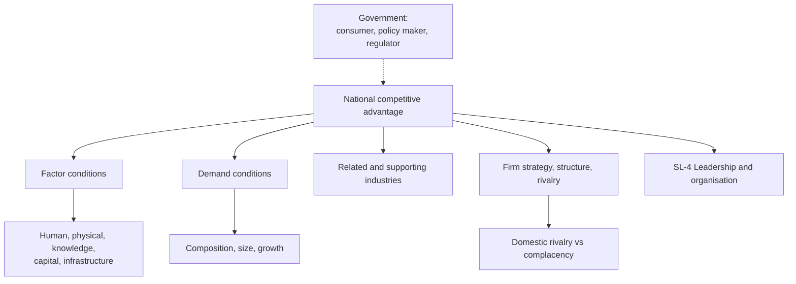

# SL-3 - National Competitive Advantage

Covers: the four determinants of national competitive advantage on the slides (factor conditions with five resource types, demand conditions, related and supporting industries, firm strategy structure and rivalry), the role of government, and a worked country-industry analysis. **(class)**

## Why nations matter (class)

Global competition (SL-2) raises the question of why firms from certain countries repeatedly win in certain industries. The slides answer with four groups of determinants. They are the corners of **Porter's diamond (general)**; the diamond picture on the slide has no text, so draw it yourself in the exam: four boxes joined by arrows, with government at the side.

Mnemonic: **F-D-R-S** (Factor conditions, Demand conditions, Related and supporting industries, firm Strategy structure and rivalry).

## 1. Factor conditions (class), five resources

| Resource | Slide definition |
|---|---|
| Human | Quantity of workers available, skills they possess, wage levels, work ethic |
| Physical | Availability, quantity, quality and cost of land, water, minerals and other natural resources |
| Knowledge | Availability within a nation of a significant population having scientific, technical and market-related knowledge |
| Capital | Availability, amount, cost and types of capital; also savings rate, interest rates, tax laws and government deficit |
| Infrastructure | A nation's banking, healthcare, transportation and communication systems |

Memory aid: **H-P-K-C-I**. Gap-fill **(general)**: Porter argues the most valuable factors are created (skills, knowledge), not inherited.

## 2. Demand conditions (class)

- **Composition of home demand** determines how firms perceive, interpret and respond to buyer needs.
- **Size and pattern of growth of home demand:** large home markets offer opportunities to achieve **economies of scale and learning** in familiar, comfortable markets.

## 3. Related and supporting industries (class)

The advantage a nation gains by being **home to internationally competitive industries in fields that are related to, or in direct support of, other industries**.

## 4. Firm strategy, structure and rivalry (class)

- **Domestic rivalry** in a single national market is a powerful influence on competitive advantage.
- **Absence of significant domestic rivalry** can lead to **complacency** in home firms and eventually make them **non-competitive in world markets**.
- Differences in **management styles, organisational skills and strategic perspectives** create advantages and disadvantages for firms in different types of industries.
- **Capital markets and attitudes toward investment** are important components of the national environment.

## Government (class)

Government influences the determinants through its roles as **consumer, policy maker and commerce regulator**. Gap-fill **(general)**: Porter's diamond also names "chance" (wars, inventions, sudden shifts) as an outside influence; the slides do not mention it.

## Worked example: why a country wins in an industry

*Illustrative and qualitative; no numbers. Question style: "Explain how a nation's competitive advantage arises, with an Indian example." Use the Indian IT services industry as the example. Claims are general knowledge and should be framed as broadly accepted points, not as data (general) [VERIFY any figure before quoting].*

1. Name the four determinants and government.
2. Apply each, one line with the slide's term:

| Determinant | Application to Indian IT services |
|---|---|
| Factor conditions | Human: large English-speaking engineering workforce at lower wage levels. Knowledge: technical education. Infrastructure: telecom links (improved over time) |
| Demand conditions | Early demand from demanding overseas clients pushed firms to improve process quality; home demand itself is smaller than export demand, so this case is weaker on home demand |
| Related and supporting industries | Telecom, training institutes, software product and consulting ecosystems |
| Firm strategy, structure, rivalry | Intense domestic rivalry between large firms drives cost and quality improvement |
| Government | Policy: software technology parks and export-friendly regulation [VERIFY exact schemes] |

3. Decision line: **the industry is strong because human and knowledge factors are backed by hard domestic rivalry; the weakest corner is home demand, so firms should keep moving up the value chain and widen the domestic market.**
4. Interpretation: this shows that a nation's advantage is a system of linked determinants, and a manager picking a sourcing or entry country should check all four, not only wage cost.

## How managers use this

- **Location choice (general):** put activities where factor conditions fit (R&D where knowledge resources are deep, assembly where labour is skilled and cheap).
- **Home base:** firms facing tough domestic rivals and demanding home buyers tend to become better global competitors.
- **Policy view:** the absence of domestic rivalry is a warning sign for complacent protected firms.

## 5-mark skeletons

*Q: Explain the factor conditions of national competitive advantage.* Define factor conditions (1); five resources with one line each (4).

*Q: Explain the role of domestic rivalry.* Powerful influence (1); absence leads to complacency (2); non-competitive in world markets (1); management styles and capital markets (1).

*Q: Explain the determinants of national competitive advantage.* Four determinants, one line each (4); government role (1).

## What to remember

- Four determinants: factor conditions, demand conditions, related and supporting industries, firm strategy structure and rivalry; government acts as consumer, policy maker and regulator.
- Five factor resources: human, physical, knowledge, capital, infrastructure.
- Home demand: composition shapes how firms read buyer needs; size and growth give scale and learning.
- Related and supporting industries give a nation advantage by clustering competitive industries.
- No domestic rivalry leads to complacency and weakness abroad.
- The diamond picture is an image on the slide: draw four boxes and add government.

## Concept map

## Flashcards
Q: What are the four determinants of national competitive advantage on the slides?
A: Factor conditions, demand conditions, related and supporting industries, and firm strategy, structure and rivalry.

Q: Name the five factor conditions (resources).
A: Human, physical, knowledge, capital and infrastructure resources.

Q: What does capital resources include?
A: Availability, amount, cost and types of capital, plus savings rate, interest rates, tax laws and government deficit.

Q: What does infrastructure resources include?
A: A nation's banking, healthcare, transportation and communication systems.

Q: Why does the size of home demand matter?
A: A large home market offers economies of scale and learning in familiar, comfortable markets.

Q: What does the composition of home demand determine?
A: How firms perceive, interpret and respond to buyer needs.

Q: Define related and supporting industries (class).
A: The advantage a nation gains by being home to internationally competitive industries in fields related to, or in direct support of, other industries.

Q: What happens without significant domestic rivalry?
A: Home firms grow complacent and eventually become non-competitive in world markets.

Q: In what three roles does government influence the determinants?
A: Consumer, policy maker and commerce regulator.

Q: Who proposed the national diamond, and is it labelled on the slide text?
A: Michael Porter (general); the slide's diamond is an image with no text, so draw the four boxes and name them yourself.

## Sources
- Faculty deck Unit 5 (global competition and national competitive advantage: factor, demand, related industries, strategy and rivalry, government)
- Diamond framing, chance, Indian IT example: general knowledge, [VERIFY] schemes and figures
- Previous node: [[International Marketing Unit 5 - SL-2 Competitive Advantage and Generic Strategies]]
- Next node: [[International Marketing Unit 5 - SL-4 Leadership Organisation and CSR]]
- [[International Marketing Unit 5 - Strategy and Leadership MOC (Node Map)]]
