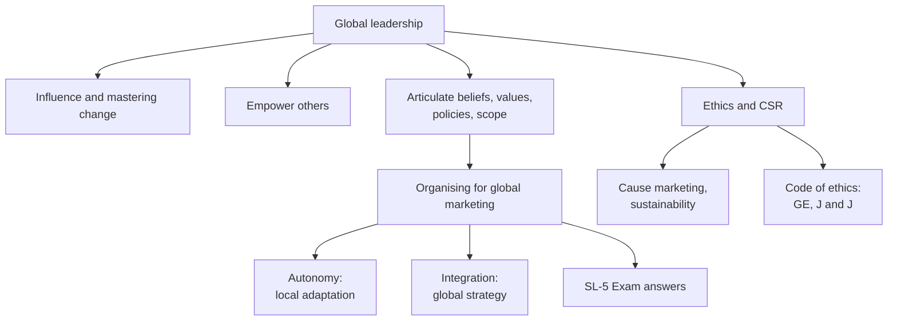

# SL-4 - Leadership, Organisation and CSR

Covers: global leadership, organising for global marketing and the autonomy-integration balance, ethics and CSR, codes of ethics, and a worked organisation-design answer. **(class)**

## Leadership (class)

**Global marketing demands exceptional leadership.** The leader's challenge is to **direct the efforts and creativity of everyone in the company toward a global effort** that best uses organisational resources to exploit global opportunities.

Key lines from the slides:
- Leadership is **not about hierarchy, title or status**. It is about **having influence and mastering change**.
- Leadership is not just creating wealth. It is about **connecting and engaging at multiple levels**: **challenging minds and capturing hearts**.
- Leadership in this new era is about **empowering others to decide for themselves** and to **reach their full potential**.
- An important leadership task is **articulating beliefs, values, policies and the intended geographic scope** of the company's activities.

The slides cite an article, "Strategic Leadership in 21st Century". Its text is not in the deck. Do not quote content from it; use the slide lines above.

Exam tip: define leadership in the slide's words (influence and mastering change, not title), then give the four leader tasks: direct effort globally, engage minds and hearts, empower others, articulate values and scope.

## Organising for global marketing (class)

- **Goal:** find a structure that enables the company to **respond to relevant market environment differences**.
- **Key issue:** how to achieve a balance between **autonomy and integration**.
  - Subsidiaries need **autonomy** to adapt to local environments.
  - The business as a whole needs **integration** to implement global strategy.

| | Autonomy | Integration |
|---|---|---|
| Who needs it | Local subsidiaries | The business as a whole |
| Purpose | Adapt to local environments | Implement global strategy |
| Risk if excessive | Fragmentation, duplicated effort **(general)** | Ignores local differences, slow response **(general)** |

The slides give no organisation structures. Gap-fill **(general)**: structures commonly taught are international division, geographic/regional, product division, matrix and global network; choose the one that fits the autonomy-integration balance. Mention only as background.

## Ethics and corporate social responsibility (class)

- Leaders of global companies must practise **corporate social responsibility (CSR)**: a **company's obligation to pursue goals and policies that are in society's best interests**.
- Ways to show commitment: **cause-marketing efforts** or a **commitment to sustainability**.
- In a socially responsible firm, employees **conduct business ethically**, guided by **moral principles that distinguish right from wrong**.
- Many companies have a **formal statement or code of ethics** summarising core ideologies, corporate values and expectations.
- Slide examples: **GE - The Spirit and the Letter**; **Johnson and Johnson - Our Credo**. Name them as the slide does, with no further claims.

Gap-fill **(general)**: Section 135 of the Companies Act, 2013 applies to a company with net worth of Rs 500 crore or more, or turnover of Rs 1,000 crore or more, or net profit of Rs 5 crore or more, in the immediately preceding financial year; it must form a CSR committee and spend at least 2% of the average net profit of the preceding three financial years. **[VERIFY against the Act or MCA before quoting]**. The slides do not cover this; use it as a one-line Indian touch only.

## Worked example: autonomy vs integration decision

*Illustrative; no real firm. A consumer goods firm sells in 12 countries. Local managers want to change pack size, flavour and price freely. Head office wants one global brand look.*

1. Define the issue in the slide's words: balance autonomy and integration.
2. Split decisions into two buckets using the slide logic:

| Decision | Who decides | Reason |
|---|---|---|
| Brand identity, quality standards, values and code of ethics | Head office (integration) | Needed to implement global strategy and protect the brand |
| Flavour, pack size, local promotion, local price points | Subsidiary (autonomy) | Needed to adapt to local environment differences |
| Core R&D platform | Head office | Scale and learning |

3. Count (illustrative): 10 decision areas, 4 central (brand identity, quality standards, code of ethics, core R&D), 6 local. Central share = 4 / 10 = **40%**; local share = 6 / 10 = **60%**.
4. Decision line: **keep a central core (brand, quality and ethics) and give subsidiaries local autonomy on adaptation, with the split reviewed as markets mature.**
5. Interpretation: the structure serves "responding to market differences" (the slide's goal), and the leader's job is to articulate the values and scope that hold the core together, which links SL-4 leadership to the organisation question.

## 5-mark skeletons

*Q: What is global leadership?* Definition in slide words (2); four tasks (3).

*Q: Explain autonomy and integration in global organisation.* Goal (1); autonomy (2); integration (2).

*Q: Explain CSR for global companies.* Definition (1); ways: cause marketing, sustainability (1); ethical conduct (1); code of ethics with GE and J and J (2).

## What to remember

- Global marketing demands exceptional leadership: influence and mastering change, not hierarchy, title or status.
- Leaders challenge minds, capture hearts, empower others, and articulate values, policies and geographic scope.
- Organising goal: respond to market differences; key issue: balance of autonomy (local) and integration (global strategy).
- CSR: obligation to pursue goals in society's best interests; shown through cause marketing or sustainability.
- A code of ethics summarises ideologies, values and expectations; slide examples are GE's The Spirit and the Letter and J and J's Our Credo.
- State what the slides do not cover as (general) and keep it short.

## Concept map

## Flashcards
Q: What is leadership about on the slide, if not hierarchy?
A: Having influence and mastering change; it is not about hierarchy, title or status.

Q: State the leader's challenge in global marketing.
A: To direct the efforts and creativity of everyone in the company toward a global effort that best uses organisational resources to exploit global opportunities.

Q: Name the leadership tasks on the slides.
A: Challenge minds and capture hearts, empower others to decide for themselves, and articulate beliefs, values, policies and the intended geographic scope.

Q: What is the goal in organising for global marketing?
A: To find a structure that lets the company respond to relevant market environment differences.

Q: What is the key issue in global organisation?
A: Balancing autonomy and integration.

Q: Why do subsidiaries need autonomy, and why must the business integrate?
A: Autonomy lets subsidiaries adapt to local environments; integration lets the business as a whole implement global strategy.

Q: Define CSR (class).
A: A company's obligation to pursue goals and policies that are in society's best interests.

Q: Two ways to show commitment to CSR?
A: Cause-marketing efforts and a commitment to sustainability.

Q: What does a code of ethics summarise, and give the two slide examples.
A: Core ideologies, corporate values and expectations; GE's The Spirit and the Letter and Johnson and Johnson's Our Credo.

Q: 10 decision areas, 4 central (brand identity, quality standards, code of ethics, core R&D), 6 local. Central and local shares?
A: 4 / 10 = 40% central, 6 / 10 = 60% local (illustrative).

## Sources
- Faculty deck Unit 5 (leadership, organising for global marketing, ethics and CSR, codes of ethics)
- Companies Act Section 135 point: general knowledge, [VERIFY against the Act or MCA before quoting]
- Split example: illustrative, my own
- Previous node: [[International Marketing Unit 5 - SL-3 National Competitive Advantage]]
- Next node: [[International Marketing Unit 5 - SL-5 Unit 5 Exam Answers]]
- [[International Marketing Unit 5 - Strategy and Leadership MOC (Node Map)]]
