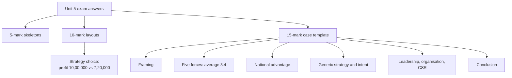

# SL-5 - Unit 5 Exam Answers

Covers: command words, 5-mark skeletons, 10-mark layouts, a reusable 15-mark case template and a full worked case that uses the whole unit. **(class)**

## The exam and how Unit 5 appears

Assumed ESE: 50 marks, 2 hours. Section A: 3 of 5 x 5 marks. Section B: 2 of 3 x 10 marks. Section C: one compulsory 15-mark case. No course plan is on file, so confirm the pattern with your faculty. Budget: about 7 minutes per 5-marker, 14 per 10-marker, 30 for the case. **(plan, assumed)**

Unit 5 is highly predictable: Porter's five forces and generic strategies are the most likely 10-markers; the national diamond, leadership, autonomy vs integration and CSR are likely 5-markers. In a case, the five forces and generic strategies are the standard analysis tools.

Command words: **explain** (definition plus reason plus example), **discuss** (both sides plus a view), **distinguish** (table, at least four rows), **analyse** (apply the tool to the facts given).

## Section A: 5-mark skeletons (about 150 words each)

| Question | Skeleton |
|---|---|
| Porter's five forces | Industry and Porter (1); five forces with one factor each (4). SL-1 |
| Barriers to entry | Entrants cut price and profit (1); eight barriers with meanings (4). SL-1 |
| Buyer and supplier power | Buyer conditions (2.5); supplier conditions (2.5). SL-1 |
| Generic strategies | Competitive advantage definition (1); 2 x 2 (1); four strategies with one point each (3). SL-2 |
| Cost leadership vs differentiation | Basis, requirements, price, return, risk (1 each). SL-2 |
| Strategic intent | Hamel and Prahalad idea (2); build tomorrow's advantage faster than rivals copy (2); learning as defensible advantage (1). SL-2 |
| Factor conditions | Definition (1); human, physical, knowledge, capital, infrastructure (4). SL-3 |
| Domestic rivalry | Powerful influence (1); complacency and weak global competitiveness (2); management styles and capital markets (2). SL-3 |
| Global leadership | Slide definition (2); four tasks (3). SL-4 |
| Autonomy vs integration | Goal of organising (1); autonomy (2); integration (2). SL-4 |
| CSR and code of ethics | Definition (1); cause marketing and sustainability (1); ethical conduct (1); GE and J and J codes (2). SL-4 |

## Section B: 10-mark layouts

**1. Analyse the competitive forces in an industry with Porter's five forces (10).** Industry definition and Porter (1); each force with slide conditions and one example, 1.5 marks x 5 (7.5); overall assessment and a decision line (1.5).

**2. Discuss generic strategies for creating competitive advantage (10).** Competitive advantage definition (1); 2 x 2 table (1); each strategy with requirement, condition and example, 1.5 x 4 (6); strategic intent and the quote (1); current issues that shorten advantage (1).

**3. Explain the determinants of national competitive advantage (10).** Link to global competition (1); factor conditions with five resources (3); demand conditions (1.5); related and supporting industries (1); strategy, structure, rivalry (2); government and a country example (1.5).

**4. Leadership, organisation and CSR in global marketing (10).** Leadership definition and tasks (3); autonomy vs integration with table (3); CSR definition, ways and codes of ethics (3); one-line link between them (1).

### Section B numeric/decision pattern: choosing a generic strategy (10)

Layout to copy (full working in SL-2):

| Step | Working | Result |
|---|---|---|
| 1. Name each strategy | Broad, low price; broad, premium | Cost leadership; differentiation |
| 2. Unit profit | 60 - 50; 80 - 62 | ₹10; ₹18 |
| 3. Margin | 10 / 60; 18 / 80 | 16.7%; 22.5% |
| 4. Total profit | 10 x 1,00,000; 18 x 40,000 | ₹10,00,000; ₹7,20,000 |
| 5. Condition | Barriers to copying; perceived uniqueness | Test each |

Decision line: **differentiation earns the higher margin but cost leadership earns the higher total profit; the right choice is the one the firm's competencies can sustain.** Marks: strategy names (2), working (4), conditions (2), interpretation (2).

## Section C: the 15-mark case template

Use for any Unit 5 case (an Indian firm going global, a new entrant in an industry, a conflict between local managers and head office). Spend about 30 minutes.

1. **Facts and framing (2).** Two lines on the firm, industry and decision; define competitive advantage as competencies matching critical success factors.
2. **Five forces (4).** One row per force with a case fact and a score or High/Medium/Low; overall verdict with a decision line.
3. **National and location advantage (2).** Home-country and target-country determinants (factor, demand, related industries, rivalry) in two or three lines.
4. **Generic strategy and strategic intent (3).** Choose from the 2 x 2 with reasons, state the condition that must hold, and add how the firm will renew its advantage.
5. **Leadership, organisation and CSR (3).** Autonomy vs integration split, leader's tasks, ethics code and CSR actions.
6. **Conclusion with a recommendation (1).** One decision sentence.

Marks are paid for interpretation as well as for the framework, so end each section with a "so what".

## Section C worked answer: a hypothetical firm going global (15 marks)

**Question (likely form):** *Aarav Foods, a mid-sized Indian packaged-snacks maker, plans to enter an emerging overseas market where three large firms hold the shelves and a few big retail chains control distribution. Using Unit 5 concepts, analyse the industry, recommend a competitive strategy and advise on organising and leadership.*

*Aarav Foods is a made-up firm. All scores and shares are illustrative.*

### 1. Framing (2 marks)

Competitive advantage arises when Aarav's distinctive competencies (for example, local flavour know-how) match the critical success factors in the target industry (shelf access, price, brand). The decision is whether and how to enter, and with which strategy.

### 2. Five forces (4 marks)

| Force | Score (1-5) | Case-based reason |
|---|---|---|
| New entrants | 3 | Capital need is moderate, but distribution channels are held by incumbents (barrier: distribution) |
| Substitutes | 3 | Fresh and local snacks cap the price |
| Buyers | 5 | A few big retail chains buy in volume and goods are near-commodity; backward integration through private labels is possible |
| Suppliers | 2 | Raw materials are widely available |
| Rivalry | 4 | Three large firms; price and advertising battles |

1. Total: 3 + 3 + 5 + 2 + 4 = 17. Average: 17 / 5 = **3.4**.
2. Decision line: **an average of 3.4 out of 5 means moderate-to-high competitive pressure, and buyers (5) are the force to manage first. Secure a retailer partnership before launch.**

### 3. National and location advantage (2 marks)

Home side: low-cost skilled workers and strong domestic rivalry in snacks have made Indian firms efficient (factor conditions, firm rivalry). Target side: a growing young population is demand condition worth checking; supporting packaging and cold-chain industries should be verified. Use this to decide what to make at home and what to localise. **(general reasoning)**

### 4. Generic strategy and strategic intent (3 marks)

- A cost-leadership attack on three large incumbents fails, because it needs the largest share and barriers that stop rivals copying. Aarav has neither.
- Choose **focused differentiation**: a narrow segment (for example, regional-flavour snacks for expatriate and ethnic communities) where unique products command a premium and rivals have not defined the segment more narrowly.
- Condition: sustainability. If incumbents narrow their segment, the advantage ends.
- Strategic intent (Hamel and Prahalad): build the next advantage, such as new flavours and faster product cycles, faster than rivals mimic today's range, because product life and design cycles are short.

### 5. Leadership, organisation and CSR (3 marks)

- **Organisation:** keep brand identity, quality standards and the ethics code central (integration); give the local subsidiary autonomy on flavour, pack size and promotion (adaptation). Illustrative split: 2 central of 5 decision areas (40%), 3 local (60%).
- **Leadership:** the leader articulates values, policies and the intended geographic scope, and empowers local managers; leadership is influence and mastering change, not title.
- **CSR:** adopt a code of ethics (as with the GE and J and J examples on the slides), sustainable sourcing and a cause-marketing link, such as nutrition for children.

### 6. Conclusion (1 mark)

**Enter with focused differentiation, negotiate retail access first, keep a central core of brand and ethics with local autonomy on adaptation, and keep renewing the range so the advantage outpaces imitation.**

Marks check: 2 + 4 + 2 + 3 + 3 + 1 = 15.

## What to remember

- Write the slide's words first: industry = close substitutes; five forces; competitive advantage = competencies match critical success factors.
- 5-marks: definition, slide list, one example. 10-marks: add a table and a decision line.
- Generic strategies: 2 x 2 by scope and source; always state the condition that must hold.
- Diamond: factor, demand, related and supporting, strategy and rivalry; government alongside.
- 15-mark case: framing 2, five forces 4, national 2, strategy 3, leadership-organisation-CSR 3, conclusion 1.
- Label illustrative numbers and general-knowledge points; interpretation earns marks.

## Concept map

## Flashcards
Q: Give the 15-mark case layout with marks for Unit 5.
A: Framing 2, five forces 4, national advantage 2, generic strategy and strategic intent 3, leadership-organisation-CSR 3, conclusion 1.

Q: What is the first line of a five-forces answer?
A: An industry is a group of firms producing close substitutes; Porter identifies five forces that influence competition.

Q: Which strategy suits a firm attacking big incumbents with a narrow, unique offer?
A: Focused differentiation (narrow market, premium price), provided rivals do not define the segment more narrowly.

Q: What condition must hold for cost leadership?
A: Barriers must exist that stop competitors reaching the same low cost.

Q: Five forces scores 3, 3, 5, 2, 4: average and verdict?
A: 17 / 5 = 3.4, moderate-to-high pressure; manage the strongest force (buyers) first.

Q: Two profits: ₹10 x 1,00,000 and ₹18 x 40,000. Which is higher and what is the lesson?
A: ₹10,00,000 against ₹7,20,000; higher margin does not mean higher total profit, so choose the strategy the firm can sustain.

Q: List the four national determinants.
A: Factor conditions, demand conditions, related and supporting industries, firm strategy, structure and rivalry.

Q: How do you split decisions between autonomy and integration?
A: Centralise brand, quality and ethics (integration); localise flavour, pack, promotion and price points (autonomy).

Q: What ends every analytical answer in this unit?
A: A decision line that states the recommendation and interprets the finding.

Q: How should you treat points the slides do not cover?
A: Tag them (general) or [VERIFY], keep them short and put the slide version first.

## Sources
- SL-1 to SL-4 of this unit; faculty deck Unit 5
- Case, scores and splits: illustrative; Aarav Foods is hypothetical
- Exam pattern: assumed standard Christ BBA ESE, confirm with faculty
- Previous node: [[International Marketing Unit 5 - SL-4 Leadership Organisation and CSR]]
- [[International Marketing Unit 5 - Strategy and Leadership MOC (Node Map)]]
