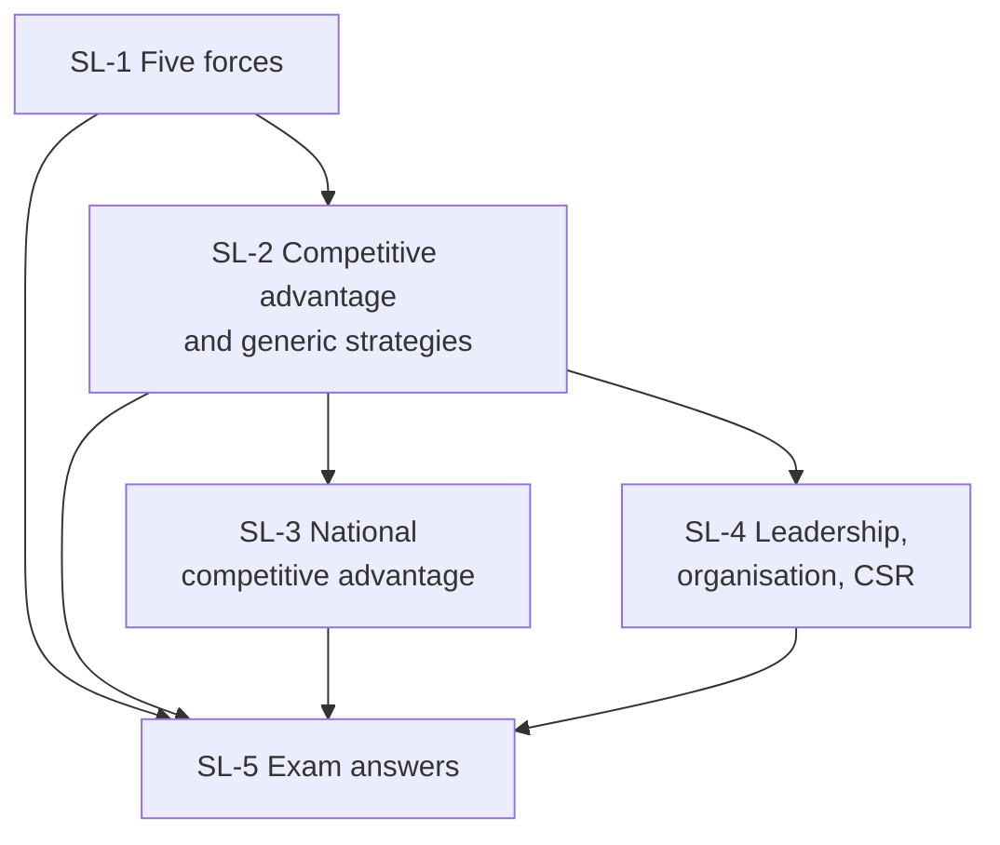

# International Marketing Unit 5: Strategy and Leadership in the 21st Century, node map

Assumed ESE: 50 marks, 2 hours: 3 of 5 x 5, 2 of 3 x 10, one compulsory 15-mark case. Unit 5 is built from the faculty slides (single source of truth); general-knowledge additions are tagged (general). The deck calls itself Unit VI; it is treated as Unit 5. Examples are **illustrative**; items tagged [VERIFY] need a check.

## Nodes

| Node | Topic | Deps | Minutes | Exam focus |
|---|---|---|---|---|
| SL-1 | Industry Analysis and Porter's Five Forces (eight entry barriers) | none | 35 | yes |
| SL-2 | Competitive Advantage and Generic Strategies; strategic intent; current issues | SL-1 | 30 | yes |
| SL-3 | National Competitive Advantage (factor, demand, related industries, rivalry) | SL-2 | 28 | yes |
| SL-4 | Leadership, Organisation and CSR | SL-2 | 28 | yes |
| SL-5 | Unit 5 Exam Answers (5, 10 and 15-mark layouts, worked case) | SL-1 to SL-4 | 35 | yes |

Total reading time: about 156 minutes.

Nodes in this unit:
- [[International Marketing Unit 5 - SL-1 Industry Analysis and Porters Five Forces]]
- [[International Marketing Unit 5 - SL-2 Competitive Advantage and Generic Strategies]]
- [[International Marketing Unit 5 - SL-3 National Competitive Advantage]]
- [[International Marketing Unit 5 - SL-4 Leadership Organisation and CSR]]
- [[International Marketing Unit 5 - SL-5 Unit 5 Exam Answers]]

## Dependency graph

## Headline numbers and facts to know

- Five forces: entrants, substitutes, buyers, suppliers, rivalry; eight entry barriers.
- Scale example (illustrative): cost per unit ₹90 at 20,000 units, ₹60 at 50,000, ₹50 at 1,00,000.
- Generic strategies: cost leadership, differentiation, cost focus, focused differentiation. Profit example: ₹10,00,000 (cost leader) vs ₹7,20,000 (differentiator).
- Diamond: factor, demand, related and supporting, strategy and rivalry; five factor resources: human, physical, knowledge, capital, infrastructure.
- Case: five-forces scores 3, 3, 5, 2, 4 give an average of 3.4 (hypothetical Aarav Foods).
- Autonomy vs integration; CSR codes: GE The Spirit and the Letter, J and J Our Credo.

## Slide gaps

- The four types of strategic intent are not listed; only the Hamel and Prahalad quote is given. SL-2 adds Hamel and Prahalad's four approaches to competitive innovation as a (general) gap-fill [VERIFY against Keegan and Green].
- The national-advantage diamond figure (slide 20) is an image with no text.
- The "Strategic Leadership in 21st Century" article is cited but not included.
- Organisation structures, Indian CSR law and Indian examples are not in the deck.

## Links
- [[International Marketing MOC]]
