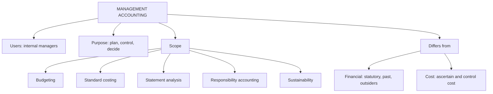

# FM-1: Meaning, Scope and Importance of Management Accounting

Covers: what management accounting is, its scope, objectives, importance and limits, and the standard comparison of financial, cost and management accounting. **(syllabus)** No faculty slides are available yet, so the method is **(textbook)**; when slides arrive, the faculty wording replaces the wording here.

## Where this fits in the ESE

Unit 1 is 6 of 45 hours. Expect one 5-mark question, most often "Differentiate financial accounting and management accounting" or "Explain the scope of management accounting". It rarely carries a 10-mark question alone. It does feed the 15-mark case through the ethics node (FM-3).

## Meaning

Management accounting is the process of identifying, measuring, collecting, analysing, interpreting and communicating accounting and other information so that **managers can plan, control and decide**. It uses financial accounting and cost accounting data as raw material and reshapes them for internal decisions. **(textbook)**

Key points to state in one line each:
- The user is **management** (internal), not shareholders or the tax office.
- It looks **forward** (budgets, forecasts, decisions) as well as backward (variances).
- It has **no statutory format**: a report is good if it helps a decision.
- It draws on **financial and non-financial** data (quality, delivery time, emissions).

## Scope (what it covers)

| Area | What management gets from it | Where it appears in this course |
|---|---|---|
| Financial accounting data | Raw records, statements | Unit 2 |
| Cost accounting | Product costs, standard costs | Unit 4 |
| Budgeting and budgetary control | Plans and control against plans | Unit 3 |
| Financial statement analysis | Ratios, trends, cash flow | Unit 2 |
| Marginal costing and CVP | Pricing, product-mix, make-or-buy | Decision tools |
| Responsibility accounting | Accountability by manager | Units 4 and 5 |
| Performance measurement | Balanced scorecard, KPIs | Unit 4 |
| Sustainability accounting | ESG costs and indicators | Unit 5 |

## Objectives and importance

1. **Planning**: turns objectives into budgets and targets.
2. **Controlling**: compares actual with plan, finds variances, assigns responsibility.
3. **Decision-making**: gives relevant cost and revenue data (keep or drop a product, price a special order).
4. **Motivation and coordination**: targets and feedback align departments.
5. **Communication**: reports are made at the right frequency and detail for each level.
6. **Stewardship of resources**: shows where money and capacity are used well or wasted.

## Financial vs cost vs management accounting

| Basis | Financial accounting | Cost accounting | Management accounting |
|---|---|---|---|
| Main user | Outsiders: shareholders, lenders, tax and regulators | Management, cost auditors | Management only |
| Purpose | Stewardship and true-and-fair statements | Ascertain and control cost | Planning, control and decisions |
| Time focus | Past | Past and present | Future-oriented |
| Legal status | Compulsory (Companies Act, Ind AS) | Cost records for notified industries (Companies Act s.148) **[VERIFY]** | Optional, no statute |
| Format | Prescribed (Schedule III) | Cost sheet, no fixed law | Free; any report that helps |
| Data | Monetary, whole firm | Monetary, product or process | Monetary and non-monetary, any segment |
| Accuracy | High, audited | Reasonably precise | Approximate is acceptable if timely |
| Reporting unit | Entire organisation | Product, job, process | Division, product, project, customer |
| Frequency | Annual, quarterly | Periodic | As needed, even daily |

## Worked example: why the management view differs (illustrative figures)

**Question (5 marks).** Orion Ltd (fictional) makes products A and B. Fixed costs are ₹10 lakh a year, allocated equally. The financial statements show only total profit. Should B be dropped?

**Answer layout.**

1. Prepare the product-wise statement (₹ lakh):

| | A | B | Total |
|---|---|---|---|
| Sales | 20 | 10 | 30 |
| Variable cost | 8 | 7 | 15 |
| **Contribution** | 12 | 3 | 15 |
| Allocated fixed cost | 5 | 5 | 10 |
| **Profit / (loss)** | 7 | (2) | 5 |

2. Financial accounting stops at the total: profit ₹5 lakh.
3. Management view: B shows a loss only because ₹5 lakh of fixed cost is allocated to it. If B is dropped, the ₹10 lakh fixed cost stays.
4. Profit after dropping B = 12 − 10 = ₹2 lakh, a fall of ₹3 lakh (B's contribution).

**Decision.** Keep B unless the capacity can earn more than ₹3 lakh elsewhere. This is the point of management accounting: the same data, reshaped by segment and by cost behaviour, changes the decision.

## Limitations of management accounting

- Based on financial and cost records, so it inherits their errors.
- Forecasts and estimates are uncertain.
- Management time and cost; benefits are hard to measure.
- Not a substitute for judgement; resistance from managers.
- No uniform rules, so reports differ across firms.

## Traps

- Writing "management accounting is compulsory". It is not, but financial accounting is.
- Calling management accounting "only future-oriented". It uses past data to project forward.
- Listing differences without a user/purpose/time anchor. Lead with these three.

## What to remember

- Management accounting serves internal managers for planning, control and decisions.
- It is optional, flexible in format, forward-looking and uses non-financial data.
- Financial accounting is statutory, past-looking and for outsiders; cost accounting ascertains and controls cost.
- Same data reshaped by segment changes decisions (Orion: dropping B cuts profit from ₹5 lakh to ₹2 lakh).
- Scope spans budgeting, standard costing, ratios, responsibility accounting, decision tools and sustainability.

## Concept map

## Flashcards
Q: Define management accounting in one line.
A: Providing accounting and other information to managers so they can plan, control and decide.

Q: Who is the main user of financial accounting and who of management accounting?
A: Financial accounting serves outsiders (shareholders, lenders, tax and regulators); management accounting serves internal management only.

Q: Is management accounting statutory?
A: No. It has no prescribed format and no legal compulsion, unlike financial accounting.

Q: What time orientation does each type have?
A: Financial accounting is past-oriented; management accounting is future-oriented while using past data.

Q: Name four items in the scope of management accounting.
A: Budgeting, standard costing and variances, financial statement analysis, responsibility accounting (also decision tools, performance measurement, sustainability).

Q: Orion's product B has contribution ₹3 lakh and an allocated fixed cost of ₹5 lakh. Drop it?
A: No. Dropping it loses ₹3 lakh of contribution because the fixed cost stays; keep unless capacity earns more elsewhere.

Q: Name two limitations of management accounting.
A: It rests on records that may be wrong, and its forecasts are uncertain (also cost, resistance, no substitute for judgement).

Q: Which basis of comparison should open a differentiation answer?
A: User, purpose and time focus.

## Sources
- BBA305-6 syllabus, Unit 1 (meaning, scope, importance; difference between the three accounting types)
- Arora, *Cost and Management Accounting* (essential reading); Khan & Jain
- Next: [[Management Accounting Unit 1 - FM-2 Role of the Management Accountant and Tools]]
- [[Management Accounting Unit 1 - Fundamentals MOC (Node Map)]]
