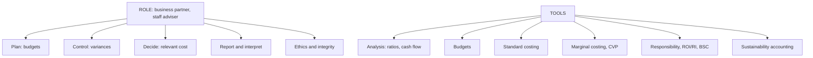

# FM-2: Role of the Management Accountant, Tools and Techniques

Covers: what a management accountant does, how the role sits as a staff function, and the tools of management accounting with the decision each one serves. **(syllabus)**

## Where this fits in the ESE

A 5-mark question: "Explain the role of the management accountant" or "Discuss any five tools and techniques". The tools list is also a source of 10-mark questions when paired with a short numerical (CVP or ratios).

## Role of the management accountant

The management accountant is a **business partner and adviser**, not just a record keeper. **(textbook)**

1. **Planning**: prepares budgets, forecasts and long-range plans with managers.
2. **Controlling**: sets standards, measures variances, issues performance reports.
3. **Decision support**: supplies relevant costs for pricing, make-or-buy, capital budgeting and product-mix decisions.
4. **Reporting and interpretation**: converts accounting data into plain, timely reports and explains what they mean.
5. **Internal communication and coordination**: links production, sales, finance.
6. **Advising on external reporting and tax**: ensures the internal system reconciles with the statutory books.
7. **Ethics and governance**: protects the integrity of numbers (see FM-3).
8. **Sustainability reporting**: increasingly collects ESG data (Unit 5).

**Line vs staff.** The management accountant has a **staff** role: advises, does not command production or sales. Authority sits with line managers; the accountant's influence comes from the quality of information.

## Tools and techniques

| Tool | What it does | Typical decision |
|---|---|---|
| Financial statement analysis (ratios, comparative, common-size) | Diagnoses performance and position | Is profitability or liquidity weakening? |
| Cash flow statement | Shows sources and uses of cash | Can the firm fund growth and dividends? |
| Budgeting and budgetary control | Plans and controls | What do we expect, and where are we off plan? |
| Standard costing and variance analysis | Measures efficiency | Who is responsible for the cost overrun? |
| Marginal costing and CVP | Separates fixed and variable cost | Break-even, pricing, keep/drop |
| Responsibility accounting | Assigns accountability | Which manager controls which cost? |
| Divisional performance (ROI, RI) | Judges investment centres | Is the division adding value? |
| Balanced scorecard and KPIs | Links strategy to measures | Are we on track strategically? |
| Capital budgeting | Evaluates long-term projects | Invest or not? |
| Sustainability accounting | Measures environmental and social cost | What does emission or waste cost? |
| Management information reports | Delivers information | Right data to the right person |

## Worked example: a tool in use (illustrative)

**Question (5 marks).** A product sells at ₹50, variable cost ₹30, fixed cost ₹4,00,000. Expected sales are 25,000 units. Show how CVP supports a managerial decision.

**Answer layout.**

1. Contribution per unit = 50 − 30 = ₹20.
2. Break-even units = 4,00,000 ÷ 20 = **20,000 units** (₹10,00,000 of sales).
3. Margin of safety = 25,000 − 20,000 = 5,000 units = **20%** of expected sales.
4. Profit at 25,000 units = 25,000 × 20 − 4,00,000 = **₹1,00,000**.

**Decision.** The product is viable; sales can fall 20% before a loss. A price cut that lowers contribution to ₹15 would raise break-even to 4,00,000 ÷ 15 = 26,667 units, above expected sales, so reject it unless volume rises sharply.

## Traps

- Presenting the management accountant as an auditor or tax filer. Lead with planning, control and decisions.
- Forgetting the staff role. Do not say the accountant "controls" costs; line managers do.
- Listing tools without the decision each supports. Markers reward the pairing.

## What to remember

- The role is advisory (staff): plan, control, decide, report, coordinate, safeguard integrity.
- Each tool answers a specific question: ratios diagnose, budgets plan, variances control, CVP decides.
- CVP example: ₹20 contribution, break-even 20,000 units, margin of safety 20%, profit ₹1,00,000.
- Modern role adds strategy (balanced scorecard) and sustainability (ESG data).

## Concept map

## Flashcards
Q: Is the management accountant a line or a staff role?
A: Staff. The accountant advises; line managers decide and are accountable.

Q: Name four functions of a management accountant.
A: Planning (budgets), controlling (variances), decision support (relevant costs), reporting and interpretation.

Q: Which tool answers "who is responsible for this cost overrun"?
A: Standard costing with variance analysis, combined with responsibility accounting.

Q: Price ₹50, variable cost ₹30, fixed ₹4,00,000. Break-even units?
A: 4,00,000 ÷ 20 = 20,000 units.

Q: With the same data, expected sales 25,000 units. Margin of safety?
A: 5,000 units, 20% of expected sales.

Q: Which tools measure performance of an investment centre?
A: ROI and residual income (and the balanced scorecard for strategic measures).

Q: Name two newer additions to the management accountant's role.
A: Strategic performance measurement (balanced scorecard, KPIs) and sustainability / ESG data.

## Sources
- BBA305-6 syllabus, Unit 1 (role of management accountant; tools and techniques)
- Arora, *Cost and Management Accounting*
- Previous: [[Management Accounting Unit 1 - FM-1 Meaning Scope and Importance]] · Next: [[Management Accounting Unit 1 - FM-3 Ethical Issues in Management Accounting]]
- [[Management Accounting Unit 1 - Fundamentals MOC (Node Map)]]
