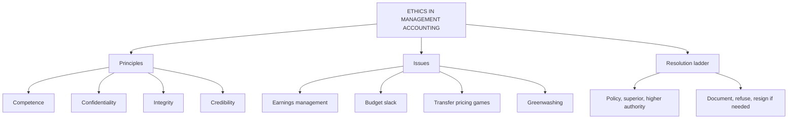

# FM-3: Ethical Issues in Management Accounting

Covers: why ethics matters for a management accountant, the standard ethical principles, the common ethical pressures (earnings management, budget slack, transfer pricing, greenwashing), and how to resolve a dilemma in a case answer. **(syllabus)**

## Where this fits in the ESE

Ethics is a cross-cutting issue for all five units in the course plan (the unit table tags Units 1 to 4 "Professional Ethics"). Expect it as a 5-mark theory answer or as the last part of the 15-mark case: "What should the accountant do?" The marks go to a structured resolution, not to opinion.

## Why ethics is a live issue here

The management accountant produces numbers that decide bonuses, budgets, promotions and loans. Managers under pressure may want those numbers shaped. The accountant sits between the pressure and the record. **(textbook)**

## Ethical principles

Two frameworks are used in textbooks. Name one and mention the other.

**IMA Statement of Ethical Professional Practice** (Institute of Management Accountants, USA) **[VERIFY wording]**:
1. **Competence**: maintain skill, follow laws and standards, give accurate and clear analysis.
2. **Confidentiality**: do not disclose or use information for personal gain.
3. **Integrity**: avoid conflicts of interest, no activity that harms the profession, no bribes or gifts that influence judgement.
4. **Credibility**: communicate fairly and objectively; disclose all relevant information, including bad news.

**Fundamental principles in the Indian professional codes** (ICAI and ICMAI follow the international pattern) **[VERIFY against the current code]**: integrity, objectivity, professional competence and due care, confidentiality, professional behaviour.

## Common ethical issues

| Issue | What happens | Why it is wrong |
|---|---|---|
| Earnings management | Defer expenses, accelerate revenue to hit a target | Misleads users; shifts the problem to the next period |
| Budget slack / padding | Manager understates revenue or overstates cost | Wastes resources; hides capacity |
| Manipulating cost allocation | Shift overheads between products or divisions | Distorts profitability and pricing |
| Transfer pricing games | Price set to move profit between divisions or jurisdictions | Hurts overall value; tax and legal risk |
| Gaming performance measures | Cut R&D or maintenance to lift this year's profit | Sacrifices long-term value |
| Conflict of interest | Using position for personal or relative's benefit | Impairs objectivity |
| Misuse of confidential data | Insider trading, leaking cost information | Breach of confidentiality, law |
| Greenwashing | Overstating environmental performance | Misleads stakeholders; regulatory risk (Unit 5) |

## Resolving a dilemma: the exam steps

1. **Identify** the facts and the principle breached (integrity, credibility).
2. **Follow the organisation's policy** for reporting concerns (code of conduct, whistle-blower channel).
3. **Raise it with the immediate superior**, unless that person is involved; then go one level up (audit committee, internal audit).
4. **Consult** an objective adviser or the professional body's ethics service, keeping the matter confidential.
5. **Document** what was asked, what was said, what was done.
6. **Do not** take part in the wrong act. If the issue is unresolved, consider resigning and seeking legal advice. Disclosure outside the firm only where law requires it.

## Worked example: a short ethics answer (illustrative figures)

**Question (5 marks).** Halcyon Foods Ltd (fictional): the division head tells the accountant to push ₹3 lakh of advertising into next quarter and book a ₹4 lakh sale (50% margin) that will only be dispatched next month. Profit before these steps is ₹46 lakh; the bonus target is ₹50 lakh. Advise.

**Answer layout.**

1. Effect of the request: 46 + 3 (expense deferred) + 2 (profit on 4 lakh sale at 50%) = **₹51 lakh**, which clears the ₹50 lakh target. The honest figure is ₹46 lakh, a shortfall of ₹4 lakh.
2. Both steps move profit between periods without any real gain: next quarter bears the ₹3 lakh expense and loses the ₹2 lakh profit, a **₹5 lakh** hit.
3. Principles breached: integrity (false recognition) and credibility (misleading report).
4. Action: decline in writing, explain the reporting rule, escalate to the finance head or audit committee if pressed.
5. Constructive alternative: explain the honest shortfall and propose a recovery plan.

**Conclusion.** The accountant must not make the entries. Reporting ₹51 lakh would make bonus payments on profit that does not exist.

## Traps

- Giving a moral opinion without naming the principle. Always name integrity, credibility, objectivity.
- Jumping to whistle-blowing outside the firm. The ladder is internal first.
- Treating budget slack as harmless. It is a standard ethics example.

## What to remember

- Ethics anchors: competence, confidentiality, integrity, credibility (IMA); integrity, objectivity, due care, confidentiality, behaviour (professional codes).
- Pressure points: earnings management, slack, allocation and transfer pricing games, short-termism, greenwashing.
- Resolve in order: policy, superior, higher authority or adviser, document, refuse to participate.
- Halcyon: honest ₹46 lakh vs manipulated ₹51 lakh; the next quarter loses ₹5 lakh.

## Concept map

## Flashcards
Q: Name the four IMA ethical standards.
A: Competence, confidentiality, integrity and credibility.

Q: What is earnings management?
A: Shifting expenses or revenue between periods, or using judgement, to reach a target profit rather than report the true result.

Q: Define budget slack.
A: A manager deliberately understates expected revenue or overstates expected cost so the budget is easy to beat.

Q: First step when asked to make a misleading entry?
A: Refuse, and follow the organisation's reporting procedure: raise it with the immediate superior, or a level above if the superior is involved.

Q: When may a management accountant disclose confidential information outside the firm?
A: Only when the law requires it or authorised; not as a first resort.

Q: Halcyon's honest profit is ₹46 lakh; the requested entries give what?
A: ₹51 lakh (46 + 3 deferred expense + 2 profit on a 4 lakh sale at 50%), a ₹5 lakh hit to next quarter.

Q: Why is cutting R&D to lift profit an ethical issue?
A: It trades long-term value for a short-term measure and misleads on sustainable performance.

Q: What is greenwashing?
A: Overstating environmental or social performance in reports or marketing.

## Sources
- BBA305-6 syllabus, Unit 1 (ethical issues in management accounting)
- IMA, *Statement of Ethical Professional Practice* **[VERIFY wording]**; ICAI / ICMAI codes of ethics **[VERIFY]**
- Previous: [[Management Accounting Unit 1 - FM-2 Role of the Management Accountant and Tools]] · Next: [[Management Accounting Unit 1 - FM-4 Unit 1 Exam Answers]]
- [[Management Accounting Unit 1 - Fundamentals MOC (Node Map)]]
