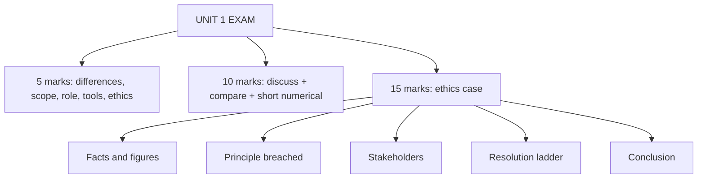

# FM-4: Unit 1 Exam Answers

Covers: answer skeletons for the 5-mark and 10-mark questions likely from Unit 1 and a layout for the 15-mark ethics case, with a model answer. **(syllabus)**

## Paper pattern

Section A: 3 questions with internal choice, 5 marks each. Section B: 2 questions with internal choice, 10 marks each. Section C: one compulsory 15-mark case. Unit 1 is the lightest unit by hours (6 of 45), so expect 5-mark theory and an ethics angle in the case.

## 5-mark skeletons

**1. Differentiate financial accounting and management accounting (5).**
Table of 5 rows, 1 mark each: user, purpose, time orientation, legal status/format, data type (see FM-1 table). Close with a one-line example: Orion's product B (loss after allocation, contribution ₹3 lakh).

**2. Scope of management accounting (5).**
Define (1), then list: budgeting and control, standard costing, financial statement analysis, marginal costing and CVP, responsibility accounting, performance measurement, sustainability (3), then one line on users and purpose (1).

**3. Role of the management accountant (5).**
Planning, controlling, decision support, reporting and interpretation, coordination, ethics (1 mark each, pick five) with the staff-role note.

**4. Tools and techniques (5).**
Pick five, give the tool, what it measures and the decision it supports (FM-2 table).

**5. Limitations of management accounting (5).**
Rests on records, forecasts uncertain, cost and time, no substitute for judgement, resistance, no uniform rules.

**6. Ethical issues (5).**
Name the IMA principles (2), three issues with one line each (2), resolution ladder (1).

## 10-mark skeletons

**A. "Management accounting is the process of providing information to managers for planning, control and decision-making." Discuss with a comparison to financial and cost accounting.**
1. Definition and nature (2).
2. Objectives and importance (2).
3. Comparison table across three types (4).
4. Limitations and a closing line (2).

**B. Role, tools and ethical responsibilities of a management accountant (10).**
1. Role and the staff position (3).
2. Tools paired with decisions (4).
3. Ethical standards and one dilemma resolved (3).

**C. Numerical with theory: product viability (10).** Use the FM-2 CVP example. Layout: contribution, break-even, margin of safety, profit, decision with interpretation (6) plus a 4-mark discussion of how management accounting uses these numbers.

## 15-mark case layout (ethics)

1. **Facts** in two lines: who, what pressure, what numbers (2).
2. **Recompute** the honest and the requested figures (3).
3. **Identify the ethical issue and principles breached** (3).
4. **Stakeholders affected**: shareholders, lenders, employees, bonus pool, the next period (2).
5. **Resolution steps** in order, with the alternative (3).
6. **Conclusion**: the one-line recommendation (2).

## Model answer (illustrative)

**Case.** Sundar Textiles Ltd (fictional) has quarterly profit of ₹46 lakh before closing entries. The plant head's bonus needs ₹50 lakh. He asks the management accountant to (i) defer ₹3 lakh of repairs to next quarter, though the repairs were done, and (ii) record a ₹4 lakh sale, 50% margin, that ships next week. Lenders' covenant needs profit of at least ₹48 lakh.

1. **Facts.** Honest profit ₹46 lakh; target ₹50 lakh; covenant ₹48 lakh.
2. **Figures.** Requested profit = 46 + 3 + (4 × 50%) = 46 + 3 + 2 = **₹51 lakh**. Honest profit misses the target by ₹4 lakh and the covenant by ₹2 lakh. After reversal next quarter is hit by 3 + 2 = **₹5 lakh**.
3. **Issue.** Earnings management by cut-off manipulation. Integrity breached (recording a sale not made, expense not recognised) and credibility (misleading report to lenders and management).
4. **Stakeholders.** Lenders rely on a false covenant test; shareholders see overstated profit; employees may lose faith; next quarter's manager inherits the hit; the accountant faces professional misconduct.
5. **Resolution.** Refuse the entries; cite the cut-off rule (repair cost belongs to the period when the service is received; a sale belongs to the period when control passes). Take it to the finance head, then audit committee. Document the request. Offer the honest report and a recovery plan (collection push, deferring discretionary spend with proper approval).
6. **Conclusion.** Report ₹46 lakh. The covenant breach should be disclosed and negotiated openly; hiding it risks far larger consequences.

## Common mark-losers

- No numbers in an ethics case. Always recompute the honest and the requested figures.
- Naming no principle.
- Recommending resignation or external disclosure before internal escalation.
- Comparison answers without a table.

## What to remember

- Differentiation answers need user, purpose, time, legal status, format.
- Tools are marked on the pairing with a decision.
- Ethics case: facts, figures, principle, stakeholders, ladder, conclusion.
- Sundar: ₹46 lakh honest vs ₹51 lakh requested; ₹5 lakh hits next quarter.

## Concept map

## Flashcards
Q: Five rows to include in a financial vs management accounting table?
A: User, purpose, time orientation, legal status or format, data type.

Q: How should a tools answer be structured for full marks?
A: Tool, what it measures, and the decision it supports.

Q: Layout for a 15-mark ethics case?
A: Facts, recomputed figures, principles breached, stakeholders, resolution ladder, conclusion.

Q: Sundar Textiles: requested profit if repairs of ₹3 lakh are deferred and a ₹4 lakh sale at 50% margin is booked early, from ₹46 lakh?
A: ₹51 lakh; the true figure is ₹46 lakh and next quarter bears a ₹5 lakh hit.

Q: Whom does the accountant approach first on an ethical concern?
A: The immediate superior (or the next level if the superior is involved), following company policy.

Q: What is the cut-off rule violated in the Sundar case?
A: Revenue and expense must be recorded in the period when the sale occurs or the service is received.

Q: Why should the case answer mention the lender covenant?
A: It shows a third party relies on the number, raising the severity of misreporting.

## Sources
- BBA305-6 syllabus, Unit 1 and ESE pattern
- [[Management Accounting Unit 1 - FM-1 Meaning Scope and Importance]] · [[Management Accounting Unit 1 - FM-2 Role of the Management Accountant and Tools]] · [[Management Accounting Unit 1 - FM-3 Ethical Issues in Management Accounting]]
- [[Management Accounting Unit 1 - Fundamentals MOC (Node Map)]]
