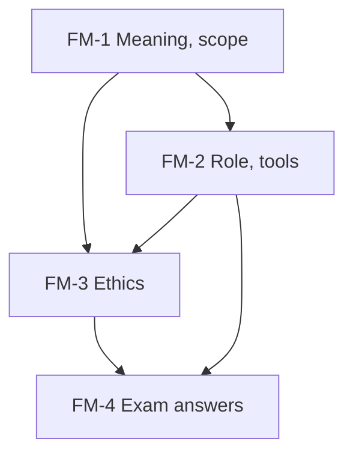

# Management Accounting Unit 1: Fundamentals, node map

ESE: 50 marks, Section A 3 × 5, Section B 2 × 10, Section C one compulsory 15-mark case. Unit 1 is CO1 (concepts, scope, tools, ethics). The lightest unit by hours; the likely questions are a 5-mark comparison and an ethics angle in the case. All examples are **illustrative figures**.

## Nodes

| Node | Topic | Deps | Minutes | Exam focus |
|---|---|---|---|---|
| FM-1 | Meaning, Scope and Importance | none | 25 | yes |
| FM-2 | Role of the Management Accountant and Tools | FM-1 | 25 | yes |
| FM-3 | Ethical Issues in Management Accounting | FM-1, FM-2 | 25 | yes |
| FM-4 | Unit 1 Exam Answers | FM-1 to FM-3 | 30 | yes |

Total reading time: about 105 minutes.

## Dependency graph

## Headline numbers to know

- Orion: product B contribution ₹3 lakh; dropping it moves profit from ₹5 lakh to ₹2 lakh.
- CVP: contribution ₹20, break-even 20,000 units, margin of safety 20%, profit ₹1,00,000.
- Halcyon / Sundar ethics: honest ₹46 lakh vs requested ₹51 lakh; ₹5 lakh hit to next quarter.

## Links
- [[Management Accounting MOC]]
