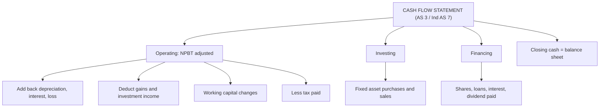

# FS-1: Cash Flow Statement, Rules and the Indirect Method

Covers: why the cash flow statement exists, AS 3 and Ind AS 7 in brief, the three activity classes, the indirect-method layout, and the line-by-line rules for the awkward items (sale of fixed assets, provision for tax, proposed dividend, depreciation hidden in the asset account). **(syllabus)** The full worked problem is in FS-2.

## Where this fits in the ESE

Cash flow statement preparation is named in the syllabus and is a standard 10-mark numerical, and it can be the first half of the 15-mark case. This node is the rulebook; FS-2 applies it.

## Why a cash flow statement

The income statement is on accrual basis and the balance sheet is a snapshot. Neither shows whether the firm generated or used cash. The cash flow statement explains the change in **cash and cash equivalents** between two balance sheets, grouped by activity. **(textbook)**

- **Cash**: cash in hand and demand deposits with banks.
- **Cash equivalents**: short-term, highly liquid investments, readily convertible to known cash with insignificant risk of change in value, usually with original maturity of **three months or less**.

## AS 3 and Ind AS 7

- **AS 3 (Cash Flow Statements)** applies to companies following the Accounting Standards; **Ind AS 7** applies to companies following Ind AS. Both use the same three headings and allow direct or indirect method for operating activities. **[VERIFY applicability thresholds]**
- Ind AS 7 asks for a disclosure of changes in liabilities arising from financing activities (opening, cash changes, non-cash changes, closing). **[VERIFY paragraph]**
- **Classification of interest and dividends.** The usual exam convention for a non-financial company: interest paid and dividend paid are **financing**; interest and dividend received are **investing**. Ind AS 7 lets an entity choose between operating and financing for interest paid, and operating and investing for interest and dividends received, if applied consistently. **State your convention at the top of the answer.** **[VERIFY]**
- **Class version:** no faculty slides yet. Follow the convention the question or the faculty uses.

## The three activities

| Activity | Meaning | Typical inflows | Typical outflows |
|---|---|---|---|
| Operating | Principal revenue-producing activity | Cash from customers | Suppliers, employees, taxes |
| Investing | Acquisition and disposal of long-term assets and investments | Sale of fixed assets, investments; interest and dividend received | Purchase of fixed assets, investments |
| Financing | Changes in owners' capital and borrowings | Share issue, loans raised | Loan repayment, buy-back, interest and dividend paid |

**Non-cash transactions do not appear**: bonus shares, conversion of debentures, purchase of an asset by issuing shares, transfer to reserves, depreciation.

## Indirect method layout

```
A. Operating activities
   Net profit before tax and extraordinary items
   + Non-cash charges (depreciation, amortisation, loss on sale)
   + Non-operating expenses (interest paid)
   - Non-operating income and gains (profit on sale, interest and dividend received)
   = Operating profit before working capital changes
   +/- Changes in working capital
   = Cash generated from operations
   - Income tax paid
   = Net cash from operating activities
B. Investing activities
C. Financing activities
Net increase / (decrease) in cash = A + B + C
+ Opening cash and cash equivalents
= Closing cash and cash equivalents  (must match the balance sheet)
```

## Working capital sign rule

| Item | Increase | Decrease |
|---|---|---|
| Inventory, receivables, prepaid expenses (assets) | Deduct (cash tied up) | Add |
| Payables, outstanding expenses (liabilities) | Add (cash retained) | Deduct |

Cash and cash equivalents themselves are never in this list. Provision for tax and proposed dividend are not working capital items here: they are handled in the tax and dividend rules below.

## The awkward items, one rule each

**1. Net profit before tax (NPBT) when only balance sheets are given.**

NPBT = Closing P&L balance − Opening P&L balance + Transfer to reserves + Proposed dividend (this year) + Provision for tax (charge for the year) [+ interim dividend].

*Example (illustrative):* opening P&L ₹1,00,000, closing ₹1,40,000, transfer to general reserve ₹20,000, proposed dividend ₹50,000, tax charge ₹60,000. NPBT = 40,000 + 20,000 + 50,000 + 60,000 = **₹1,70,000**.

**2. Provision for tax.** The tax charge goes through the P&L (it is added back by starting from NPBT). The cash actually paid is deducted in operating activities.

Tax paid = Opening provision + Charge for the year − Closing provision.

*Example:* opening ₹50,000, charge ₹70,000, closing ₹60,000. Tax paid = 50,000 + 70,000 − 60,000 = **₹60,000**. If advance tax is shown, net it first.

**3. Proposed dividend.** Dividend **paid** in the year is the **opening** proposed dividend (declared at the last AGM and paid this year). It is a financing outflow. The **closing** proposed dividend is not a cash flow this year; it is added back only to arrive at NPBT (rule 1).

*Example:* opening proposed ₹80,000, closing proposed ₹90,000: dividend paid = **₹80,000**, not 90,000 and not the difference.

*Background:* under Ind AS 10 (and revised AS 4 since 2016), dividends declared after the balance sheet date are not a liability at year end. Many exam problems still show "proposed dividend" as a provision. **Follow the question.** **[VERIFY AS 4 amendment]**

**4. Depreciation hidden in the asset account.** If the problem gives only opening and closing net block, purchases and the book value sold, derive depreciation from the asset account:

Depreciation = Opening net block + Purchases − Book value of assets sold − Closing net block.

*Example:* opening machinery ₹5,00,000, purchases ₹1,50,000, sold (book value ₹60,000), closing ₹5,20,000. Depreciation = 5,00,000 + 1,50,000 − 60,000 − 5,20,000 = **₹70,000**.

With accumulated depreciation given: charge for year = Closing acc. dep. − Opening acc. dep. + Acc. dep. on assets sold. *Example:* 2,50,000 − 2,00,000 + 30,000 = **₹80,000**.

**5. Sale of fixed assets.**
- Add back **loss** (non-cash, non-operating) or deduct **profit** in the operating adjustments.
- Show the **sale proceeds** (book value ± profit/loss) as an investing **inflow**.
- *Example:* book value ₹60,000 sold for ₹45,000: loss ₹15,000 added back; ₹45,000 shown under investing. A profit of ₹15,000 on a sale at ₹75,000 is deducted in A and ₹75,000 is shown in B.
- Purchases of assets are an investing outflow at cost, not net of depreciation.

**6. Interest and investment income.** Add back interest expense (A) and show it as paid under financing (C). Deduct investment income (A) and show it as received under investing (B). The net effect on total cash is the same; the classification is what changes.

## Direct method (one paragraph)

The direct method lists gross receipts from customers and gross payments to suppliers and employees. It gives the same net operating cash flow. The syllabus asks for preparation; the standard exam sum is indirect. Name the direct method and one advantage (shows gross flows) in a theory answer. **(textbook)**

## Traps

- **Double counting the tax:** starting from NPAT and also deducting tax paid. Start from NPBT, then deduct tax paid.
- **Using the whole movement in proposed dividend** as the amount paid.
- **Treating the gain on sale as an operating item and also showing proceeds in investing.** Strip the gain in A, show proceeds in B.
- **Ignoring depreciation** because it is "not given". Derive it from the asset account.
- **Reserve transfers and bonus shares** shown as cash flows. They are non-cash.
- **Final check missed:** the statement's closing cash must equal the balance sheet.

## What to remember

- CFS explains the change in cash and equivalents: operating, investing, financing.
- Indirect: start at NPBT, adjust non-cash and non-operating items, then working capital, then tax paid.
- Tax paid = opening provision + charge − closing provision; dividend paid = opening proposed dividend.
- Depreciation = opening block + purchases − book value sold − closing block.
- Profit or loss on sale is stripped in A; proceeds go to B. Interest paid and dividend paid go to C (state convention).

## Concept map



## Flashcards
Q: What does a cash flow statement explain?
A: The change in cash and cash equivalents between two balance sheet dates, grouped into operating, investing and financing activities.

Q: What is a cash equivalent?
A: A short-term, highly liquid investment convertible to a known amount of cash with insignificant risk of value change, usually maturity of three months or less.

Q: Formula for tax paid?
A: Opening provision for tax + charge for the year − closing provision for tax.

Q: How much dividend was paid during the year?
A: The opening proposed dividend (declared last year, paid this year); the closing proposed dividend is not paid yet.

Q: How do you find depreciation when it is not stated?
A: Opening net block + purchases − book value of assets sold − closing net block.

Q: Machinery of book value ₹60,000 sells for ₹45,000. Treatment?
A: Add back the ₹15,000 loss in operating activities; show ₹45,000 as an investing inflow.

Q: Opening P&L ₹1,00,000, closing ₹1,40,000, reserve transfer ₹20,000, proposed dividend ₹50,000, tax charge ₹60,000. NPBT?
A: 40,000 + 20,000 + 50,000 + 60,000 = ₹1,70,000.

Q: Increase in inventory: add or deduct?
A: Deduct, because cash is tied up in stock.

Q: Name two non-cash items that never appear in the CFS.
A: Bonus shares and transfer to reserves (also depreciation as a cash flow, conversion of debentures into shares).

## Sources
- BBA305-6 syllabus, Unit 2 (preparation of cash flow statement)
- AS 3 and Ind AS 7 **[VERIFY paragraph numbers]**; Arora, *Cost and Management Accounting*; ICAI study material
- Previous: [[Management Accounting Unit 1 - FM-2 Role of the Management Accountant and Tools]] · Next: [[Management Accounting Unit 2 - FS-2 Cash Flow Statement Full Worked Problem]]
- [[Management Accounting Unit 2 - Financial Statement Analysis MOC (Node Map)]]
