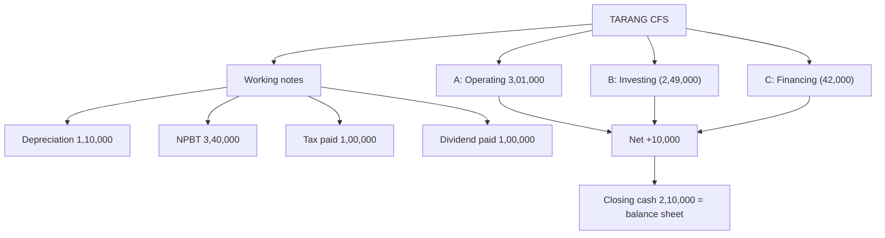

# FS-2: Cash Flow Statement, Full Worked Problem

Covers: one complete indirect-method problem with a sale of fixed assets, provision for tax, proposed dividend, hidden depreciation, a share issue and a loan repayment, laid out as the exam answer with working notes, a check and an interpretation. **(syllabus)** **All figures are hypothetical.**

## Where this fits in the ESE

This is the model for the 10-mark numerical in Section B and for the first half of a 15-mark case. Learn the order: working notes, statement, check, interpretation.

## The problem (Tarang Traders Ltd, fictional)

**Balance sheets as at 31 March (₹)**

| Liabilities | 2025 | 2026 |
|---|---|---|
| Equity share capital | 10,00,000 | 12,00,000 |
| General reserve | 2,00,000 | 2,50,000 |
| Profit and loss account | 1,50,000 | 2,10,000 |
| 12% Debentures | 4,00,000 | 3,00,000 |
| Provision for tax | 80,000 | 90,000 |
| Proposed dividend | 1,00,000 | 1,20,000 |
| Trade payables | 1,20,000 | 1,50,000 |
| Outstanding expenses | 20,000 | 15,000 |
| **Total** | **20,70,000** | **23,35,000** |

| Assets | 2025 | 2026 |
|---|---|---|
| Machinery (net block) | 12,00,000 | 13,10,000 |
| Investments (non-current) | 1,00,000 | 1,50,000 |
| Inventory | 3,00,000 | 3,60,000 |
| Trade receivables | 2,50,000 | 2,80,000 |
| Prepaid expenses | 20,000 | 25,000 |
| Cash and bank | 2,00,000 | 2,10,000 |
| **Total** | **20,70,000** | **23,35,000** |

**Additional information**

1. New machinery costing ₹3,00,000 was purchased during the year. Machinery with a net book value of ₹80,000 was sold for ₹95,000. No other asset movement except depreciation.
2. Provision for tax made during the year (charge to P&L) was ₹1,10,000.
3. Interest on debentures of ₹42,000 was charged and paid. Interest on investments of ₹6,000 was received in cash and is included in profit.
4. The ₹50,000 increase in general reserve is a transfer from the P&L account. Proposed dividend of ₹1,20,000 for the year is appropriated from the P&L account; last year's proposed dividend was paid in the year.
5. Debentures of ₹1,00,000 were redeemed at par. Shares were issued at par for cash.

Prepare the cash flow statement under the indirect method (interest paid and dividend paid in financing; interest and dividend received in investing).

## Exam answer

### Working notes

**WN 1. Depreciation (from the machinery account)**

| Machinery account | ₹ |
|---|---|
| Opening net block | 12,00,000 |
| + Purchases | 3,00,000 |
| − Book value of sold machinery | (80,000) |
| − Depreciation (balancing figure) | (1,10,000) |
| = Closing net block | 13,10,000 |

Check: 12,00,000 + 3,00,000 − 80,000 − 1,10,000 = 13,10,000. Depreciation = **₹1,10,000**.

**WN 2. Profit on sale of machinery** = 95,000 − 80,000 = **₹15,000**.

**WN 3. Net profit before tax**

| | ₹ |
|---|---|
| Closing P&L balance | 2,10,000 |
| − Opening P&L balance | (1,50,000) |
| = Increase | 60,000 |
| + Transfer to general reserve | 50,000 |
| + Proposed dividend (current year) | 1,20,000 |
| = Net profit after tax | 2,30,000 |
| + Provision for tax (charge) | 1,10,000 |
| **Net profit before tax** | **3,40,000** |

**WN 4. Tax paid** = Opening 80,000 + Charge 1,10,000 − Closing 90,000 = **₹1,00,000**.

**WN 5. Dividend paid** = Opening proposed dividend = **₹1,00,000**.

### Cash flow statement for the year ended 31 March 2026

| | ₹ | ₹ |
|---|---|---|
| **A. Cash flow from operating activities** | | |
| Net profit before tax | | 3,40,000 |
| Add: Depreciation | 1,10,000 | |
| Add: Interest expense | 42,000 | |
| Less: Profit on sale of machinery | (15,000) | |
| Less: Interest income on investments | (6,000) | 1,31,000 |
| **Operating profit before working capital changes** | | **4,71,000** |
| Increase in inventory | (60,000) | |
| Increase in trade receivables | (30,000) | |
| Increase in prepaid expenses | (5,000) | |
| Increase in trade payables | 30,000 | |
| Decrease in outstanding expenses | (5,000) | (70,000) |
| **Cash generated from operations** | | **4,01,000** |
| Less: Income tax paid (WN 4) | | (1,00,000) |
| **Net cash from operating activities (A)** | | **3,01,000** |
| **B. Cash flow from investing activities** | | |
| Purchase of machinery | (3,00,000) | |
| Sale proceeds of machinery | 95,000 | |
| Purchase of investments | (50,000) | |
| Interest received | 6,000 | |
| **Net cash used in investing activities (B)** | | **(2,49,000)** |
| **C. Cash flow from financing activities** | | |
| Proceeds from issue of shares | 2,00,000 | |
| Redemption of debentures | (1,00,000) | |
| Interest paid | (42,000) | |
| Dividend paid (WN 5) | (1,00,000) | |
| **Net cash used in financing activities (C)** | | **(42,000)** |
| **Net increase in cash (A + B + C)** | | **10,000** |
| Add: Opening cash and bank | | 2,00,000 |
| **Closing cash and bank** | | **2,10,000** |

### Check

Balance sheet cash 2025 ₹2,00,000 and 2026 ₹2,10,000, an increase of ₹10,000. This matches 3,01,000 − 2,49,000 − 42,000 = **₹10,000**. The statement ties.

### Interpretation (the marks are here)

1. **Operations generated ₹3,01,000** against profit after tax of ₹2,30,000, a cash conversion of 3,01,000 ÷ 2,30,000 = **1.31**. Profit is backed by cash; depreciation of ₹1,10,000 explains most of the gap.
2. **Working capital absorbed ₹70,000**, mainly stock and debtors growth. Monitor, but it is modest against ₹4,71,000 of operating profit.
3. **Operating cash covers capex.** Machinery purchase ₹3,00,000 against operating cash ₹3,01,000: cover of 1.00 times, so growth capex was self-funded.
4. **Financing outflow is a deliberate payout:** ₹1,00,000 debenture redemption, ₹42,000 interest and ₹1,00,000 dividend total ₹2,42,000, partly offset by ₹2,00,000 of fresh equity. Raising equity to repay debt and pay dividends is worth questioning.
5. **Verdict:** healthy, internally funded, cash up ₹10,000; the thin cash increase shows little headroom for the ₹1,20,000 dividend proposed for next year without similar operating cash flow.

## If the question is framed differently

| Given | Do this |
|---|---|
| Only gross block and accumulated depreciation | Depreciation = Closing acc. dep. − Opening acc. dep. + acc. dep. on assets sold |
| Closing balance of asset and depreciation, purchases not stated | Purchases = Closing + depreciation + book value sold − Opening |
| Profit after tax given directly | NPBT = PAT + tax charge (do not add back proposed dividend again) |
| Loss on sale instead of profit | Add back the loss in A; proceeds still in B |
| Dividend declared and paid within the year | Show the amount paid in C; it is not a balance sheet liability |

## Traps

- Adding back both the **closing** proposed dividend and paying the **closing** proposed dividend. Add back the closing in WN 3 only; pay the opening in C.
- Showing the machinery purchase net of depreciation.
- Forgetting the profit on sale in A when also showing the full proceeds in B.
- Including **cash itself** in the working capital changes.

## What to remember

- Order: working notes (depreciation, gain, NPBT, tax paid, dividend paid), then A, B, C, then the check.
- Tarang: depreciation ₹1,10,000; NPBT ₹3,40,000; tax paid ₹1,00,000; dividend paid ₹1,00,000.
- Operating profit before WC ₹4,71,000; CFO ₹3,01,000; CFI (₹2,49,000); CFF (₹42,000); net +₹10,000.
- The closing cash must equal the balance sheet cash (₹2,10,000).
- Always close with a two-line interpretation: cash conversion, what funded what.

## Concept map

## Flashcards
Q: Tarang: how is depreciation of ₹1,10,000 derived?
A: 12,00,000 + 3,00,000 − 80,000 (book value sold) − 13,10,000 closing = 1,10,000.

Q: Tarang: NPBT?
A: Increase in P&L 60,000 + reserve transfer 50,000 + proposed dividend 1,20,000 + tax charge 1,10,000 = ₹3,40,000.

Q: Tarang: tax paid?
A: 80,000 + 1,10,000 − 90,000 = ₹1,00,000.

Q: Tarang: dividend paid and where does it appear?
A: ₹1,00,000, the opening proposed dividend; financing activities.

Q: Tarang: operating profit before working capital changes?
A: 3,40,000 + 1,10,000 + 42,000 − 15,000 − 6,000 = ₹4,71,000.

Q: Tarang: net cash from operating activities?
A: 4,71,000 − 70,000 working capital − 1,00,000 tax = ₹3,01,000.

Q: Tarang: net cash used in investing?
A: −3,00,000 + 95,000 − 50,000 + 6,000 = −₹2,49,000.

Q: Tarang: how do you confirm the statement is right?
A: Net change (+₹10,000) must equal closing less opening balance sheet cash (2,10,000 − 2,00,000).

Q: Tarang: cash conversion of profit?
A: CFO 3,01,000 ÷ PAT 2,30,000 = 1.31.

## Sources
- BBA305-6 syllabus, Unit 2; hypothetical problem, all figures recomputed
- Rules from [[Management Accounting Unit 2 - FS-1 Cash Flow Statement Rules and Indirect Method]]
- Next: [[Management Accounting Unit 2 - FS-3 Comparative and Common-Size Statements]]
- [[Management Accounting Unit 2 - Financial Statement Analysis MOC (Node Map)]]
