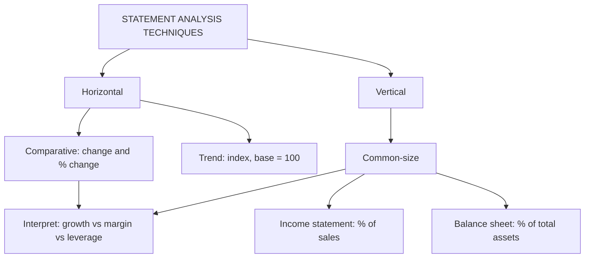

# FS-3: Comparative and Common-Size Statements

Covers: horizontal analysis (comparative statements and trend), vertical analysis (common-size statements), how to prepare them, and how to read them, with a full worked example on a fictional company. **(syllabus)**

## Where this fits in the ESE

Often a 5-mark "prepare a comparative income statement and comment" or the opening 5 marks of a Unit 2 case. Preparation is quick; marks sit in the comment.

## Techniques at a glance

| Technique | Direction | What it shows | Base |
|---|---|---|---|
| Comparative statements | Horizontal | Absolute and % change between two or more years | Earlier year |
| Trend (index) analysis | Horizontal, many years | Direction over time | A chosen base year = 100 |
| Common-size statements | Vertical | Each item as % of a total | Sales (income statement), total assets (balance sheet) |

## Rules

- **Comparative:** columns are Year 1, Year 2, Absolute change (Year 2 − Year 1), % change = change ÷ Year 1 × 100. If the base is zero or negative, the % is not meaningful: say so.
- **Common-size income statement:** each line ÷ net sales × 100; sales = 100.
- **Common-size balance sheet:** each line ÷ total assets (or total liabilities and equity) × 100.
- **Trend:** Index = year value ÷ base-year value × 100.
- Compare **like with like**: same accounting policies, same period length.

## Worked example: Meridian Components Ltd (fictional, illustrative)

**Income statements (₹)**

| | 2025 | 2026 | Change | % change | % of sales 2025 | % of sales 2026 |
|---|---|---|---|---|---|---|
| Net sales | 10,00,000 | 12,00,000 | 2,00,000 | 20.0 | 100.0 | 100.0 |
| Cost of goods sold | 6,00,000 | 7,50,000 | 1,50,000 | 25.0 | 60.0 | 62.5 |
| **Gross profit** | 4,00,000 | 4,50,000 | 50,000 | 12.5 | 40.0 | 37.5 |
| Operating expenses | 2,00,000 | 2,40,000 | 40,000 | 20.0 | 20.0 | 20.0 |
| **EBIT** | 2,00,000 | 2,10,000 | 10,000 | 5.0 | 20.0 | 17.5 |
| Interest | 40,000 | 50,000 | 10,000 | 25.0 | 4.0 | 4.2 |
| **PBT** | 1,60,000 | 1,60,000 | 0 | 0.0 | 16.0 | 13.3 |
| Tax (30%) | 48,000 | 48,000 | 0 | 0.0 | 4.8 | 4.0 |
| **PAT** | 1,12,000 | 1,12,000 | 0 | 0.0 | 11.2 | 9.3 |

**Balance sheets (₹)**

| | 2025 | 2026 | Change | % change | % of total 2025 | % of total 2026 |
|---|---|---|---|---|---|---|
| Machinery (net) | 7,20,000 | 8,00,000 | 80,000 | 11.1 | 59.5 | 57.1 |
| Inventory | 1,60,000 | 2,00,000 | 40,000 | 25.0 | 13.2 | 14.3 |
| Receivables | 1,60,000 | 2,00,000 | 40,000 | 25.0 | 13.2 | 14.3 |
| Cash | 1,00,000 | 1,20,000 | 20,000 | 20.0 | 8.3 | 8.6 |
| Other current assets | 70,000 | 80,000 | 10,000 | 14.3 | 5.8 | 5.7 |
| **Total assets** | 12,10,000 | 14,00,000 | 1,90,000 | 15.7 | 100.0 | 100.0 |
| Shareholders' equity | 7,20,000 | 8,00,000 | 80,000 | 11.1 | 59.5 | 57.1 |
| Long-term debt (12.5%) | 3,20,000 | 4,00,000 | 80,000 | 25.0 | 26.4 | 28.6 |
| Trade payables | 1,00,000 | 1,20,000 | 20,000 | 20.0 | 8.3 | 8.6 |
| Other current liabilities | 70,000 | 80,000 | 10,000 | 14.3 | 5.8 | 5.7 |
| **Total** | 12,10,000 | 14,00,000 | 1,90,000 | 15.7 | 100.0 | 100.0 |

**Trend example (three years, base 2024 = 100):** sales ₹8,00,000, ₹10,00,000, ₹12,00,000 give index 100, 125, 150. PAT ₹90,000, ₹1,12,000, ₹1,12,000 give index 100, 124.4, 124.4. Sales kept growing; profit stalled.

## Exam answer: comment

1. **Sales grew 20% but PAT is flat at ₹1,12,000.** Growth did not reach the bottom line.
2. **Cost of goods sold rose 25%** against sales 20%. Gross margin fell from 40.0% to 37.5% (down 2.5 points): input cost pressure or price discounting.
3. **Operating expenses held at 20% of sales**, so cost control above gross profit is neutral. The EBIT margin fell from 20.0% to 17.5%, entirely due to the gross margin.
4. **Interest rose 25%**, in line with debt (+25%): finance cost ate the small EBIT gain (EBIT +₹10,000, interest +₹10,000).
5. **Balance sheet:** debt grew faster (+25%) than equity (+11.1%), so debt's share rose from 26.4% to 28.6%. Inventory and receivables grew 25%, faster than sales (20%): working capital is being built up, which needs scrutiny.
6. **Conclusion:** growth was bought with more debt and more working capital while margins eroded. Priority actions: input cost and pricing, collections and stock levels.

## Traps

- Computing % change on the **later** year. The base is always the earlier year.
- Common-size balance sheet on sales. Use total assets.
- Commenting only on rupee changes. Compare % growth of related items (sales vs inventory, debt vs equity).
- Ignoring that PAT stayed flat while the tax rate did not change; the lever was margin and interest.

## What to remember

- Comparative = horizontal (change, % change on the earlier year); common-size = vertical (% of sales or total assets).
- Meridian: sales +20%, COGS +25%, gross margin 40.0% to 37.5%, PAT flat at ₹1,12,000.
- Debt +25% vs equity +11.1%; inventory and receivables +25% vs sales +20%.
- Trend index: 8, 10, 12 lakh gives 100, 125, 150.
- Always end with a two-to-four line interpretation.

## Concept map

## Flashcards
Q: Base for percentage change in a comparative statement?
A: The earlier year.

Q: Common-size income statement is expressed as a percentage of what?
A: Net sales (sales = 100).

Q: Common-size balance sheet is expressed as a percentage of what?
A: Total assets (or total liabilities and equity).

Q: Meridian sales ₹10,00,000 to ₹12,00,000, COGS ₹6,00,000 to ₹7,50,000. Gross margin movement?
A: 40.0% to 37.5%, down 2.5 points, because COGS grew 25% against sales 20%.

Q: Meridian PAT in both years?
A: ₹1,12,000 both years, so 0% change despite 20% sales growth.

Q: What is a trend index?
A: Each year's value divided by the base-year value times 100.

Q: Sales ₹8 lakh, ₹10 lakh, ₹12 lakh. Index with 2024 as base?
A: 100, 125, 150.

Q: Why is % change not meaningful on a negative base?
A: A change from a loss to a profit has no sensible percentage; state the absolute change instead.

## Sources
- BBA305-6 syllabus, Unit 2 (comparative statements and common-size statements)
- Arora, *Cost and Management Accounting*; Khan & Jain
- Previous: [[Management Accounting Unit 2 - FS-2 Cash Flow Statement Full Worked Problem]] · Next: [[Management Accounting Unit 2 - FS-4 Ratio Analysis]]
- [[Management Accounting Unit 2 - Financial Statement Analysis MOC (Node Map)]]
