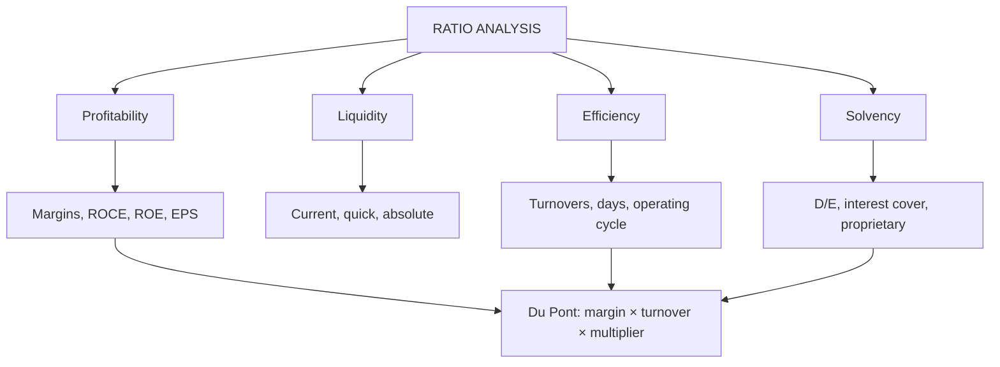

# FS-4: Ratio Analysis

Covers: the four ratio families (profitability, liquidity, solvency, efficiency), every formula, a full worked computation on the Meridian statements, the Du Pont breakdown and the conventions to state in an exam. **(syllabus)**

## Where this fits in the ESE

Ratio computation with interpretation is a standard 10-mark question and a core piece of the Unit 2 case. State your formula and your convention (closing vs average balances) once at the top.

## Formulas

**Profitability**

| Ratio | Formula |
|---|---|
| Gross profit margin | Gross profit ÷ Net sales × 100 |
| Operating (EBIT) margin | EBIT ÷ Net sales × 100 |
| Net profit margin | PAT ÷ Net sales × 100 |
| Return on capital employed (ROCE) | EBIT ÷ Capital employed × 100, capital employed = equity + long-term debt |
| Return on equity (ROE) | PAT ÷ Shareholders' equity × 100 |
| Return on assets (ROA) | PAT ÷ Total assets × 100 |
| Earnings per share | PAT ÷ Number of equity shares |

**Liquidity**

| Ratio | Formula |
|---|---|
| Current ratio | Current assets ÷ Current liabilities |
| Quick (acid-test) ratio | (Current assets − Inventory − Prepaid) ÷ Current liabilities |
| Absolute liquid ratio | Cash and equivalents ÷ Current liabilities |

**Solvency (leverage)**

| Ratio | Formula |
|---|---|
| Debt-equity ratio | Long-term debt ÷ Shareholders' equity |
| Total outside liabilities to equity | (Total assets − Equity) ÷ Equity |
| Proprietary ratio | Equity ÷ Total assets |
| Interest coverage | EBIT ÷ Interest |

**Efficiency (activity)**

| Ratio | Formula |
|---|---|
| Inventory turnover | COGS ÷ Average inventory; days = 365 ÷ turnover |
| Debtors turnover | Credit sales ÷ Receivables; days = 365 ÷ turnover |
| Creditors turnover | Credit purchases ÷ Payables; days = 365 ÷ turnover |
| Operating cycle | Inventory days + Debtor days − Creditor days |
| Fixed asset turnover | Sales ÷ Net fixed assets |
| Total asset turnover | Sales ÷ Total assets |

**Du Pont:** ROE = Net margin × Total asset turnover × Equity multiplier (Total assets ÷ Equity).

**Conventions to state.** Use closing balances unless averages are given; take all sales as credit if nothing says otherwise; use 365 days. Quick assets differ by textbook (some deduct only inventory). **Class version:** no slides yet; follow the faculty's definition when it arrives.

## Worked example: Meridian Components Ltd, 2026 (fictional)

Data from FS-3 for 2026: sales ₹12,00,000; COGS ₹7,50,000; EBIT ₹2,10,000; interest ₹50,000; PAT ₹1,12,000; equity ₹8,00,000; long-term debt ₹4,00,000; total assets ₹14,00,000; current assets ₹6,00,000 (inventory 2,00,000, receivables 2,00,000, cash 1,20,000, other 80,000); current liabilities ₹2,00,000 (payables 1,20,000); opening inventory ₹1,60,000; 40,000 shares; all sales and purchases on credit.

**Step 1. Profitability**

| Ratio | Working | Result |
|---|---|---|
| Gross margin | 4,50,000 ÷ 12,00,000 | **37.5%** |
| EBIT margin | 2,10,000 ÷ 12,00,000 | **17.5%** |
| Net margin | 1,12,000 ÷ 12,00,000 | **9.33%** |
| ROCE | 2,10,000 ÷ (8,00,000 + 4,00,000) | **17.5%** |
| ROE | 1,12,000 ÷ 8,00,000 | **14.0%** |
| ROA | 1,12,000 ÷ 14,00,000 | **8.0%** |
| EPS | 1,12,000 ÷ 40,000 | **₹2.80** |

**Step 2. Liquidity**

| Ratio | Working | Result |
|---|---|---|
| Current ratio | 6,00,000 ÷ 2,00,000 | **3.00** |
| Quick ratio | (6,00,000 − 2,00,000 − 80,000) ÷ 2,00,000 | **1.60** |
| Absolute liquid | 1,20,000 ÷ 2,00,000 | **0.60** |

**Step 3. Solvency**

| Ratio | Working | Result |
|---|---|---|
| Debt-equity | 4,00,000 ÷ 8,00,000 | **0.50** |
| Outside liabilities to equity | 6,00,000 ÷ 8,00,000 | **0.75** |
| Proprietary | 8,00,000 ÷ 14,00,000 | **0.571** |
| Interest coverage | 2,10,000 ÷ 50,000 | **4.2 times** |

**Step 4. Efficiency**

| Ratio | Working | Result |
|---|---|---|
| Average inventory | (1,60,000 + 2,00,000) ÷ 2 | 1,80,000 |
| Inventory turnover | 7,50,000 ÷ 1,80,000 | **4.17 times**, 365 ÷ 4.1667 = **87.6 days** |
| Debtors turnover | 12,00,000 ÷ 2,00,000 | **6.0 times**, **60.8 days** |
| Credit purchases | 7,50,000 + 2,00,000 − 1,60,000 | 7,90,000 |
| Creditors turnover | 7,90,000 ÷ 1,20,000 | **6.58 times**, **55.4 days** |
| Operating cycle | 87.6 + 60.8 − 55.4 | **93.0 days** |
| Fixed asset turnover | 12,00,000 ÷ 8,00,000 | **1.50** |
| Total asset turnover | 12,00,000 ÷ 14,00,000 | **0.857** |

**Step 5. Du Pont**

ROE = 9.33% × 0.857 × 1.75 = **14.0%**, which equals the direct ROE in Step 1. (Equity multiplier = 14,00,000 ÷ 8,00,000 = 1.75.)

**Interpretation lines (exam style).**
- Profitability: a 17.5% ROCE against a 12.5% cost of debt means leverage is positive for equity holders.
- Liquidity: a current ratio of 3.0 and a quick ratio of 1.6 are comfortable against the usual 2:1 and 1:1 rules of thumb, but a very high current ratio may mean idle stock and debtors.
- Solvency: interest cover 4.2 times and debt-equity 0.5 show moderate leverage with room to borrow, though cover is falling.
- Efficiency: stock takes about 88 days to sell and debtors 61 days to pay while suppliers are paid in 55, so cash is tied up for about **93 days**; this is the working-capital lever.

## Traps

- Using total debt in "debt-equity" when the class defines it as long-term debt, or vice versa. State the definition.
- Dividing credit sales by average receivables when the question gives only closing; use what is given.
- Quick ratio: not deducting prepaid expenses when the data lists them.
- Du Pont multiplication that does not return to ROE (a sign of using the wrong base).
- Reading a single ratio in isolation. A ratio needs a benchmark: past year, industry, budget.

## What to remember

- Four families: profitability, liquidity, solvency, efficiency; ROE = margin × turnover × multiplier.
- Meridian 2026: GP 37.5%, net margin 9.33%, ROCE 17.5%, ROE 14.0%.
- Current ratio 3.0, quick 1.6, D/E 0.5, interest cover 4.2, operating cycle 93.0 days.
- State conventions (closing vs average, credit sales, 365 days) at the top.
- Interpret each family in one line; link to action.

## Concept map

## Flashcards
Q: Formula for ROCE?
A: EBIT ÷ (shareholders' equity + long-term debt) × 100.

Q: Quick ratio formula?
A: (Current assets − inventory − prepaid) ÷ current liabilities.

Q: Meridian 2026 ROE?
A: 1,12,000 ÷ 8,00,000 = 14.0%.

Q: Meridian 2026 interest coverage?
A: 2,10,000 ÷ 50,000 = 4.2 times.

Q: Du Pont identity?
A: ROE = net margin × total asset turnover × equity multiplier (14.0% = 9.33% × 0.857 × 1.75 for Meridian).

Q: Meridian operating cycle?
A: 87.6 inventory days + 60.8 debtor days − 55.4 creditor days = 93.0 days.

Q: How are credit purchases found when not given?
A: COGS + closing inventory − opening inventory (7,50,000 + 2,00,000 − 1,60,000 = 7,90,000).

Q: Meridian's debt-equity ratio?
A: 4,00,000 ÷ 8,00,000 = 0.50.

Q: A current ratio of 3.0: good or bad?
A: Safe on liquidity, but possibly idle stock and debtors; judge against industry and the operating cycle.

## Sources
- BBA305-6 syllabus, Unit 2 (ratio analysis)
- Arora, *Cost and Management Accounting*; Khan & Jain
- Previous: [[Management Accounting Unit 2 - FS-3 Comparative and Common-Size Statements]] · Next: [[Management Accounting Unit 2 - FS-5 Managerial Interpretation and Limitations]]
- [[Management Accounting Unit 2 - Financial Statement Analysis MOC (Node Map)]]
