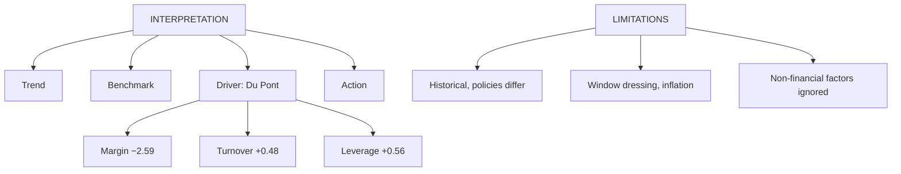

# FS-5: Managerial Interpretation of Ratios and Limitations of Analysis

Covers: how to turn ratios into a managerial diagnosis (trend, benchmark, Du Pont attribution, action), and the limitations of financial statement analysis. **(syllabus)**

## Where this fits in the ESE

The syllabus names "managerial interpretation of financial ratios" and "limitations of financial statement analysis" explicitly. Expect a 5-mark limitations answer and interpretation marks inside every Unit 2 numerical.

## How to interpret: the four-step routine

1. **Trend:** compare the ratio with last year's.
2. **Benchmark:** compare with industry average, budget or a peer. (Without a benchmark a ratio has no meaning.)
3. **Driver:** find which component moved (Du Pont, margin vs turnover vs leverage).
4. **Action:** say what the manager should do, and who the user is (lender, owner, manager).

**Different users read the same ratios differently.** A lender looks at liquidity, interest cover and debt-equity; an owner at ROE, EPS and margins; a manager at the operating cycle, margins and turnover. **(textbook)**

## Worked example: trend and Du Pont on Meridian (fictional, from FS-3 and FS-4)

**Step 1. Ratio trend**

| Ratio | 2025 | 2026 | Direction |
|---|---|---|---|
| Gross margin | 40.0% | 37.5% | Worse |
| Net margin | 11.2% | 9.33% | Worse |
| ROCE | 19.2% | 17.5% | Worse |
| ROE | 15.56% | 14.0% | Worse |
| Current ratio | 2.88 | 3.00 | Higher |
| Quick ratio | 1.53 | 1.60 | Higher |
| Debt-equity | 0.44 | 0.50 | More leverage |
| Interest cover | 5.0 | 4.2 | Thinner |
| Debtor days (closing basis) | 58.4 | 60.8 | Slower |

Workings for 2025: ROCE = 2,00,000 ÷ (7,20,000 + 3,20,000) = 19.2%; ROE = 1,12,000 ÷ 7,20,000 = 15.56%; D/E = 3,20,000 ÷ 7,20,000 = 0.44; cover = 2,00,000 ÷ 40,000 = 5.0; debtor days = 365 × 1,60,000 ÷ 10,00,000 = 58.4.

**Step 2. Du Pont attribution of the ROE fall**

| | 2025 | 2026 |
|---|---|---|
| Net margin | 11.2% | 9.33% |
| Total asset turnover | 0.826 | 0.857 |
| Equity multiplier | 1.681 | 1.750 |
| **ROE** | 15.56% | 14.0% |

ROE fell 1.56 percentage points. Attribution, one factor at a time in the order margin, turnover, leverage:
- Margin effect: (9.33% − 11.2%) × 0.826 × 1.681 = **−2.59 points**
- Turnover effect: 9.33% × (0.857 − 0.826) × 1.681 = **+0.48 points**
- Leverage effect: 9.33% × 0.857 × (1.750 − 1.681) = **+0.56 points**
- Total: −2.59 + 0.48 + 0.56 = **−1.56 points**.

**Step 3. Diagnosis.** The ROE fall is a margin problem. Higher asset turnover and more leverage cushioned it. Interest cover dropping from 5.0 to 4.2 is the price of the extra leverage.

**Step 4. Managerial actions.**
1. Margin: reprice or renegotiate input costs; target the 2.5-point gross margin loss.
2. Working capital: debtors slowed to 60.8 days and stock grew 25% against sales 20%; tighten credit and reorder levels.
3. Financing: stop adding debt until margin recovers; interest cover has little spare room.
4. A current ratio of 3.0 is high: part of the cash and stock could be released.

## Limitations of financial statement analysis

1. **Historical data.** Statements show the past, not the future.
2. **Accounting policy differences.** Depreciation method, stock valuation, revenue recognition vary across firms and years.
3. **Window dressing.** Year-end balances can be managed to improve liquidity ratios.
4. **Inflation.** Historical cost distorts asset values and comparisons across years.
5. **Ignores non-financial factors:** quality, brand, management, ESG risk.
6. **Ratios in isolation mislead.** Need a benchmark; no universal standard (the 2:1 current ratio rule is a rule of thumb).
7. **Seasonality.** A balance sheet at one date may not represent the year.
8. **Different definitions** of the same ratio across textbooks and firms.
9. **Size and diversification.** Averages hide that a conglomerate's segments differ; peers may not be comparable.
10. **Window of two or three years** may miss cycles.

## Exam answer: 5-mark limitations

Lead with "historical, policy-dependent, manipulable, inflation-blind, ignores non-financial factors". Give one line each for five points and close: "so analysis should combine ratios with trends, benchmarks, cash flow and qualitative information."

## Traps

- Stating a verdict ("liquidity is good") without a benchmark or trend.
- Listing limitations without explaining why. One reason per point.
- Saying the current ratio of 3.0 is "very good" without noting idle assets.

## What to remember

- Interpret in four steps: trend, benchmark, driver, action.
- Meridian: ROE 15.56% to 14.0%; margin −2.59, turnover +0.48, leverage +0.56 points.
- Different users (lender, owner, manager) read different ratios.
- Limitations: historical, policy differences, window dressing, inflation, non-financial factors, no benchmark.
- Ratios plus cash flow plus qualitative judgement, not ratios alone.

## Concept map

## Flashcards
Q: What are the four steps of interpreting a ratio?
A: Trend, benchmark, driver, action.

Q: Meridian ROE fell from 15.56% to 14.0%. What caused it?
A: Margin fell (−2.59 points); asset turnover (+0.48) and leverage (+0.56) partly offset it.

Q: Why did interest cover fall from 5.0 to 4.2?
A: EBIT rose only 5% while interest rose 25% with debt.

Q: Which users care most about interest cover and liquidity?
A: Lenders; owners focus on ROE and EPS, managers on margins and the operating cycle.

Q: Name four limitations of financial statement analysis.
A: Historical data, differing accounting policies, window dressing, inflation (also non-financial factors ignored).

Q: What is window dressing?
A: Arranging year-end balances (for example, delaying purchases or speeding collections) to make liquidity ratios look better.

Q: Is a current ratio of 3.0 necessarily good?
A: No. It signals safety but may mean idle inventory, debtors or cash; compare with the industry and the operating cycle.

Q: Why must a ratio be compared with a benchmark?
A: Without a past year, industry or budget, the number has no meaning; rule-of-thumb standards are not universal.

## Sources
- BBA305-6 syllabus, Unit 2 (managerial interpretation of ratios; limitations)
- Arora, *Cost and Management Accounting*
- Previous: [[Management Accounting Unit 2 - FS-4 Ratio Analysis]] · Next: [[Management Accounting Unit 2 - FS-6 Unit 2 Exam Answers]]
- [[Management Accounting Unit 2 - Financial Statement Analysis MOC (Node Map)]]
