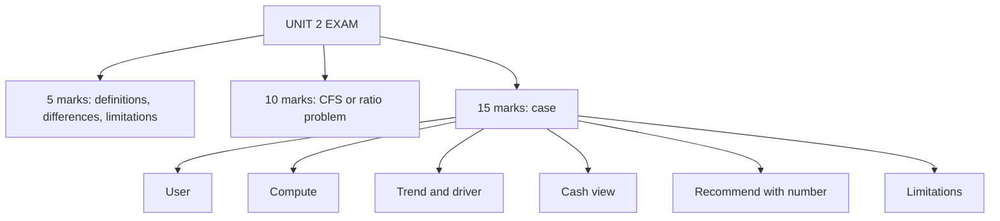

# FS-6: Unit 2 Exam Answers

Covers: 5-mark and 10-mark answer skeletons for Unit 2 and a 15-mark case layout with a model answer using ratios, trend and a lending recommendation. **(syllabus)**

## Paper pattern

Section A: 3 questions with choice, 5 marks each. Section B: 2 questions with choice, 10 marks each. Section C: one compulsory 15-mark case. Unit 2 is 10 of 45 hours, the joint-heaviest, and the most numerical unit for Sections B and C.

## 5-mark skeletons

**1. Differentiate direct and indirect method of the cash flow statement.** Starting point (receipts vs NPBT), what it shows (gross flows vs reconciliation), effort, usual use, same net result (5 rows).

**2. Treatment of tax, dividend and sale of fixed assets in the cash flow statement.** Tax paid = opening + charge − closing; dividend paid = opening proposed dividend, financing; profit/loss on sale stripped in A, proceeds in B (3 rules, each with a one-line example from FS-1).

**3. Comparative vs common-size statements.** Direction, base, purpose, example (Meridian gross margin 40.0% to 37.5%).

**4. Operating cycle and working capital ratios.** Inventory days + debtor days − creditor days (87.6 + 60.8 − 55.4 = 93.0 days for Meridian).

**5. Limitations of financial statement analysis.** FS-5 list; five points with reasons.

**6. Du Pont analysis.** ROE = margin × turnover × multiplier; Meridian 9.33% × 0.857 × 1.75 = 14.0%; say why it helps (locates the driver).

**7. Liquidity vs solvency ratios.** Time horizon, examples, user (short-term creditors vs lenders), one number each.

## 10-mark skeletons

**A. Cash flow statement problem.** Layout from FS-2 (budget the marks):
1. Working notes: depreciation, profit on sale, NPBT, tax paid, dividend paid (3).
2. Operating activities to cash generated and net CFO (3).
3. Investing and financing (2).
4. Closing cash check and a two-line interpretation (2).

**B. Ratio analysis problem.** State conventions (1); compute 8 to 10 ratios across the four families with formulas (5); interpret each family in one line (3); one action (1).

**C. Statement analysis and interpretation.** Comparative and common-size table (4); comment on growth vs margin vs leverage (4); limitations or recommendation (2).

## 15-mark case layout

1. **State the user and purpose** (lender, owner, manager) in one line (1).
2. **Compute** the required ratios or statements, with formulas, both years (5).
3. **Trend and benchmark**: compare years and, where given, industry (2).
4. **Driver**: Du Pont or the component that moved (2).
5. **Cash view**: cash flow from operations vs profit (1).
6. **Recommendation** with a number-based condition (3).
7. **Limitations** that qualify the conclusion (1).

## Model answer (illustrative)

**Case.** Meridian Components Ltd (fictional) asks its bank for a further term loan of ₹2,00,000 at 12.5%. Statements for 2025 and 2026 are in FS-3. Net cash from operating activities in 2026 was ₹1,40,000. The bank's norm is interest cover of at least 3.0 and debt-equity of at most 0.75. Advise the bank (user: lender).

**Step 1. Ratios.**

| Ratio | 2025 | 2026 |
|---|---|---|
| Current ratio | 2.88 | 3.00 |
| Quick ratio | 1.53 | 1.60 |
| Debt-equity | 0.44 | 0.50 |
| Interest cover | 5.0 | 4.2 |
| ROCE | 19.2% | 17.5% |
| Net margin | 11.2% | 9.33% |

**Step 2. Trend.** Liquidity is strong and stable. Profitability and cover are weakening: EBIT +5% while interest +25%.

**Step 3. Driver.** ROE fell from 15.56% to 14.0%. Margin effect −2.59 points, offset by turnover +0.48 and leverage +0.56. The margin is the problem.

**Step 4. Cash.** Operating cash ₹1,40,000 against PAT ₹1,12,000, a conversion of 1.25, so profits are cash-backed. Interest paid is ₹50,000, about 36% of operating cash flow (50,000 ÷ 1,40,000).

**Step 5. Pro forma with the full ₹2,00,000 loan.**
- Debt = 6,00,000; interest = 6,00,000 × 12.5% = ₹75,000.
- Interest cover = 2,10,000 ÷ 75,000 = **2.8**, below the norm of 3.0.
- Debt-equity = 6,00,000 ÷ 8,00,000 = **0.75**, exactly at the limit.

**Pro forma with ₹1,00,000.**
- Debt = 5,00,000; interest = ₹62,500.
- Interest cover = 2,10,000 ÷ 62,500 = **3.36** (meets the norm).
- Debt-equity = 5,00,000 ÷ 8,00,000 = **0.625** (meets the norm).

**Step 6. Recommendation.** Decline the full ₹2,00,000 and offer ₹1,00,000, with a covenant that interest cover stays at or above 3.0 and debt-equity at or below 0.75, and reporting of debtor and stock days quarterly. The business is liquid and cash-generative, but margins are weakening and the larger loan breaches the cover norm.

**Step 7. Limitations.** Two years of data; EBIT is held flat in the pro forma and ignores any benefit from the loan; ratios use year-end balances; no industry benchmark was supplied.

## Common mark-losers

- Cash flow answers with no working notes and no closing-cash check.
- Ratios with no formula, no convention and no interpretation.
- Comparative statements with percentages on the wrong base.
- A case answer with no recommendation or no number supporting it.

## What to remember

- CFS: working notes, A, B, C, check, interpretation.
- Ratio answers: convention, formula, number, one-line meaning, action.
- Case: user, compute, trend, driver, cash, recommend with a number, limitations.
- Meridian pro forma: full loan gives cover 2.8 and D/E 0.75; ₹1,00,000 gives cover 3.36 and D/E 0.625.

## Concept map

## Flashcards
Q: How to structure a 10-mark cash flow statement answer?
A: Working notes (3), operating (3), investing and financing (2), closing-cash check and interpretation (2).

Q: Meridian's interest cover if a further ₹2,00,000 loan at 12.5% is taken?
A: Interest 75,000; cover 2,10,000 ÷ 75,000 = 2.8, below the 3.0 norm.

Q: Meridian's debt-equity with the full ₹2,00,000 loan?
A: 6,00,000 ÷ 8,00,000 = 0.75.

Q: With a ₹1,00,000 loan, interest cover?
A: Interest 62,500; 2,10,000 ÷ 62,500 = 3.36.

Q: Layout for a Unit 2 15-mark case?
A: User, compute, trend and benchmark, driver, cash view, recommendation with a number, limitations.

Q: Meridian cash conversion if CFO is ₹1,40,000 and PAT ₹1,12,000?
A: 1.25.

Q: What is the first line of any ratio answer?
A: The conventions: formulas, closing vs average balances, credit sales, 365 days.

Q: One-line contrast of direct and indirect method?
A: Direct lists gross cash receipts and payments; indirect adjusts NPBT for non-cash and working capital items; the net operating cash flow is the same.

## Sources
- BBA305-6 syllabus, Unit 2 and ESE pattern
- [[Management Accounting Unit 2 - FS-1 Cash Flow Statement Rules and Indirect Method]] · [[Management Accounting Unit 2 - FS-2 Cash Flow Statement Full Worked Problem]] · [[Management Accounting Unit 2 - FS-3 Comparative and Common-Size Statements]] · [[Management Accounting Unit 2 - FS-4 Ratio Analysis]] · [[Management Accounting Unit 2 - FS-5 Managerial Interpretation and Limitations]]
- [[Management Accounting Unit 2 - Financial Statement Analysis MOC (Node Map)]]
