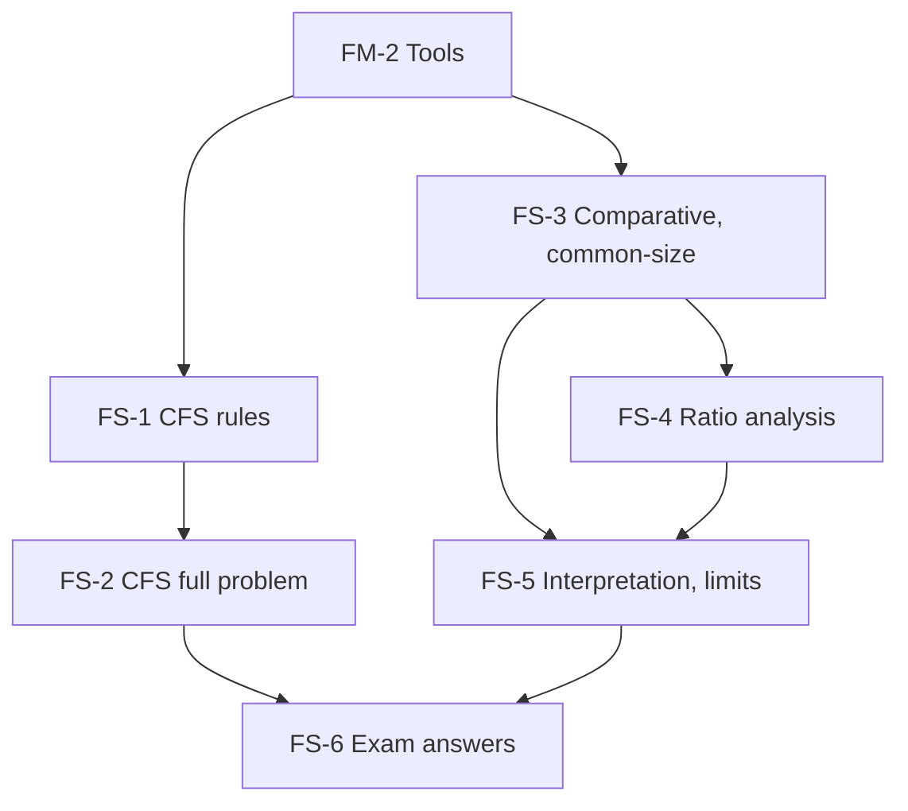

# Management Accounting Unit 2: Financial Statement Analysis, node map

ESE: 50 marks, Section A 3 × 5, Section B 2 × 10, Section C one compulsory 15-mark case. Unit 2 is CO2 (analyse statements using comparative analysis, common-size and ratios; recognise limitations). The most numerical unit: expect a cash flow statement or ratio problem in Section B and a ratio interpretation case. All examples are **hypothetical figures**.

## Nodes

| Node | Topic | Deps | Minutes | Exam focus |
|---|---|---|---|---|
| FS-1 | Cash Flow Statement Rules and Indirect Method | FM-2 | 40 | yes |
| FS-2 | Cash Flow Statement Full Worked Problem | FS-1 | 45 | yes |
| FS-3 | Comparative and Common-Size Statements | FM-2 | 30 | yes |
| FS-4 | Ratio Analysis | FS-3 | 40 | yes |
| FS-5 | Managerial Interpretation and Limitations | FS-3, FS-4 | 30 | yes |
| FS-6 | Unit 2 Exam Answers | FS-1 to FS-5 | 35 | yes |

Total reading time: about 220 minutes.

## Dependency graph

## Headline numbers to know

- Tarang CFS: depreciation ₹1,10,000; NPBT ₹3,40,000; tax paid ₹1,00,000; dividend paid ₹1,00,000; CFO ₹3,01,000; CFI (₹2,49,000); CFF (₹42,000); net +₹10,000; closing cash ₹2,10,000.
- Meridian: sales +20%, PAT flat at ₹1,12,000; gross margin 40.0% to 37.5%.
- Meridian 2026: ROE 14.0%, ROCE 17.5%, current ratio 3.0, quick 1.6, D/E 0.5, interest cover 4.2, operating cycle 93.0 days.
- Du Pont 2025 to 2026: 15.56% to 14.0% (margin −2.59, turnover +0.48, leverage +0.56).
- Lending pro forma: ₹2,00,000 loan gives cover 2.8, D/E 0.75; ₹1,00,000 gives cover 3.36, D/E 0.625.

## Links
- [[Management Accounting MOC]]
