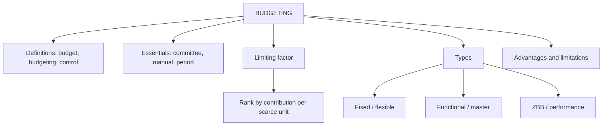

# BU-1: Budgeting, Types of Budgets and Budgetary Control

Covers: budget, budgeting and budgetary control, objectives, steps and organisation, types of budgets, the limiting (principal budget) factor with a worked product-mix example, and advantages and limitations. **(syllabus)**

## Where this fits in the ESE

A 5-mark "Explain budgetary control and its advantages/limitations" is highly likely. The limiting-factor sum is a short numerical that tests whether you rank by contribution per scarce resource.

## Definitions

- **Budget:** a financial and/or quantitative statement, prepared before a period, of the policy to be pursued to attain given objectives. It is a plan in numbers.
- **Budgeting:** the process of preparing budgets.
- **Budgetary control:** establishing budgets, comparing actual with budget, and acting on the differences (revise the plan or correct performance). Planning plus control. **(textbook)**

## Objectives and importance

Planning, coordination, communication, motivation, control, performance evaluation, and resource allocation. A budget turns strategy into a number each manager is accountable for.

## Essentials of a good budgeting system

- Top-management support and clear organisational structure with defined responsibility centres.
- A **budget committee** (coordinates) and a **budget manual** (the rule book: procedures, forms, calendar).
- A **budget period** (usually one year, broken into months or quarters) and a **budget centre** for each manager.
- Realistic targets and timely, accurate actuals.
- Participation of the managers who must deliver the numbers (BU-5).
- The **principal budget factor** identified first.

## Limiting (principal budget) factor

The factor that limits the activity of the firm in the budget period (sales demand, raw material, labour, plant capacity, cash). Budgets are built around it. When it is a scarce resource, **rank products by contribution per unit of the scarce resource**, not by contribution per unit of product.

### Worked example: limiting factor (hypothetical)

Machine hours available: 4,000. Maximum demand: A 500 units, B 400 units, C 600 units.

| | A | B | C |
|---|---|---|---|
| Selling price (₹) | 100 | 120 | 90 |
| Variable cost (₹) | 60 | 70 | 50 |
| Contribution per unit (₹) | 40 | 50 | 40 |
| Machine hours per unit | 4 | 10 | 2 |
| **Contribution per machine hour (₹)** | **10** | **5** | **20** |
| Rank | 2 | 3 | 1 |

**Allocation.**
1. C: 600 units × 2 = 1,200 hours; remaining 2,800.
2. A: 500 units × 4 = 2,000 hours; remaining 800.
3. B: 800 ÷ 10 = **80 units** (demand is 400, so B is cut).

**Contribution.** C 600 × 40 = 24,000; A 500 × 40 = 20,000; B 80 × 50 = 4,000. Total = **₹48,000**.

**Check against the wrong ranking.** Ranked by contribution per unit (B first), B takes 400 × 10 = 4,000 hours, leaving nothing: contribution = 400 × 50 = ₹20,000. The per-hour ranking earns **₹28,000 more**.

**Decision.** Produce C 600, A 500, B 80 for ₹48,000. If hours could be bought, each extra hour of capacity is worth ₹5 (B's contribution per hour), the marginal use.

## Types of budgets

| Basis | Types |
|---|---|
| Time | Long-term (strategic); short-term (usually one year) |
| Function | Sales, production, material, labour, overhead, capital expenditure, cash, master |
| Flexibility | Fixed; flexible (BU-2) |
| Approach | Incremental; zero-based (BU-5); performance / programme |
| Condition | Basic (long-standing standard); current |

## Advantages

Forces planning; coordinates departments; sets targets and yardsticks; enables control by exception; improves resource use; communicates management expectations; supports delegation.

## Limitations

- Based on estimates and forecasts, which may be wrong.
- Rigid if applied mechanically; may discourage initiative.
- Time-consuming and costly; needs top-management support.
- Can encourage slack and "spend it or lose it" behaviour (BU-5).
- A budget does not replace management judgement.

## Traps

- Ranking by contribution per unit when a resource is scarce.
- Treating budgetary control as only comparison. It also needs corrective action.
- Forgetting that the budget committee coordinates but managers own their budgets.

## What to remember

- Budget = plan in numbers; budgetary control = plan, compare, act.
- Always identify the principal budget factor first.
- Scarce resource: rank by contribution per hour (₹20, 10, 5 gives ₹48,000, against ₹20,000 if ranked wrongly).
- Types: by time, function, flexibility and approach.
- Benefits: planning, coordination, control; weaknesses: estimates, rigidity, slack.

## Concept map

## Flashcards
Q: Define budgetary control.
A: Establishing budgets, comparing actual results with them, and acting on the differences.

Q: What is the principal budget factor?
A: The factor that limits the firm's activity in the budget period (sales demand, material, labour, capacity or cash); budgets are built around it.

Q: What does the budget manual contain?
A: The procedures, forms, responsibilities and calendar for preparing and operating budgets.

Q: How are products ranked when machine hours are scarce?
A: By contribution per machine hour.

Q: In the example, how many units of B are produced?
A: 80 (800 remaining hours ÷ 10 hours per unit).

Q: Total contribution of the optimal mix?
A: ₹48,000 (C 24,000 + A 20,000 + B 4,000).

Q: Contribution if ranked wrongly by contribution per unit?
A: ₹20,000 (B takes all 4,000 hours), ₹28,000 lower.

Q: Name three limitations of budgeting.
A: Estimates may be wrong, rigidity, and time/cost (also slack and inhibited initiative).

## Sources
- BBA305-6 syllabus, Unit 3 (concept and importance of budgeting; types of budgets)
- Arora, *Cost and Management Accounting*; Khan & Jain
- Previous: [[Management Accounting Unit 2 - FS-6 Unit 2 Exam Answers]] · Next: [[Management Accounting Unit 3 - BU-2 Fixed and Flexible Budgets]]
- [[Management Accounting Unit 3 - Budgeting MOC (Node Map)]]
