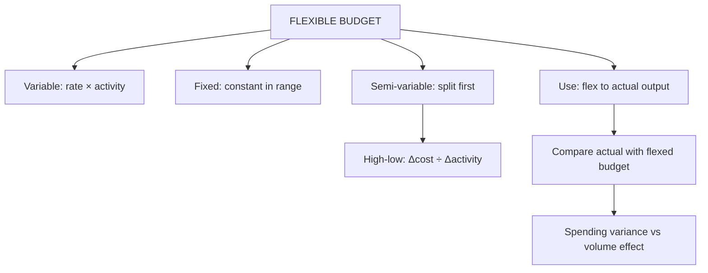

# BU-2: Fixed and Flexible Budgets

Covers: fixed vs flexible budgets, splitting semi-variable costs (high-low method), preparing a flexible budget at several activity levels, and using it to evaluate performance, with a full worked problem. **(syllabus)**

## Where this fits in the ESE

A 10-mark numerical: "prepare a flexible budget for 60%, 80% and 100% capacity" with a semi-variable cost to split. The comparison of a static budget with a flexed budget is the interpretation mark.

## Fixed vs flexible

| | Fixed (static) budget | Flexible budget |
|---|---|---|
| Based on | One expected level of activity | A range of activity levels |
| Changes with actual output? | No | Yes: variable costs adjust, fixed stay |
| Use | Stable conditions; planning | Control and evaluation; uncertain demand |
| Comparison with actual | Misleading if actual output differs | Like-for-like |

A **flexible budget** is a set of budgets for different levels of activity, or a formula (fixed cost + variable cost per unit × activity) from which the budget for any actual level can be flexed. **(textbook)**

## Cost behaviour for flexing

| Type | Behaviour | Flexing rule |
|---|---|---|
| Variable | Changes in proportion with output | Rate per unit × activity |
| Fixed | Constant in total within the relevant range | Same total at every level |
| Semi-variable | Fixed element plus variable element | Split first, then flex |

**Relevant range:** fixed costs stay fixed only within a range of activity. Say so when flexing to 100%.

## Splitting a semi-variable cost: high-low method

Variable cost per unit = (Cost at high level − Cost at low level) ÷ (High activity − Low activity)

Fixed element = Total cost at any level − Variable rate × Activity at that level.

## Worked problem: flexible budget (hypothetical)

Capacity is 10,000 units. Price ₹150 per unit. Cost data:

- Direct material ₹40 per unit; direct labour ₹25 per unit; variable overhead ₹10 per unit.
- Fixed overhead ₹2,40,000.
- Power and maintenance (semi-variable): ₹1,00,000 at 5,000 units; ₹1,24,000 at 8,000 units.

Prepare a flexible budget at 60%, 80% and 100%.

**Step 1. Split the semi-variable cost.**
- Variable rate = (1,24,000 − 1,00,000) ÷ (8,000 − 5,000) = 24,000 ÷ 3,000 = **₹8 per unit**.
- Fixed element = 1,00,000 − 5,000 × 8 = **₹60,000**. Check at 8,000: 60,000 + 64,000 = 1,24,000 ✓.

**Step 2. Flexible budget.**

| | 60% (6,000) | 80% (8,000) | 100% (10,000) |
|---|---|---|---|
| Sales (₹150) | 9,00,000 | 12,00,000 | 15,00,000 |
| Direct material | 2,40,000 | 3,20,000 | 4,00,000 |
| Direct labour | 1,50,000 | 2,00,000 | 2,50,000 |
| Variable overhead | 60,000 | 80,000 | 1,00,000 |
| Power and maintenance: variable (8/unit) | 48,000 | 64,000 | 80,000 |
| Power and maintenance: fixed | 60,000 | 60,000 | 60,000 |
| Fixed overhead | 2,40,000 | 2,40,000 | 2,40,000 |
| **Total cost** | **7,98,000** | **9,64,000** | **11,30,000** |
| **Profit** | **1,02,000** | **2,36,000** | **3,70,000** |
| Cost per unit (₹) | 133.00 | 120.50 | 113.00 |

**Reading the table.** Total cost per unit falls from ₹133.00 to ₹113.00 as the fixed cost of 3,00,000 (2,40,000 + 60,000) is spread over more units. Contribution per unit is 150 − (40 + 25 + 10 + 8) = ₹67; at 6,000 units contribution is 4,02,000 less fixed 3,00,000 = ₹1,02,000 ✓.

## Using the flexible budget for control

Actual results: 7,000 units sold at ₹150 and costs of ₹9,02,000 (material 2,84,000; labour 1,80,000; variable overhead 72,000; power and maintenance 1,18,000; fixed overhead 2,48,000).

**Flex the budget to 7,000 units.**

| | Flexed budget | Actual | Variance |
|---|---|---|---|
| Direct material | 2,80,000 | 2,84,000 | 4,000 A |
| Direct labour | 1,75,000 | 1,80,000 | 5,000 A |
| Variable overhead | 70,000 | 72,000 | 2,000 A |
| Power and maintenance | 1,16,000 | 1,18,000 | 2,000 A |
| Fixed overhead | 2,40,000 | 2,48,000 | 8,000 A |
| **Total cost** | **8,81,000** | **9,02,000** | **21,000 A** |

Power and maintenance flexed: 60,000 + 8 × 7,000 = 1,16,000.

**Compare with the static budget (80% = 9,64,000).** The actual cost of ₹9,02,000 looks ₹62,000 **better** than the static budget. That is misleading: 1,000 fewer units were made. The true spending result is ₹21,000 **worse** than the flexed budget.

**Profit reconciliation.**
- Static budget profit (8,000 units): ₹2,36,000.
- Flexed budget profit (7,000 units): 10,50,000 − 8,81,000 = ₹1,69,000.
- Actual profit: 10,50,000 − 9,02,000 = ₹1,48,000.
- Sales volume effect: 1,69,000 − 2,36,000 = −₹67,000 (1,000 units × ₹67 contribution).
- Spending effect: 1,48,000 − 1,69,000 = −₹21,000.
- Total: −67,000 − 21,000 = **−₹88,000** = 1,48,000 − 2,36,000 ✓.

**Decision line.** Of the ₹88,000 shortfall, ₹67,000 is volume (a sales problem) and ₹21,000 is spending (a cost control problem). The largest single overspend is fixed overhead ₹8,000: investigate whether it is a one-off.

## Traps

- Flexing fixed costs. They stay constant in total.
- Flexing a semi-variable cost proportionally. Split it first.
- Comparing actual with the static budget and calling the cost saving a success.
- Forgetting that cost per unit is not constant: do not multiply total cost per unit at one level.

## What to remember

- Flexible budget = fixed cost + variable rate × activity; the budget moves with the actual output.
- High-low: rate = Δcost ÷ Δactivity (₹8); fixed element = ₹60,000.
- Totals: 7,98,000 (60%), 9,64,000 (80%), 11,30,000 (100%); profits 1,02,000, 2,36,000, 3,70,000.
- At 7,000 units flexed cost is 8,81,000; actual 9,02,000 is ₹21,000 adverse, not ₹62,000 favourable.
- Profit gap ₹88,000 = volume ₹67,000 + spending ₹21,000.

## Concept map

## Flashcards
Q: Why is a flexible budget better for control than a static budget?
A: It compares actual with the budget for the actual output, so variances show spending, not volume.

Q: Formula for the variable rate in the high-low method?
A: (Cost at high level − cost at low level) ÷ (high activity − low activity).

Q: ₹1,00,000 at 5,000 units and ₹1,24,000 at 8,000 units. Split?
A: Variable ₹8 per unit; fixed ₹60,000.

Q: Total cost and profit at 80% in the worked problem?
A: Cost ₹9,64,000; profit ₹2,36,000.

Q: Flexed total cost at 7,000 units?
A: ₹8,81,000.

Q: Actual cost ₹9,02,000 at 7,000 units. Variance against the flexed budget?
A: ₹21,000 adverse.

Q: Why is the static comparison misleading?
A: Static 80% budget is ₹9,64,000, making actual look ₹62,000 favourable, but 1,000 fewer units were made.

Q: Break the ₹88,000 profit shortfall.
A: ₹67,000 volume (1,000 units × ₹67 contribution) and ₹21,000 spending.

Q: Cost per unit at 60% and at 100%?
A: ₹133.00 and ₹113.00; fixed cost is spread over more units.

## Sources
- BBA305-6 syllabus, Unit 3 (fixed and flexible budgets)
- Arora, *Cost and Management Accounting*; ICAI study material
- Previous: [[Management Accounting Unit 3 - BU-1 Budgeting Concept Types and Control]] · Next: [[Management Accounting Unit 3 - BU-3 Functional and Master Budgets]]
- [[Management Accounting Unit 3 - Budgeting MOC (Node Map)]]
