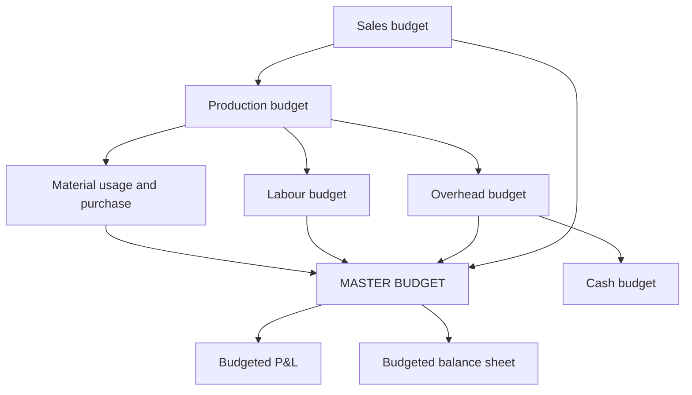

# BU-3: Functional and Master Budgets

Covers: the functional budgets (sales, production, material, labour, overhead), their order of preparation, the master budget, and a full worked problem that chains them together. **(syllabus)**

## Where this fits in the ESE

A 10-mark numerical may ask for the production budget, material purchase budget and a budgeted profit statement from sales and stock policies. The production budget formula is the usual stumbling block.

## Order of preparation

1. **Sales budget** (usually the principal budget factor).
2. **Production budget** (units): sales + closing stock − opening stock.
3. **Material usage and purchase budgets**.
4. **Labour budget**.
5. **Overhead budgets** (variable, fixed).
6. **Cash budget** (BU-4), capital expenditure budget.
7. **Master budget**: the summary of all functional budgets in the form of a budgeted profit and loss account and balance sheet, approved by top management.

Where something else is the limiting factor (material, capacity), start there and build the sales plan within it.

## Formulas

- Production (units) = Sales + Closing stock of finished goods − Opening stock.
- Material required for production = Production × material per unit.
- **Material purchases** = Material used + Closing stock of material − Opening stock of material.
- Labour cost = Production × hours per unit × rate per hour (add idle time allowance if given).
- Overhead = Variable rate × activity + fixed amount (cash fixed overhead excludes depreciation).

## Worked problem (hypothetical)

Dhara Plastics Ltd (fictional) makes one product, sold at ₹100.

- Sales units: January 2,000; February 2,400; March 2,800; April 3,000.
- Closing finished stock each month = 25% of next month's sales. Opening stock in January = 500 units.
- Raw material: 3 kg per unit at ₹8 per kg. Opening raw material in January = 2,000 kg; closing stock at the end of each month = 1,500 kg.
- Direct labour: 2 hours per unit at ₹20 per hour.
- Variable overhead ₹5 per unit produced. Fixed overhead ₹60,000 per month, including depreciation of ₹10,000.

Prepare the sales, production, material, labour and overhead budgets for January to March and a master budget (budgeted profit statement, marginal costing).

### 1. Sales budget

| | Jan | Feb | Mar | Total |
|---|---|---|---|---|
| Units | 2,000 | 2,400 | 2,800 | 7,200 |
| Value at ₹100 | 2,00,000 | 2,40,000 | 2,80,000 | 7,20,000 |

### 2. Production budget (units)

Closing stock: Jan 25% × 2,400 = 600; Feb 25% × 2,800 = 700; Mar 25% × 3,000 = 750.

| | Jan | Feb | Mar | Total |
|---|---|---|---|---|
| Sales | 2,000 | 2,400 | 2,800 | 7,200 |
| + Closing stock | 600 | 700 | 750 | 750 |
| − Opening stock | (500) | (600) | (700) | (500) |
| **Production** | **2,100** | **2,500** | **2,850** | **7,450** |

Check January: 500 + 2,100 − 2,000 = 600 ✓.

### 3. Material budgets

| | Jan | Feb | Mar | Total |
|---|---|---|---|---|
| Kg required (3 per unit) | 6,300 | 7,500 | 8,550 | 22,350 |
| + Closing stock (kg) | 1,500 | 1,500 | 1,500 | |
| − Opening stock (kg) | (2,000) | (1,500) | (1,500) | |
| **Purchases (kg)** | **5,800** | **7,500** | **8,550** | **21,850** |
| Purchase cost at ₹8 | 46,400 | 60,000 | 68,400 | 1,74,800 |

### 4. Labour budget

| | Jan | Feb | Mar | Total |
|---|---|---|---|---|
| Hours (2 per unit) | 4,200 | 5,000 | 5,700 | 14,900 |
| Cost at ₹20 | 84,000 | 1,00,000 | 1,14,000 | 2,98,000 |

### 5. Overhead budget

| | Jan | Feb | Mar | Total |
|---|---|---|---|---|
| Variable (₹5 × production) | 10,500 | 12,500 | 14,250 | 37,250 |
| Fixed | 60,000 | 60,000 | 60,000 | 1,80,000 |
| Total | 70,500 | 72,500 | 74,250 | 2,17,250 |
| Cash overhead (excl. 10,000 depreciation) | 60,500 | 62,500 | 64,250 | 1,87,250 |

### 6. Master budget: budgeted profit statement (quarter, marginal costing)

| | ₹ |
|---|---|
| Sales (7,200 × 100) | 7,20,000 |
| Variable cost of sales (7,200 × ₹69) | 4,96,800 |
| **Contribution** (7,200 × ₹31) | **2,23,200** |
| Fixed overhead (3 × 60,000) | 1,80,000 |
| **Budgeted profit** | **43,200** |

Variable cost per unit = 3 × 8 (material) + 2 × 20 (labour) + 5 (overhead) = 24 + 40 + 5 = ₹69; contribution = 100 − 69 = ₹31.

**Notes for the answer.**
- Under marginal costing, stock is valued at variable cost, so the build-up of stock (500 to 750 units) does not move profit. Under absorption costing, part of the fixed overhead would be carried in the closing stock and profit would be slightly higher. State which method the question asks for.
- The master budget would also show a budgeted balance sheet; here the point is the link: sales drives production, production drives material, labour and overhead.

## Traps

- Production = sales without adjusting for stock.
- Material purchases = usage. Adjust for opening and closing stock of material.
- Including depreciation in cash overhead for the cash budget.
- Closing stock percentage applied to current month's sales instead of next month's.
- Mixing units and rupees in the same table.

## What to remember

- Production = sales + closing stock − opening stock; purchases = usage + closing − opening.
- Dhara: production 2,100 / 2,500 / 2,850 (7,450); purchases 5,800 / 7,500 / 8,550 kg (21,850 kg, ₹1,74,800).
- Labour ₹2,98,000; variable overhead ₹37,250; fixed ₹1,80,000.
- Master budget: sales ₹7,20,000, contribution ₹2,23,200, profit ₹43,200.
- Cash overhead excludes depreciation.

## Concept map

## Flashcards
Q: Formula for the production budget in units?
A: Sales + closing stock of finished goods − opening stock.

Q: Formula for material purchases?
A: Material used + closing material stock − opening material stock.

Q: Dhara: February production?
A: 2,400 + 700 − 600 = 2,500 units.

Q: Dhara: March material purchases in kg?
A: 8,550 kg needed + 1,500 closing − 1,500 opening = 8,550 kg, ₹68,400.

Q: Dhara: quarter's labour cost?
A: 14,900 hours × ₹20 = ₹2,98,000.

Q: Dhara: variable cost per unit and contribution?
A: ₹69 and ₹31.

Q: Dhara: quarter's budgeted profit under marginal costing?
A: 7,200 × 31 = 2,23,200 contribution − 1,80,000 fixed = ₹43,200.

Q: What is the master budget?
A: The summary of all functional budgets, as a budgeted profit statement and balance sheet, approved by top management.

Q: Which budget is built first, and why?
A: The one for the principal budget factor, usually sales.

## Sources
- BBA305-6 syllabus, Unit 3 (preparation of functional and master budgets)
- Arora, *Cost and Management Accounting*
- Previous: [[Management Accounting Unit 3 - BU-2 Fixed and Flexible Budgets]] · Next: [[Management Accounting Unit 3 - BU-4 Cash Budget]]
- [[Management Accounting Unit 3 - Budgeting MOC (Node Map)]]
