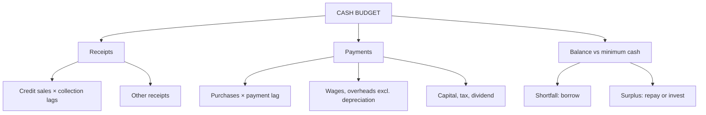

# BU-4: Cash Budget

Covers: the receipts and payments method, collection and payment lags, the layout with minimum balance and short-term borrowing, and a full worked problem. **(syllabus)**

## Where this fits in the ESE

The cash budget is the most common budgeting numerical for 10 marks. The skill is converting sales and purchases into cash using lags, then ignoring non-cash items.

## What a cash budget is

A forecast of cash receipts and payments for each period, showing the expected closing balance, surpluses to invest and shortfalls to finance. It is prepared monthly (or weekly) because a profitable firm can still run out of cash. **(textbook)**

## Method: receipts and payments

| Step | Rule |
|---|---|
| 1. Collections | Apply the collection pattern to credit sales; add cash sales |
| 2. Other receipts | Asset sales, loans, share issue, interest |
| 3. Payments for purchases | Apply the payment lag to purchases |
| 4. Wages, overheads | Pay in the month incurred unless stated; **exclude depreciation and other non-cash items** |
| 5. Capital and other payments | Machinery, tax, dividend in the month paid |
| 6. Closing balance | Opening + receipts − payments |
| 7. Financing | If below the minimum balance, borrow; if above, repay or invest |

## Reading lags

- "30% in the month of sale, 50% next month, 20% the month after": collections in March = 30% of March sales + 50% of February sales + 20% of January sales.
- "Purchases paid one month after": payments in March = February purchases.
- Always draw the schedule with the earlier months (November, December) in the data; they feed the first months.
- A cash discount reduces the cash received: 2% on cash received in the sale month means receipts of 98% on that portion.

## Worked problem (hypothetical)

Nirmal Appliances Ltd (fictional) gives this data (₹):

| | Nov | Dec | Jan | Feb | Mar | Apr |
|---|---|---|---|---|---|---|
| Credit sales | 80,000 | 90,000 | 1,00,000 | 1,20,000 | 1,40,000 | 1,60,000 |
| Purchases | 50,000 | 55,000 | 60,000 | 70,000 | 80,000 | |

- Collections: 30% in the month of sale, 50% in the next month, 20% in the second month. No bad debts.
- Purchases paid in the month after purchase.
- Wages ₹15,000 a month; overheads ₹20,000 a month including depreciation ₹4,000; both paid in the month.
- Machinery bought for ₹50,000 cash in February; tax of ₹10,000 paid in March.
- Cash on 1 January ₹20,000. Minimum cash balance ₹15,000. Borrow in multiples of ₹10,000; repay in multiples of ₹10,000 when surplus allows. Ignore interest.

Prepare the cash budget for January to March.

### Step 1. Collection schedule

| | Jan | Feb | Mar |
|---|---|---|---|
| 30% of current month sales | 30,000 | 36,000 | 42,000 |
| 50% of previous month sales | 45,000 (Dec) | 50,000 (Jan) | 60,000 (Feb) |
| 20% of sales two months back | 16,000 (Nov) | 18,000 (Dec) | 20,000 (Jan) |
| **Total collections** | **91,000** | **1,04,000** | **1,22,000** |

### Step 2. Payments schedule

| | Jan | Feb | Mar |
|---|---|---|---|
| Suppliers (previous month's purchases) | 55,000 | 60,000 | 70,000 |
| Wages | 15,000 | 15,000 | 15,000 |
| Overheads (20,000 − 4,000 depreciation) | 16,000 | 16,000 | 16,000 |
| Machinery | | 50,000 | |
| Tax | | | 10,000 |
| **Total payments** | **86,000** | **1,41,000** | **1,11,000** |

### Step 3. Cash budget

| | Jan | Feb | Mar |
|---|---|---|---|
| Opening balance | 20,000 | 25,000 | 18,000 |
| + Collections | 91,000 | 1,04,000 | 1,22,000 |
| − Payments | (86,000) | (1,41,000) | (1,11,000) |
| **Balance before financing** | **25,000** | **(12,000)** | **29,000** |
| Minimum balance | 15,000 | 15,000 | 15,000 |
| Surplus / (shortfall) | 10,000 | (27,000) | 14,000 |
| Borrowing (multiples of 10,000) | 0 | 30,000 | 0 |
| Repayment | 0 | 0 | (10,000) |
| **Closing balance** | **25,000** | **18,000** | **19,000** |
| Loan outstanding | 0 | 30,000 | 20,000 |

Feb: shortfall 27,000 rounded up to a multiple of 10,000 gives 30,000; closing 25,000 + 1,04,000 − 1,41,000 + 30,000 = 18,000. Mar: surplus 14,000 allows repayment of 10,000; 29,000 − 10,000 = 19,000.

### Decision line

The business is profitable but cash-tight in February because the ₹50,000 machinery payment lands on top of ₹60,000 of supplier payments while collections (₹1,04,000) still lag the rising sales. Arrange a ₹30,000 short-term facility before February; the ₹20,000 balance is repaid as collections catch up (collections rise to ₹1,22,000 in March). If the machinery could be deferred or financed, no borrowing would be needed in the quarter.

## Traps

- Including **depreciation** in overhead payments.
- Treating **sales as cash received** in the month of sale.
- Forgetting that the first months depend on the **previous year's** sales and purchases.
- Borrowing the exact shortfall when the question says "multiples of ₹10,000" or forgetting the minimum balance.
- Showing the loan as a receipt in the same column as collections but forgetting to repay it later.
- Netting loan with the balance: report the loan outstanding separately.

## What to remember

- Cash budget = collections (with lags) − payments (excluding non-cash items), then financing against the minimum balance.
- Nirmal collections: 91,000, 1,04,000, 1,22,000; payments 86,000, 1,41,000, 1,11,000.
- Balance before financing: 25,000, (12,000), 29,000; borrow 30,000 in February; repay 10,000 in March.
- Closing balances 25,000, 18,000, 19,000; loan outstanding 20,000.
- Profit and cash differ because of lags, capital items and non-cash charges.

## Concept map

## Flashcards
Q: Why exclude depreciation from a cash budget?
A: It is a non-cash charge; no cash leaves the business when it is recorded.

Q: Nirmal: January collections?
A: 30% of 1,00,000 + 50% of 90,000 + 20% of 80,000 = 30,000 + 45,000 + 16,000 = ₹91,000.

Q: Nirmal: February payments?
A: Suppliers 60,000 + wages 15,000 + overheads 16,000 + machinery 50,000 = ₹1,41,000.

Q: Nirmal: balance before financing in February?
A: 25,000 + 1,04,000 − 1,41,000 = −₹12,000.

Q: Nirmal: how much is borrowed in February and why?
A: ₹30,000: the shortfall to the ₹15,000 minimum is 27,000, rounded up to a multiple of 10,000.

Q: Nirmal: closing cash in February and loan outstanding?
A: ₹18,000 and ₹30,000.

Q: Nirmal: what happens in March?
A: Balance before financing is 29,000; 10,000 is repaid, closing ₹19,000, loan outstanding ₹20,000.

Q: How is a cash discount of 2% on early collections handled?
A: Collections on that portion are 98% of the sales value.

Q: Why can a profitable business face a cash shortage?
A: Collection lags, capital spending, and tax or dividend payments occur before sales are collected.

## Sources
- BBA305-6 syllabus, Unit 3 (cash budget under functional budgets)
- Arora, *Cost and Management Accounting*; ICAI study material
- Previous: [[Management Accounting Unit 3 - BU-3 Functional and Master Budgets]] · Next: [[Management Accounting Unit 3 - BU-5 ZBB Performance Budgeting and Behavioural Aspects]]
- [[Management Accounting Unit 3 - Budgeting MOC (Node Map)]]
