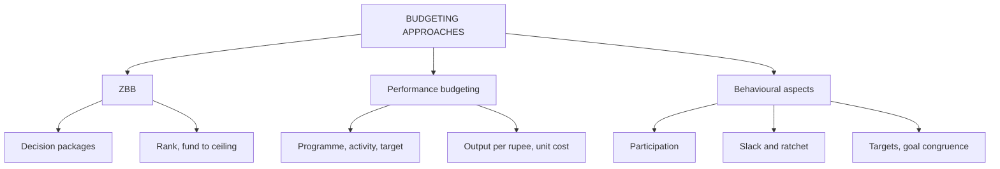

# BU-5: Zero-Based Budgeting, Performance Budgeting and Behavioural Aspects

Covers: ZBB (steps, decision packages, ranking, benefits and limits), performance (programme) budgeting, and the behavioural side of budgets (participation, slack, targets, ratchet effect), each with a worked example. **(syllabus)**

## Where this fits in the ESE

Theory-heavy: a 5-mark "Explain ZBB" or "Behavioural aspects of budgeting" is very likely, and a 10-mark answer can combine ZBB vs traditional budgeting with a small ranking exercise.

## Zero-based budgeting (ZBB)

**ZBB** builds the budget from zero: every activity must be justified afresh each period rather than adding a percentage to last year's figure (incremental budgeting). **(textbook)**

**Steps.**
1. Define the **decision units** (departments or activities).
2. Prepare a **decision package** for each: purpose, alternatives, cost, benefit of funding, consequence of not funding. Include a minimum level and incremental levels.
3. **Rank** packages by priority (cost-benefit, necessity, risk).
4. **Allocate** resources from the top down until the budget ceiling is reached.
5. Approve, implement, review.

### Worked example: ZBB ranking (hypothetical)

An IT department spent ₹10,00,000 last year. Management would add 10% under an incremental approach. The ceiling under ZBB is ₹9,00,000. Packages ranked by priority:

| Rank | Package | Cost (₹) | Cumulative (₹) | Funded? |
|---|---|---|---|---|
| 1 | Payroll and statutory systems (minimum level) | 3,00,000 | 3,00,000 | Yes |
| 2 | Core helpdesk | 2,00,000 | 5,00,000 | Yes |
| 3 | Staff training | 1,50,000 | 6,50,000 | Yes |
| 4 | Software upgrade | 2,50,000 | 9,00,000 | Yes |
| 5 | Brand events portal | 1,80,000 | 10,80,000 | No |
| 6 | Expansion pilot | 1,20,000 | 12,00,000 | No |

**Result.** Packages 1 to 4 are funded at ₹9,00,000, exactly the ceiling. Packages 5 and 6 (₹3,00,000) are not funded; total demand was ₹12,00,000.

**Compare:** incremental budget = 10,00,000 × 1.10 = ₹11,00,000. ZBB saves 11,00,000 − 9,00,000 = **₹2,00,000** against it, and ₹1,00,000 (10%) against last year's spending, while forcing a priority list.

**Decision line.** Fund 1 to 4. Revisit package 5 if extra budget appears; package 6 may be re-presented next year with a stronger benefit case.

**Advantages:** eliminates inefficient or obsolete activities; links spending to priorities; improves resource allocation; involves managers; reveals alternatives.
**Limitations:** time-consuming and paper-heavy; needs training; rankings are subjective; hard for fixed or committed costs; managers may inflate the minimum package. Often done every three to five years or for discretionary costs only.

## Performance (programme) budgeting

**Performance budgeting** links budgeted money to **programmes, activities and physical targets**, and measures output per rupee. It is widely used in government and public bodies. **(textbook)**

Elements: programme and activity classification, physical targets, unit cost standards, and performance reports on output against input.

### Worked example: performance budget (hypothetical road maintenance)

| Activity | Target | Unit cost (₹) | Budget (₹) |
|---|---|---|---|
| Patching (km) | 120 | 40,000 | 48,00,000 |
| Resurfacing (km) | 30 | 2,50,000 | 75,00,000 |
| Drain cleaning (km) | 200 | 5,000 | 10,00,000 |
| **Total** | | | **1,33,00,000** |

Actual: patching 110 km at ₹42,000 = ₹46,20,000; resurfacing 30 km at ₹2,60,000 = ₹78,00,000; drain cleaning 210 km at ₹4,800 = ₹10,08,000. Total ₹1,34,28,000.

| Activity | Physical achievement | Cost of actual output at budget unit cost | Actual cost | Cost variance |
|---|---|---|---|---|
| Patching | 110 ÷ 120 = 91.7% | 44,00,000 | 46,20,000 | 2,20,000 A |
| Resurfacing | 100% | 75,00,000 | 78,00,000 | 3,00,000 A |
| Drain cleaning | 210 ÷ 200 = 105% | 10,50,000 | 10,08,000 | 42,000 F |
| **Total** | | **1,29,50,000** | **1,34,28,000** | **4,78,000 A** |

**Reading.** Comparing 1,34,28,000 with the budget of 1,33,00,000 shows a small ₹1,28,000 overrun. Costing the actual output at budget unit costs shows the real overrun of ₹4,78,000, hidden by the shortfall in patching (10 km not done). Unit-cost control, not total spend, is the lesson.

## Behavioural aspects of budgeting

| Issue | What happens | Remedy |
|---|---|---|
| Participation | Imposed budgets cause resistance; participation builds ownership | Participative (bottom-up with top-down guidance) |
| Budgetary slack | Managers pad costs or understate revenue | Review and challenge, link rewards to accuracy |
| Target difficulty | Too easy: no effort; too hard: ignored | Challenging but attainable targets |
| Ratchet effect | Good performance this year raises next year's target | Longer-term targets, fair adjustment |
| "Spend it or lose it" | Spending to protect next year's allocation | Carry-forward rules, ZBB |
| Controllability | Managers blamed for items they do not control | Report controllable and non-controllable separately |
| Goal congruence | Department targets conflict with organisation goals | Link budgets to strategy; cross-functional review |
| Pressure and gaming | Short-term manipulation to hit targets | Balanced measures, ethical code (FM-3) |
| Feedback | Late or irrelevant reports demotivate | Timely, understandable reports |

**Approaches:** top-down (fast, imposes, low ownership), bottom-up (owned, but slack), participative with negotiation (balanced).

## Traps

- Describing ZBB as "no budget last year". It means every activity is justified, not that history is ignored.
- Saying ZBB always reduces cost. It reallocates; the ceiling decides the total.
- Listing behavioural problems without remedies.
- Judging a performance budget by total spend only.

## What to remember

- ZBB: decision units, packages, ranking, allocation to the ceiling.
- IT example: packages 1 to 4 funded at ₹9,00,000; saves ₹2,00,000 against the incremental ₹11,00,000.
- Performance budget links money to physical targets; road example: true overrun ₹4,78,000 although total looks like ₹1,28,000.
- Behavioural issues: participation, slack, target difficulty, ratchet, controllability, goal congruence.
- Good budgets are owned by managers, challenging, and tied to strategy.

## Concept map

## Flashcards
Q: Define zero-based budgeting.
A: A budget built from zero where every activity must be justified afresh each period, rather than adding a percentage to last year.

Q: What is a decision package?
A: A document for a decision unit giving its purpose, alternatives, cost, benefit, and consequence of not funding, at minimum and incremental levels.

Q: ZBB example: how is funding decided?
A: Rank packages by priority and fund from the top until the ceiling (₹9,00,000) is reached: packages 1 to 4.

Q: ZBB example: saving against the incremental budget?
A: 11,00,000 − 9,00,000 = ₹2,00,000.

Q: What is performance budgeting?
A: Budgeting linked to programmes, activities and physical targets, measuring output against cost.

Q: Road example: why compare cost at budget unit cost for actual output?
A: It isolates the unit-cost overrun (₹4,78,000 adverse) from the effect of doing less work.

Q: What is budgetary slack?
A: Deliberate understating of revenue or overstating of costs by a manager to make the budget easy to meet.

Q: What is the ratchet effect?
A: Strong performance this year leads to a tougher target next year, discouraging outperformance.

Q: Name three ways to reduce dysfunctional budget behaviour.
A: Participation, challenging but attainable targets, and separating controllable from non-controllable items.

## Sources
- BBA305-6 syllabus, Unit 3 (ZBB, performance budgeting, behavioural aspects)
- Arora, *Cost and Management Accounting*
- Previous: [[Management Accounting Unit 3 - BU-4 Cash Budget]] · Next: [[Management Accounting Unit 3 - BU-6 Unit 3 Exam Answers]]
- [[Management Accounting Unit 3 - Budgeting MOC (Node Map)]]
