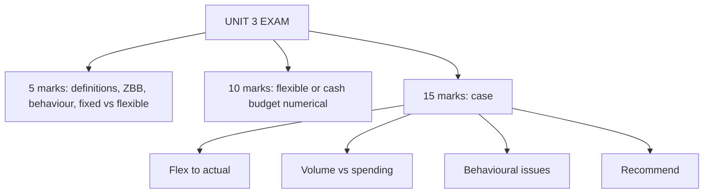

# BU-6: Unit 3 Exam Answers

Covers: 5-mark and 10-mark answer skeletons for Unit 3 and a 15-mark case layout with a model answer combining a flexed budget, variance reading and behavioural recommendations. **(syllabus)**

## Paper pattern

Section A: 3 questions with choice, 5 marks each. Section B: 2 questions with choice, 10 marks each. Section C: one compulsory 15-mark case. Unit 3 (9 hours) usually supplies one flexible or cash budget numerical and one theory answer on ZBB or behaviour.

## 5-mark skeletons

**1. Explain budgetary control, its objectives and limitations.** Definition (1), objectives (2), limitations (2).

**2. Fixed vs flexible budget.** Table of 5 rows: basis, level of activity, cost behaviour, usefulness for control, use case.

**3. Explain ZBB with its steps.** Define (1), steps with decision packages (2), advantages (1), limitations (1).

**4. Performance budgeting.** Definition, elements (programme, activity, target, unit cost), advantages, one example (road maintenance).

**5. Behavioural aspects of budgeting.** Participation, slack, target difficulty, ratchet, controllability with a remedy for each.

**6. Principal budget factor.** Definition, examples, one line on ranking by contribution per scarce unit (BU-1: ₹48,000 vs ₹20,000).

**7. Master budget.** Definition, components, order of preparation, relation to functional budgets.

## 10-mark skeletons

**A. Flexible budget numerical (BU-2).**
1. Split the semi-variable cost with the high-low method, show the check (2).
2. Flex at each level with a clear table (4).
3. Cost per unit or profit comparison (2).
4. One interpretive line: cost per unit falls because fixed cost is spread over more units; fixed cost holds only within the relevant range (2).

**B. Cash budget numerical (BU-4).**
1. Collection and payment schedules with lags (3).
2. Cash budget table with opening, receipts, payments, closing (4).
3. Financing against the minimum balance (1).
4. Decision line: when the shortfall occurs and what to arrange (2).

**C. Functional budgets (BU-3).** Sales, production (sales + closing − opening), material purchases (usage + closing − opening), labour, master summary.

**D. ZBB vs traditional budgeting.** Comparison table (5) plus a ranking example (3) plus a recommendation (2).

## 15-mark case layout

1. **Restate the problem** in two lines: budget vs actual, what to decide (1).
2. **Flex the budget** to the actual activity (4).
3. **Compute variances** and separate volume from spending (3).
4. **Diagnose**: controllable vs not, one-off vs recurring (2).
5. **Behavioural issues** observed in the case and remedies (3).
6. **Recommendation** (ZBB for discretionary costs, flexible budgeting, participation, KPIs) with the number that supports it (2).

## Model answer (illustrative)

**Case.** Zephyr Bottling Ltd (fictional) budgeted 10,000 units at ₹80, variable cost ₹50 per unit and fixed cost ₹1,50,000. Actual: 9,000 units sold at ₹80; variable cost ₹4,68,000; fixed cost ₹1,58,000. The plant manager says the shortfall is entirely the sales team's fault. The sales manager says the plant overspent. Sales staff admit they offered extended credit near the year end to hit volume. The manager of one department says he "spent the whole budget before March so it would not be cut".

**1. Restate.** Static budget profit ₹1,50,000; actual profit is lower. Decide who is responsible and what to change.

**2. Flex to 9,000 units.**

| | Static (10,000) | Flexed (9,000) | Actual (9,000) | Variance (actual vs flexed) |
|---|---|---|---|---|
| Sales | 8,00,000 | 7,20,000 | 7,20,000 | 0 |
| Variable cost | 5,00,000 | 4,50,000 | 4,68,000 | 18,000 A |
| Contribution | 3,00,000 | 2,70,000 | 2,52,000 | 18,000 A |
| Fixed cost | 1,50,000 | 1,50,000 | 1,58,000 | 8,000 A |
| **Profit** | **1,50,000** | **1,20,000** | **94,000** | **26,000 A** |

**3. Variances.** Total shortfall = 1,50,000 − 94,000 = **₹56,000**.
- Volume: flexed − static = 1,20,000 − 1,50,000 = −₹30,000 (1,000 units × contribution ₹30).
- Spending: variable cost ₹18,000 A (₹2 per unit more than ₹50) and fixed cost ₹8,000 A, total ₹26,000 A.
- Check: 30,000 + 26,000 = 56,000 ✓.

**4. Diagnosis.** Neither manager is wholly right: 54% (30,000 ÷ 56,000) of the shortfall is volume (sales), and 46% (26,000 ÷ 56,000) is spending (plant). Variable cost per unit was 4,68,000 ÷ 9,000 = ₹52 against ₹50, an efficiency or input-price question for the plant. Fixed cost overrun ₹8,000 needs a reason.

**5. Behavioural issues.**
- Extended credit to hit volume: gaming the target; the sales number may reverse in bad debts or returns. Remedy: measure sales on collections or margin as well.
- Spending the whole budget early: "spend it or lose it" behaviour. Remedy: permit carry-forward of savings, use ZBB for discretionary heads.
- Blame between departments: lack of controllability reporting. Remedy: separate controllable items by manager.

**6. Recommendation.** Adopt flexible budgets for monthly review, so volume and spending are reported separately. Use ZBB for discretionary overheads. Add a collection-based KPI to the sales target. Involve managers in setting next year's budget.

## Common mark-losers

- Comparing actual with the static budget only.
- Cash budgets with depreciation, or sales instead of collections.
- Production budgets that omit stock adjustments.
- Behavioural answers that list problems without remedies.

## What to remember

- Flexible budget answers: split, flex, compare, interpret.
- Cash budget answers: schedules, table, financing, decision.
- Case: restate, flex, variances, diagnose, behaviour, recommend.
- Zephyr: static profit ₹1,50,000; flexed ₹1,20,000; actual ₹94,000; shortfall ₹56,000 = volume ₹30,000 + spending ₹26,000.

## Concept map

## Flashcards
Q: Layout for a 10-mark flexible budget answer?
A: Split semi-variable cost, flexible budget table, cost per unit or profit comparison, one interpretive line.

Q: Zephyr: flexed profit at 9,000 units?
A: 7,20,000 − 4,50,000 − 1,50,000 = ₹1,20,000.

Q: Zephyr: actual profit?
A: 7,20,000 − 4,68,000 − 1,58,000 = ₹94,000.

Q: Zephyr: how is the ₹56,000 shortfall split?
A: ₹30,000 volume (1,000 × 30) and ₹26,000 spending (18,000 variable + 8,000 fixed).

Q: Zephyr: variable cost per unit actual?
A: 4,68,000 ÷ 9,000 = ₹52 against ₹50 budgeted.

Q: What behavioural issue is "spending the whole budget early"?
A: "Spend it or lose it" behaviour; remedy with carry-forward rules and ZBB for discretionary items.

Q: Which budget isolates spending from volume effects?
A: The flexible budget, by flexing to actual activity before comparing.

Q: First steps in a cash budget answer?
A: Draw collection and payment schedules with lags, and exclude non-cash items.

## Sources
- BBA305-6 syllabus, Unit 3 and ESE pattern
- [[Management Accounting Unit 3 - BU-1 Budgeting Concept Types and Control]] · [[Management Accounting Unit 3 - BU-2 Fixed and Flexible Budgets]] · [[Management Accounting Unit 3 - BU-3 Functional and Master Budgets]] · [[Management Accounting Unit 3 - BU-4 Cash Budget]] · [[Management Accounting Unit 3 - BU-5 ZBB Performance Budgeting and Behavioural Aspects]]
- [[Management Accounting Unit 3 - Budgeting MOC (Node Map)]]
