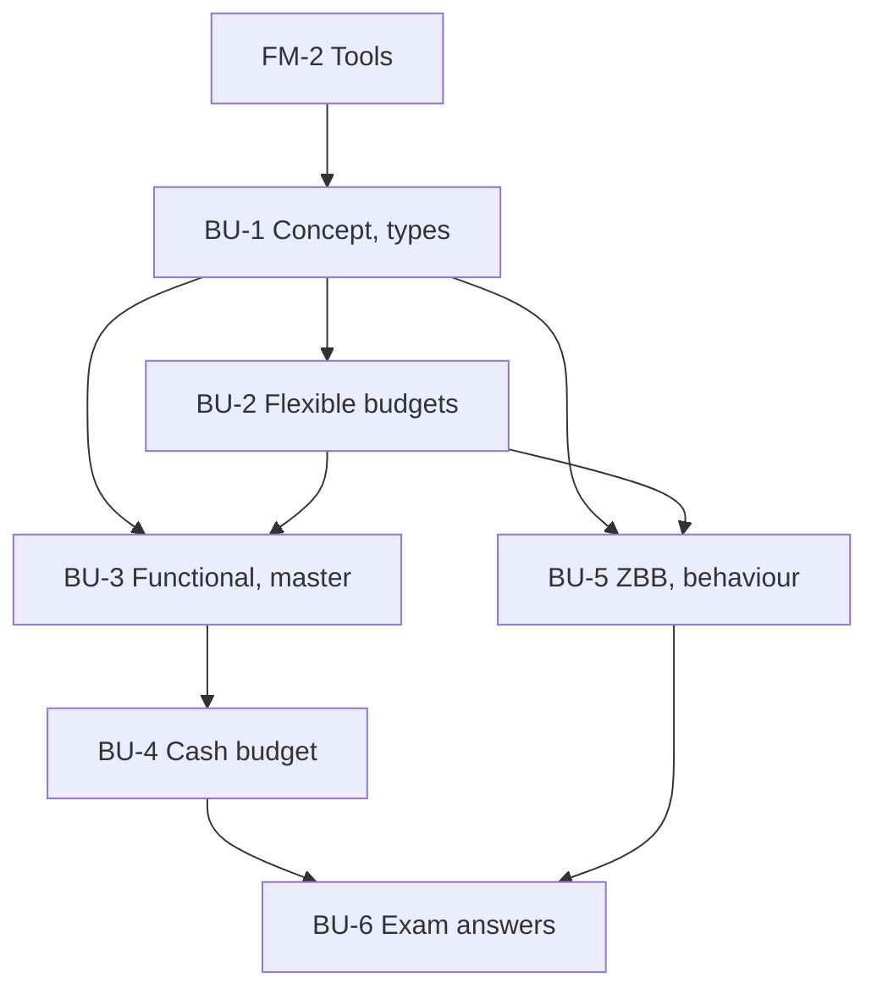

# Management Accounting Unit 3: Budgeting and Budgetary Control, node map

ESE: 50 marks, Section A 3 × 5, Section B 2 × 10, Section C one compulsory 15-mark case. Unit 3 is CO3 (analyse fixed, flexible, zero-based and performance budgeting). Likely numericals: a flexible budget with a semi-variable cost split, and a cash budget with collection lags. All examples are **hypothetical figures**.

## Nodes

| Node | Topic | Deps | Minutes | Exam focus |
|---|---|---|---|---|
| BU-1 | Budgeting Concept Types and Control | FM-2 | 30 | yes |
| BU-2 | Fixed and Flexible Budgets | BU-1 | 40 | yes |
| BU-3 | Functional and Master Budgets | BU-1, BU-2 | 40 | yes |
| BU-4 | Cash Budget | BU-3 | 40 | yes |
| BU-5 | ZBB, Performance Budgeting and Behavioural Aspects | BU-1, BU-2 | 35 | yes |
| BU-6 | Unit 3 Exam Answers | BU-1 to BU-5 | 35 | yes |

Total reading time: about 220 minutes.

## Dependency graph

## Headline numbers to know

- Limiting factor: contribution per machine hour ₹20, 10, 5; optimal mix ₹48,000 (wrong ranking ₹20,000).
- High-low: variable ₹8 per unit, fixed ₹60,000. Flexible budget cost ₹7,98,000 / 9,64,000 / 11,30,000 at 60 / 80 / 100%.
- At 7,000 units: flexed cost ₹8,81,000; actual ₹9,02,000; ₹21,000 adverse. Profit gap ₹88,000 = volume 67,000 + spending 21,000.
- Dhara production 2,100 / 2,500 / 2,850; purchases ₹1,74,800; master budget profit ₹43,200.
- Nirmal cash budget: collections 91,000 / 1,04,000 / 1,22,000; borrow ₹30,000 in February; closing 25,000 / 18,000 / 19,000.
- ZBB ceiling ₹9,00,000 saves ₹2,00,000 against ₹11,00,000. Road overrun ₹4,78,000.
- Zephyr: ₹1,50,000 static; ₹1,20,000 flexed; ₹94,000 actual.

## Links
- [[Management Accounting MOC]]
