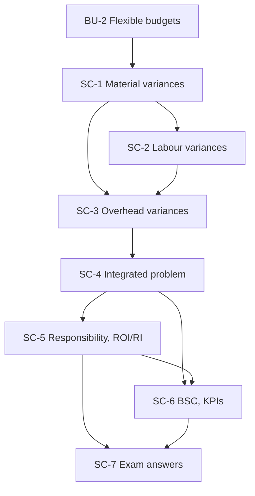

# Management Accounting Unit 4: Performance Measurement and Strategic Decision-Making, node map

ESE: 50 marks, Section A 3 × 5, Section B 2 × 10, Section C one compulsory 15-mark case. Unit 4 is CO4 (evaluate performance using standard costing, variances, responsibility accounting and the balanced scorecard). The variance nodes (SC-1 to SC-4) carry the extra worked numericals. All examples are **hypothetical figures**.

## Nodes

| Node | Topic | Deps | Minutes | Exam focus |
|---|---|---|---|---|
| SC-1 | Standard Costing and Material Variances | BU-2 | 45 | yes |
| SC-2 | Labour Variances | SC-1 | 40 | yes |
| SC-3 | Overhead Variances | SC-1, SC-2 | 45 | yes |
| SC-4 | Integrated Variance Problem and Investigation | SC-1 to SC-3 | 40 | yes |
| SC-5 | Responsibility Accounting and Divisional Performance | SC-4 | 40 | yes |
| SC-6 | Balanced Scorecard and KPIs | SC-4, SC-5 | 35 | yes |
| SC-7 | Unit 4 Exam Answers | SC-1 to SC-6 | 40 | yes |

Total reading time: about 285 minutes.

## Dependency graph

## Headline numbers to know

- Material: MCV ₹1,300 A = price ₹200 F + mix ₹100 F + yield ₹1,600 A (usage ₹1,500 A).
- Labour: LCV ₹4,550 A = rate ₹550 A + idle ₹1,200 A + efficiency ₹2,800 A (mix ₹160 A + yield ₹2,640 A).
- Overhead: VOH ₹4,400 A (2,600 + 1,800); FOH ₹22,000 A (expenditure 10,000 + volume 12,000 = efficiency 9,000 A + capacity 6,600 F + calendar 9,600 A); total ₹26,400 A.
- Brightline: standard ₹12,48,000, actual ₹13,06,400, variance ₹58,400 A.
- ROI/RI: project ROI 18% vs 15% required; divisional ROI 20.0% to 19.67%, RI ₹50,000 to ₹56,000. P: 18% and ₹60,000; Q: 16% and ₹1,00,000.
- BSC example score 91.71; R&D cut lifts ROCE 18.0% to 20.0%.
- Orchid: total ₹26,200 A (material ₹1,600 A; labour ₹24,600 A).

## Links
- [[Management Accounting MOC]]
