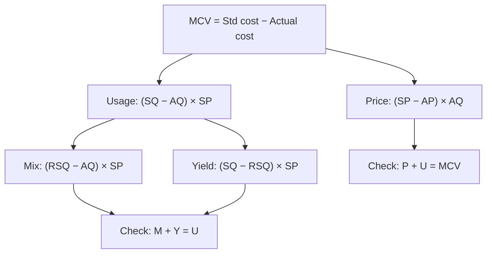

# SC-1: Standard Costing and Material Variances

Covers: standard costing and its use, the sign convention, the full material variance tree (price, usage, mix, yield) with a worked problem and the check that the sub-variances add up to the total. **(syllabus)** One of the student's hard topics, so work every line.

## Where this fits in the ESE

Variance analysis is the most numerical part of Unit 4 and a favourite 10-mark question. Material variances (including mix and yield) can also feed the 15-mark case.

## Standard costing in brief

**Standard cost** is a pre-determined cost of a unit of output under stated conditions. **Standard costing** compares it with the actual cost and analyses the difference (**variance**) so that management can act by exception. **(textbook)**

- **Types of standard:** ideal (perfect conditions, rarely met), normal (average over a cycle), attainable (efficient but achievable; the usual choice for motivation).
- **Standard cost card:** quantity and price (or hours and rate) for each element: material, labour, variable overhead, fixed overhead.
- **Variance:** Favourable (F) if it adds to profit (actual cost lower than standard); Adverse (A) if it reduces profit.
- **Convention in these notes:** variance = (standard − actual) so positive = F, negative = A. Working out the sign by the logic "did we pay less or use less than standard?" is the error-proof route.

## Material variance tree

```
Material cost variance (MCV) = Standard cost of actual output − Actual cost
   |-- Material price variance (MPV)
   |-- Material usage variance (MUV)
          |-- Material mix variance (MMV)
          |-- Material yield variance (MYV)
```

| Variance | Formula |
|---|---|
| MCV | (Standard quantity for actual output × SP) − (AQ × AP) |
| **Price (MPV)** | (SP − AP) × AQ |
| **Usage (MUV)** | (SQ − AQ) × SP |
| **Mix (MMV)** | (RSQ − AQ) × SP |
| **Yield (MYV)** | (SQ − RSQ) × SP |

Where: SQ = standard quantity for actual output; AQ = actual quantity; RSQ = **revised standard quantity** = total actual input × standard mix proportion; SP = standard price; AP = actual price.

**Checks:** MPV + MUV = MCV; MMV + MYV = MUV.

**Price on purchases or on usage?** The usual rule: price variance on the quantity **purchased** (to flag the buyer early), usage variance on the quantity **used**. If purchases equal usage, one quantity serves both. **Class version:** no slides yet; if the question gives opening and closing stock, follow its instruction.

**Yield from the output side.** Standard yield from actual input = Actual input × (standard output ÷ standard input). Yield variance = (Actual output − Standard yield from actual input) × Standard cost per unit of output. It equals the input-side yield variance.

## Warm-up: single material (hypothetical)

Standard: 5 kg per unit at ₹20. Actual: 1,000 units made, 5,200 kg used (all purchased) at ₹19, cost ₹98,800.

1. SQ = 1,000 × 5 = 5,000 kg. Standard cost = 5,000 × 20 = ₹1,00,000.
2. MPV = (20 − 19) × 5,200 = ₹5,200 F.
3. MUV = (5,000 − 5,200) × 20 = ₹4,000 A.
4. MCV = 1,00,000 − 98,800 = ₹1,200 F. Check: 5,200 − 4,000 = 1,200 ✓.

## Worked problem: price, usage, mix and yield (hypothetical)

**Standard mix for 100 kg of input (producing 80 kg of output after 20% normal loss):**

| Material | Quantity (kg) | Standard price (₹/kg) | Cost (₹) |
|---|---|---|---|
| A | 40 | 5 | 200 |
| B | 60 | 10 | 600 |
| Input | 100 | | 800 |
| Normal loss 20% | (20) | | |
| Output | 80 | | 800 (₹10 per kg of output) |

**Actual results.** Output 1,600 kg. Input: A 900 kg at ₹5.50 = ₹4,950; B 1,300 kg at ₹9.50 = ₹12,350. Total input 2,200 kg, cost ₹17,300. (Assume all purchased material was used.)

### Step 1. Quantities

- Standard input for 1,600 kg of output = 1,600 ÷ 0.80 = 2,000 kg. SQ: A 800, B 1,200.
- AQ: A 900, B 1,300 (total 2,200 kg).
- RSQ = 2,200 × standard mix: A 40% = 880; B 60% = 1,320.
- Standard cost of actual output = 1,600 × ₹10 = ₹16,000 (check: 800 × 5 + 1,200 × 10 = 4,000 + 12,000 = 16,000 ✓).

### Step 2. Material cost variance

MCV = 16,000 − 17,300 = **₹1,300 A**.

### Step 3. Price variance (SP − AP) × AQ

| | Working | ₹ |
|---|---|---|
| A | (5.00 − 5.50) × 900 | 450 A |
| B | (10.00 − 9.50) × 1,300 | 650 F |
| **MPV** | | **200 F** |

### Step 4. Usage variance (SQ − AQ) × SP

| | Working | ₹ |
|---|---|---|
| A | (800 − 900) × 5 | 500 A |
| B | (1,200 − 1,300) × 10 | 1,000 A |
| **MUV** | | **1,500 A** |

### Step 5. Mix variance (RSQ − AQ) × SP

| | Working | ₹ |
|---|---|---|
| A | (880 − 900) × 5 | 100 A |
| B | (1,320 − 1,300) × 10 | 200 F |
| **MMV** | | **100 F** |

### Step 6. Yield variance (SQ − RSQ) × SP

| | Working | ₹ |
|---|---|---|
| A | (800 − 880) × 5 | 400 A |
| B | (1,200 − 1,320) × 10 | 1,200 A |
| **MYV** | | **1,600 A** |

Cross-check from the output side: standard yield from actual input = 2,200 × 0.80 = 1,760 kg; actual 1,600 kg; (1,600 − 1,760) × ₹10 = **₹1,600 A** ✓.

### Step 7. The check

| Check | Working | Result |
|---|---|---|
| Price + Usage | +200 − 1,500 | −1,300 = MCV ✓ |
| Mix + Yield | +100 − 1,600 | −1,500 = MUV ✓ |
| Total | 200 + 100 − 1,600 | **₹1,300 A** |

### Interpretation (the marks are here)

1. **Buying was good:** B was bought ₹0.50 below standard, giving ₹650 F, only partly offset by A's ₹0.50 premium. Net price gain ₹200.
2. **The mix helped slightly (₹100 F):** more of cheaper A and less of dearer B than standard. But a mix shift can change quality; check it did not cause the loss.
3. **The yield is the problem (₹1,600 A):** 2,200 kg of input produced only 1,600 kg; the loss was 600 ÷ 2,200 = **27.3%** against the standard 20%. This single variance outweighs everything else.
4. **Action:** investigate the production process (wastage, machine setting, quality of material). Do not reward purchasing for the small price gain until cause of the yield loss is known; cheaper or substituted material may be driving the loss.

## Causes and who is responsible

| Variance | Typical causes | Usually responsible |
|---|---|---|
| Price | Market change, bulk discount lost, urgent buying, freight | Purchase manager (if controllable) |
| Usage | Wastage, poor quality material, theft, inefficient workers, wrong standards | Production manager |
| Mix | Substitution, shortage, deliberate change | Production / planning |
| Yield | Poor quality input, process loss, inexperience | Production |

## Traps

- Computing usage variance at actual price. Usage is always at **standard** price.
- Using actual mix as the base for RSQ. RSQ uses the **standard** mix on total actual input.
- Reversing signs: "standard − actual" for costs, so a positive number is favourable.
- Not checking MMV + MYV = MUV. Do it every time.
- Treating a favourable price variance as a success without checking quality and usage.

## What to remember

- Tree: MCV = price + usage; usage = mix + yield.
- Formulas: (SP − AP) × AQ; (SQ − AQ) × SP; (RSQ − AQ) × SP; (SQ − RSQ) × SP.
- Worked problem: MCV ₹1,300 A = price ₹200 F + mix ₹100 F + yield ₹1,600 A.
- RSQ: A 880, B 1,320; yield loss 27.3% against 20% standard.
- Interpret: favourable price and mix hid an adverse yield; investigate the process.

## Concept map



## Flashcards
Q: Material price variance formula?
A: (Standard price − actual price) × actual quantity.

Q: Material usage variance formula?
A: (Standard quantity for actual output − actual quantity) × standard price.

Q: What is RSQ?
A: Revised standard quantity: total actual input spread in the standard mix proportion.

Q: Material mix variance formula?
A: (RSQ − AQ) × standard price.

Q: Material yield variance formula?
A: (SQ − RSQ) × standard price, or (actual output − standard yield from actual input) × standard cost per unit of output.

Q: Which two checks must always hold?
A: Price + usage = cost variance; mix + yield = usage variance.

Q: In the worked problem, MPV, MMV, MYV and MCV?
A: ₹200 F, ₹100 F, ₹1,600 A and ₹1,300 A.

Q: Why is the yield loss 27.3% in the worked problem?
A: Input 2,200 kg, output 1,600 kg; 600 ÷ 2,200 = 27.3% against the 20% normal loss.

Q: Single material warm-up: SQ 5,000 kg at ₹20, actual 5,200 kg at ₹19. MPV and MUV?
A: MPV ₹5,200 F; MUV ₹4,000 A; MCV ₹1,200 F.

Q: Usage variance is valued at which price?
A: The standard price, never the actual price.

## Sources
- BBA305-6 syllabus, Unit 4 (standard costing and variance analysis, material)
- Arora, *Cost and Management Accounting*; Khan & Jain; ICAI study material
- Previous: [[Management Accounting Unit 3 - BU-6 Unit 3 Exam Answers]] · Next: [[Management Accounting Unit 4 - SC-2 Labour Variances]]
- [[Management Accounting Unit 4 - Performance Measurement MOC (Node Map)]]
