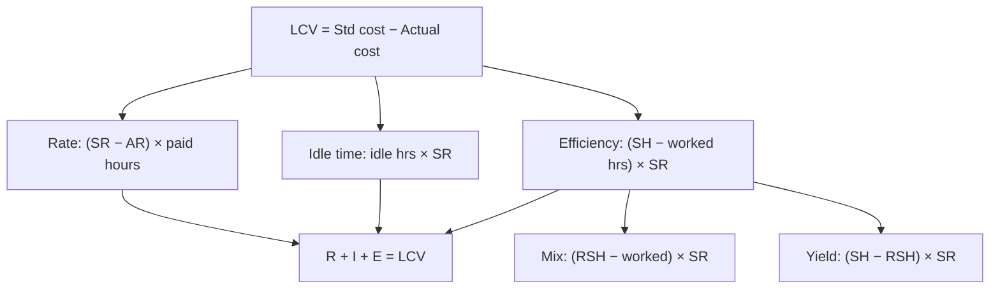

# SC-2: Labour Variances

Covers: the labour variance tree (rate, efficiency, idle time, mix, yield), a warm-up and a full worked problem with two grades of labour, and the check that the sub-variances add up to the total. **(syllabus)** The same logic as materials, with hours in place of kilograms.

## Where this fits in the ESE

Labour variances are asked with material variances in one 10-mark question. The point most often missed is idle time: it comes out of the efficiency variance and is valued at the standard rate.

## The labour variance tree

```
Labour cost variance (LCV) = Standard labour cost of actual output − Actual labour cost
   |-- Labour rate variance (LRV)
   |-- Labour efficiency variance (LEV)
   |      |-- Labour mix variance (gang composition)
   |      |-- Labour yield / sub-efficiency variance
   |-- Idle time variance (ITV)
```

| Variance | Formula |
|---|---|
| LCV | (SH for actual output × SR) − (AH paid × AR) |
| **Rate (LRV)** | (SR − AR) × **hours paid** |
| **Efficiency (LEV)** | (SH for actual output − **hours worked**) × SR |
| **Idle time (ITV)** | Idle hours × SR |
| **Mix** | (Revised standard hours − Hours worked) × SR |
| **Yield / sub-efficiency** | (SH for actual output − Revised standard hours) × SR |

Where SH = standard hours for actual output; hours worked = hours paid − idle hours; revised standard hours = total hours worked × standard mix proportion.

**Checks:** LRV + LEV + ITV = LCV; Mix + Yield = LEV.

**Convention:** rate variance is on hours **paid** (the cost actually incurred); efficiency on hours **worked**. Some texts compute rate on hours worked and idle time at actual rate; follow the faculty or the question. **Class version:** no slides yet.

## Warm-up (hypothetical)

Standard: 3 hours per unit at ₹40. Actual: 500 units; 1,600 hours paid at ₹42, of which 50 were idle.

1. SH = 500 × 3 = 1,500; hours worked = 1,600 − 50 = 1,550. Standard cost = 500 × 120 = ₹60,000. Actual cost = 1,600 × 42 = ₹67,200.
2. LRV = (40 − 42) × 1,600 = ₹3,200 A.
3. ITV = 50 × 40 = ₹2,000 A.
4. LEV = (1,500 − 1,550) × 40 = ₹2,000 A.
5. LCV = 60,000 − 67,200 = ₹7,200 A. Check: 3,200 + 2,000 + 2,000 = 7,200 ✓.

## Worked problem: two grades, idle time, mix and yield (hypothetical)

**Standard per unit:** Grade I 2 hours at ₹30 = ₹60; Grade II 3 hours at ₹20 = ₹60; total 5 hours, ₹120 (average ₹24 per hour).

**Actual:** output 400 units.

| | Hours paid | Idle hours | Hours worked | Actual rate | Actual cost |
|---|---|---|---|---|---|
| Grade I | 900 | 40 | 860 | ₹32 | 28,800 |
| Grade II | 1,250 | 0 | 1,250 | ₹19 | 23,750 |
| **Total** | 2,150 | 40 | 2,110 | | **52,550** |

### Step 1. Standards for actual output

- SH: Grade I 400 × 2 = 800; Grade II 400 × 3 = 1,200; total 2,000 hours.
- Standard cost = 400 × 120 = ₹48,000 (check: 800 × 30 + 1,200 × 20 = 24,000 + 24,000 = 48,000 ✓).
- **LCV** = 48,000 − 52,550 = **₹4,550 A**.

### Step 2. Rate variance (SR − AR) × hours paid

| | Working | ₹ |
|---|---|---|
| Grade I | (30 − 32) × 900 | 1,800 A |
| Grade II | (20 − 19) × 1,250 | 1,250 F |
| **LRV** | | **550 A** |

### Step 3. Idle time variance

Grade I: 40 × 30 = **₹1,200 A**. Grade II: nil. **ITV = ₹1,200 A.**

### Step 4. Efficiency variance (SH − hours worked) × SR

| | Working | ₹ |
|---|---|---|
| Grade I | (800 − 860) × 30 | 1,800 A |
| Grade II | (1,200 − 1,250) × 20 | 1,000 A |
| **LEV** | | **2,800 A** |

### Step 5. Split the efficiency variance into mix and yield

Total hours worked = 2,110. Standard mix 2:3 → revised standard hours: Grade I 2,110 × 2/5 = **844**; Grade II 2,110 × 3/5 = **1,266**.

**Mix** = (RSH − hours worked) × SR

| | Working | ₹ |
|---|---|---|
| Grade I | (844 − 860) × 30 | 480 A |
| Grade II | (1,266 − 1,250) × 20 | 320 F |
| **Mix** | | **160 A** |

**Yield (sub-efficiency)** = (SH − RSH) × SR

| | Working | ₹ |
|---|---|---|
| Grade I | (800 − 844) × 30 | 1,320 A |
| Grade II | (1,200 − 1,266) × 20 | 1,320 A |
| **Yield** | | **2,640 A** |

Shortcut: total hours (2,000 − 2,110) × average standard rate ₹24 = −110 × 24 = **₹2,640 A** ✓.

### Step 6. The check

| Check | Working | Result |
|---|---|---|
| Rate + Idle + Efficiency | −550 − 1,200 − 2,800 | **−4,550 = LCV** ✓ |
| Mix + Yield | −160 − 2,640 | **−2,800 = LEV** ✓ |

### Interpretation

1. **Rate (₹550 A net):** Grade I was paid ₹2 above standard (₹1,800 A); Grade II ₹1 below (₹1,250 F). Overtime or wage settlement for Grade I is the likely cause; Grade II may be less experienced.
2. **Idle time (₹1,200 A):** 40 Grade I hours were paid but not worked. Check machine breakdown, material shortage, power failure. Often not the workers' fault; the cause decides who is responsible.
3. **Efficiency (₹2,800 A):** 110 more hours were worked than the 2,000 standard allowed (5.5% over), of which ₹2,640 is pure efficiency; the mix (more Grade I, the costlier grade) cost only ₹160.
4. **Priority:** idle time and efficiency are production-control issues worth ₹4,000 of the ₹4,550. The rate issue is a personnel decision.

## Causes and responsibility

| Variance | Typical causes | Usually responsible |
|---|---|---|
| Rate | Wage settlement, overtime premium, grade substitution | HR / production planning |
| Efficiency | Skill, supervision, poor material, machine condition, wrong standard | Production manager |
| Idle time | Breakdown, power cut, material shortage, strike, lack of orders | Depends on cause: maintenance, stores, sales |
| Mix | Grade substitution | Production planning |

## Traps

- Computing efficiency on hours **paid** (double counts idle time). Efficiency uses hours **worked**.
- Valuing idle time at actual rate. Use the standard rate (the rate variance already holds the actual-versus-standard difference).
- Using the wrong total in the mix split: RSH is built on hours **worked**, not hours paid.
- Forgetting that rate and efficiency interact: cheaper, less skilled labour saves rate but loses efficiency.

## What to remember

- Tree: LCV = rate + efficiency + idle time; efficiency = mix + yield.
- Rate on hours paid; efficiency on hours worked; idle at standard rate.
- Worked problem: LCV ₹4,550 A = rate ₹550 A + idle ₹1,200 A + efficiency ₹2,800 A (mix ₹160 A + yield ₹2,640 A).
- RSH: Grade I 844, Grade II 1,266; average standard rate ₹24.
- Always run the two checks.

## Concept map



## Flashcards
Q: Labour rate variance formula?
A: (Standard rate − actual rate) × hours paid.

Q: Labour efficiency variance formula?
A: (Standard hours for actual output − actual hours worked) × standard rate.

Q: Idle time variance formula?
A: Idle hours × standard rate (always adverse).

Q: How are hours worked found?
A: Hours paid − idle hours.

Q: What check links the labour variances?
A: Rate + efficiency + idle time = labour cost variance; mix + yield = efficiency variance.

Q: In the worked problem, LCV, LRV, ITV and LEV?
A: ₹4,550 A, ₹550 A, ₹1,200 A and ₹2,800 A.

Q: In the worked problem, mix and yield?
A: Mix ₹160 A and yield ₹2,640 A, summing to ₹2,800 A.

Q: How is labour yield computed as a shortcut?
A: (Standard hours − total hours worked) × average standard rate: (2,000 − 2,110) × 24 = ₹2,640 A.

Q: Warm-up: 500 units, 1,600 hours paid at ₹42, 50 idle, standard 3 hours at ₹40. Efficiency variance?
A: SH 1,500, worked 1,550: (1,500 − 1,550) × 40 = ₹2,000 A.

## Sources
- BBA305-6 syllabus, Unit 4 (standard costing and variance analysis, labour)
- Arora, *Cost and Management Accounting*; ICAI study material
- Previous: [[Management Accounting Unit 4 - SC-1 Standard Costing and Material Variances]] · Next: [[Management Accounting Unit 4 - SC-3 Overhead Variances]]
- [[Management Accounting Unit 4 - Performance Measurement MOC (Node Map)]]
