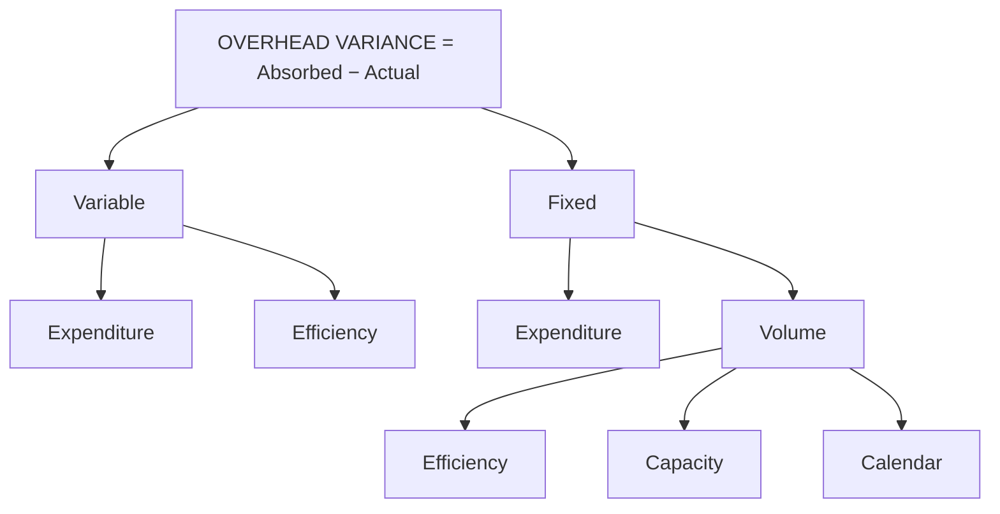

# SC-3: Overhead Variances

Covers: variable and fixed overhead variances (expenditure, volume, capacity, calendar, efficiency), the absorption logic behind them, a full worked problem with every sub-variance and the check that they sum to the total. **(syllabus)**

## Where this fits in the ESE

Overhead variances are the hardest of the three families because the standard is an absorption rate. A 10-mark question gives the budget, the actual and asks for four to six variances. The check (sub-variances = total) is how you protect your marks.

## The idea

Overhead is charged to output at a **standard absorption rate**:
- Standard variable overhead rate = Budgeted variable overhead ÷ Budgeted hours (or units).
- Standard fixed overhead rate = Budgeted fixed overhead ÷ Budgeted hours (or units).

**Overhead absorbed** = Standard hours for actual output × standard rate.
**Total overhead variance** = Absorbed − Actual (negative = under-absorbed = adverse).

Variable overhead varies with activity, so its variances concern **spending** and **efficiency**. Fixed overhead does not vary with activity, so the volume of activity enters through **volume** variances.

## Variable overhead variances

| Variance | Formula |
|---|---|
| Total VOH variance | (SH for actual output × std rate) − Actual VOH |
| **Expenditure** | (Actual hours × std rate) − Actual VOH |
| **Efficiency** | (SH for actual output − Actual hours) × std rate |

Check: Expenditure + Efficiency = Total.

## Fixed overhead variances

| Variance | Formula |
|---|---|
| Total FOH variance | (SH for actual output × std rate) − Actual FOH |
| **Expenditure (budget)** | Budgeted FOH − Actual FOH |
| **Volume** | (SH for actual output − Budgeted hours) × std rate |
| Volume splits into: | |
| **Efficiency** | (SH for actual output − Actual hours) × std rate |
| **Capacity** | (Actual hours − Revised budgeted hours) × std rate |
| **Calendar** | (Revised budgeted hours − Budgeted hours) × std rate |

Revised budgeted hours = budgeted hours adjusted for the actual number of working days (actual days × budgeted hours per day).

Checks: Expenditure + Volume = Total; Efficiency + Capacity + Calendar = Volume.

**Output-based version:** volume variance = (Actual output − Budgeted output) × standard fixed overhead rate per unit. It equals the hours-based figure.

**If the question has no working-days data:** drop the calendar variance; then Capacity = (Actual hours − Budgeted hours) × std rate, and Efficiency + Capacity = Volume. **Class version:** no slides yet; follow the faculty on whether calendar is a separate variance.

## Worked problem (hypothetical)

**Budget for the month.** Output 4,000 units at 2 hours per unit = **8,000 hours**; 25 working days (320 hours a day). Fixed overhead ₹2,40,000. Standard variable overhead ₹6 per hour.

**Actual.** Output 3,800 units; actual hours worked 7,900; working days 24; actual variable overhead ₹50,000; actual fixed overhead ₹2,50,000.

### Step 1. Rates and bases

- Standard fixed overhead rate = 2,40,000 ÷ 8,000 = **₹30 per hour** (₹60 per unit).
- Standard hours for actual output = 3,800 × 2 = **7,600 hours**.
- Revised budgeted hours = 24 days × 320 = **7,680 hours**.
- Absorbed variable overhead = 7,600 × 6 = ₹45,600. Absorbed fixed overhead = 7,600 × 30 = ₹2,28,000.

### Step 2. Variable overhead

| Variance | Working | ₹ |
|---|---|---|
| Total | 45,600 − 50,000 | 4,400 A |
| Expenditure | (7,900 × 6) − 50,000 = 47,400 − 50,000 | 2,600 A |
| Efficiency | (7,600 − 7,900) × 6 | 1,800 A |
| Check | 2,600 + 1,800 | 4,400 ✓ |

### Step 3. Fixed overhead

| Variance | Working | ₹ |
|---|---|---|
| Total | 2,28,000 − 2,50,000 | 22,000 A |
| Expenditure | 2,40,000 − 2,50,000 | 10,000 A |
| Volume | (7,600 − 8,000) × 30 | 12,000 A |
| of which Efficiency | (7,600 − 7,900) × 30 | 9,000 A |
| of which Capacity | (7,900 − 7,680) × 30 | 6,600 F |
| of which Calendar | (7,680 − 8,000) × 30 | 9,600 A |
| Check: Efficiency + Capacity + Calendar | −9,000 + 6,600 − 9,600 | −12,000 = Volume ✓ |
| Check: Expenditure + Volume | −10,000 − 12,000 | −22,000 = Total ✓ |

**Without the calendar variance:** capacity = (7,900 − 8,000) × 30 = ₹3,000 A; efficiency ₹9,000 A; sum ₹12,000 A = volume ✓.
**Output-based volume:** (3,800 − 4,000) × ₹60 = ₹12,000 A ✓.

### Step 4. Total overhead variance

Total OH variance = 4,400 A + 22,000 A = **₹26,400 A**. Check: absorbed 45,600 + 2,28,000 = 2,73,600 against actual 3,00,000 = 26,400 under-absorbed ✓.

### Interpretation

1. **Spending is over budget on both heads:** variable ₹2,600 A and fixed ₹10,000 A. Fixed overhead overspend is a control matter (rent, salaries, maintenance contracts).
2. **Efficiency (₹1,800 A variable, ₹9,000 A fixed):** 300 more hours were used than the 7,600 allowed for the output, an inefficiency of about 3.9% (300 ÷ 7,600).
3. **Calendar (₹9,600 A):** one fewer working day cost 320 hours of capacity. Not a management failure; it is a timing effect.
4. **Capacity (₹6,600 F):** within the 24 days, the plant worked more hours (7,900) than the days allowed (7,680), a use of overtime or higher shifts.
5. **Regrouped for control:** spending ₹12,600 A (2,600 + 10,000), efficiency ₹10,800 A (1,800 + 9,000), calendar ₹9,600 A, capacity ₹6,600 F. Sum: −12,600 − 10,800 − 9,600 + 6,600 = **−26,400** ✓. The controllable items are spending and efficiency (₹23,400 A); calendar and capacity net to ₹3,000 A.

## Traps

- Absorbing fixed overhead at actual hours. Absorption uses **standard hours for actual output**.
- Applying the variable overhead rate to fixed overhead.
- Showing calendar variance when no working-day data is given.
- Wrong sign on capacity: if actual hours exceed revised budgeted hours, it is favourable.
- Forgetting to run both checks.

## What to remember

- Variable: expenditure and efficiency. Fixed: expenditure and volume (efficiency, capacity, calendar).
- Standard rates: fixed ₹30 per hour, variable ₹6 per hour in the example.
- Variable overhead variance ₹4,400 A (₹2,600 A + ₹1,800 A).
- Fixed overhead variance ₹22,000 A (expenditure ₹10,000 A + volume ₹12,000 A = efficiency ₹9,000 A + capacity ₹6,600 F + calendar ₹9,600 A).
- Total overhead variance ₹26,400 A, which is the under-absorbed overhead.

## Concept map

## Flashcards
Q: How is the standard fixed overhead rate computed?
A: Budgeted fixed overhead ÷ budgeted hours (or units).

Q: Variable overhead expenditure variance formula?
A: (Actual hours × standard rate) − actual variable overhead.

Q: Fixed overhead volume variance formula?
A: (Standard hours for actual output − budgeted hours) × standard fixed overhead rate.

Q: How does the fixed overhead volume variance split?
A: Efficiency + capacity + calendar.

Q: Capacity variance formula?
A: (Actual hours − revised budgeted hours) × standard fixed overhead rate.

Q: Worked problem: variable overhead variances?
A: Expenditure ₹2,600 A, efficiency ₹1,800 A, total ₹4,400 A.

Q: Worked problem: fixed overhead variances?
A: Expenditure ₹10,000 A, volume ₹12,000 A, total ₹22,000 A.

Q: Worked problem: split of the ₹12,000 volume variance?
A: Efficiency ₹9,000 A, capacity ₹6,600 F, calendar ₹9,600 A.

Q: What does the total overhead variance represent?
A: Over- or under-absorbed overhead: absorbed minus actual (₹26,400 under-absorbed).

Q: Worked problem: what is volume variance by the output method?
A: (3,800 − 4,000) × ₹60 per unit = ₹12,000 A.

## Sources
- BBA305-6 syllabus, Unit 4 (overhead variances)
- Arora, *Cost and Management Accounting*; ICAI study material
- Previous: [[Management Accounting Unit 4 - SC-2 Labour Variances]] · Next: [[Management Accounting Unit 4 - SC-4 Integrated Variance Problem and Investigation]]
- [[Management Accounting Unit 4 - Performance Measurement MOC (Node Map)]]
