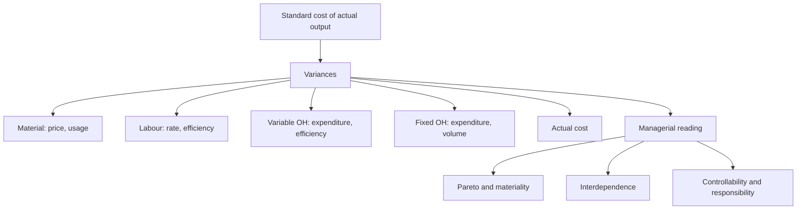

# SC-4: Integrated Variance Problem, Reconciliation and Investigation

Covers: one problem that runs all four cost elements together (material, labour, variable and fixed overhead) with a reconciliation of standard cost to actual cost, the managerial reading of variances (interdependence, controllability, investigation), and advantages and limitations of standard costing. **(syllabus)**

## Where this fits in the ESE

A full-length variance question gives a standard cost card and actuals and asks for all variances and a reconciliation. The syllabus phrase "for managerial control" is the interpretation half: who is responsible and what to investigate.

## Worked problem: all elements (hypothetical)

**Standard cost card per unit (Brightline Tools Ltd, fictional)**

| Element | Standard | ₹ |
|---|---|---|
| Direct material | 3 kg at ₹40 | 120 |
| Direct labour | 2 hours at ₹50 | 100 |
| Variable overhead | 2 hours at ₹10 | 20 |
| Fixed overhead | 2 hours at ₹10 (budget ₹1,00,000 for 5,000 units, 10,000 hours) | 20 |
| **Standard cost per unit** | | **260** |

**Actual results.** Output 4,800 units. Material 15,000 kg bought and used at ₹42 = ₹6,30,000. Labour 9,800 hours at ₹48 = ₹4,70,400 (no idle time). Variable overhead ₹1,02,000. Fixed overhead ₹1,04,000. Actual cost = 6,30,000 + 4,70,400 + 1,02,000 + 1,04,000 = **₹13,06,400**.

### Step 1. Standard cost of actual output

4,800 × 260 = **₹12,48,000**: material 5,76,000; labour 4,80,000; variable overhead 96,000; fixed overhead 96,000. Total cost variance = 12,48,000 − 13,06,400 = **₹58,400 A**.

### Step 2. Material

- SQ = 4,800 × 3 = 14,400 kg.
- Price = (40 − 42) × 15,000 = **₹30,000 A**.
- Usage = (14,400 − 15,000) × 40 = **₹24,000 A**.
- Check: 5,76,000 − 6,30,000 = 54,000 A = 30,000 + 24,000 ✓.

### Step 3. Labour

- SH = 4,800 × 2 = 9,600 hours.
- Rate = (50 − 48) × 9,800 = **₹19,600 F**.
- Efficiency = (9,600 − 9,800) × 50 = **₹10,000 A**.
- Check: 4,80,000 − 4,70,400 = 9,600 F = 19,600 − 10,000 ✓.

### Step 4. Variable overhead (₹10 per hour)

- Expenditure = (9,800 × 10) − 1,02,000 = **₹4,000 A**.
- Efficiency = (9,600 − 9,800) × 10 = **₹2,000 A**.
- Check: 96,000 − 1,02,000 = 6,000 A = 4,000 + 2,000 ✓.

### Step 5. Fixed overhead (₹10 per hour, ₹20 per unit)

- Expenditure = 1,00,000 − 1,04,000 = **₹4,000 A**.
- Volume = (4,800 − 5,000) × 20 = **₹4,000 A** (hours basis: (9,600 − 10,000) × 10 = 4,000 ✓).
- Check: 96,000 − 1,04,000 = 8,000 A = 4,000 + 4,000 ✓.

### Step 6. Reconciliation statement

| | ₹ | ₹ |
|---|---|---|
| **Standard cost of actual output** | | **12,48,000** |
| Material price | 30,000 A | |
| Material usage | 24,000 A | |
| Labour rate | 19,600 F | |
| Labour efficiency | 10,000 A | |
| Variable overhead expenditure | 4,000 A | |
| Variable overhead efficiency | 2,000 A | |
| Fixed overhead expenditure | 4,000 A | |
| Fixed overhead volume | 4,000 A | |
| **Net adverse variance** | | **58,400** |
| **Actual cost** | | **13,06,400** |

Check: 30,000 + 24,000 − 19,600 + 10,000 + 4,000 + 2,000 + 4,000 + 4,000 = 58,400 ✓. Actual cost per unit = 13,06,400 ÷ 4,800 = ₹272.17 against ₹260, a rise of 4.7%.

## Managerial reading

**1. Pareto.** The three largest variances are material price (₹30,000), material usage (₹24,000) and labour rate (₹19,600), together ₹73,600 of the gross variance of ₹97,600 (75%). Investigate these first.

**2. Interdependence (the key insight).**
- **Labour rate ₹19,600 F with efficiency ₹10,000 A:** wages were ₹2 per hour below standard but 200 extra hours were needed. Cheaper, less experienced labour saved rate and lost efficiency.
- **Material usage ₹24,000 A:** the same inexperienced workforce, or poor material, may also explain the 600 kg extra material.
- **Material price ₹30,000 A:** a 5% price rise (₹2 on ₹40) over standard; check whether the standard price is outdated.
- **Net effect:** labour saved ₹9,600 but material, efficiency and overhead lost far more. A favourable variance in one place can cause an adverse one in another; judge the net.

**3. Controllability.** Price: purchase manager (if market-driven, partly uncontrollable). Usage and efficiency: production manager. Fixed overhead volume: usually a sales or planning matter, because production was 4,800 against a budget of 5,000.

**4. When to investigate (management by exception).** Apply a rule such as: variance above a threshold in rupees or as a percentage of standard (for example 5%), a repeated adverse trend, or a variance with a clear controllable cause. Compare the cost of investigating with the expected benefit.

**5. When to revise standards.** If a variance is persistent and caused by a permanent change (input price rise, new process), revise the standard; do not keep reporting a known, uncontrollable variance.

## Advantages and limitations of standard costing

| Advantages | Limitations |
|---|---|
| Management by exception | Standards may be outdated in a fast-changing environment |
| Sets benchmarks and motivates | Setting and revising standards is costly |
| Eases budgeting, pricing and stock valuation | May focus on cost and efficiency, not quality or customer value |
| Pinpoints responsibility | Can encourage wrong behaviour (cheap inputs, ignoring downstream cost) |
| Reduces clerical work in costing | Less suited to non-repetitive or highly automated work |

## Traps

- Presenting variances without a reconciliation to the actual cost.
- Reading each variance alone. Link price and usage, rate and efficiency.
- Reporting an uncontrollable variance against a manager.
- Mixing up the fixed overhead bases: expenditure compares the budget amount with the actual amount; volume uses the standard rate on the difference in units or hours.

## What to remember

- Standard cost of actual output ₹12,48,000; actual ₹13,06,400; net variance ₹58,400 A.
- Material price ₹30,000 A, usage ₹24,000 A; labour rate ₹19,600 F, efficiency ₹10,000 A.
- Overhead: variable ₹4,000 A and ₹2,000 A; fixed ₹4,000 A and ₹4,000 A.
- Interpret in links: cheaper labour (rate F) lowers efficiency and may raise wastage.
- Reconcile, rank, assign responsibility, decide whether to investigate or revise the standard.

## Concept map

## Flashcards
Q: Brightline: standard cost per unit?
A: ₹260 (120 material + 100 labour + 20 variable overhead + 20 fixed overhead).

Q: Brightline: net total cost variance?
A: Standard 12,48,000 − actual 13,06,400 = ₹58,400 A.

Q: Brightline: material price and usage variances?
A: ₹30,000 A and ₹24,000 A.

Q: Brightline: labour rate and efficiency variances?
A: ₹19,600 F and ₹10,000 A.

Q: Brightline: fixed overhead variances?
A: Expenditure ₹4,000 A and volume ₹4,000 A, total ₹8,000 A.

Q: Why is a favourable labour rate variance not necessarily good?
A: It may reflect cheaper, less skilled labour, causing an adverse efficiency variance and extra material wastage.

Q: What is management by exception?
A: Investigating only significant variances (by amount, percentage or trend) rather than every difference.

Q: When should a standard be revised?
A: When a variance is persistent due to a permanent change, such as a lasting input price rise.

Q: Name two limitations of standard costing.
A: Standards become outdated in changing conditions, and a cost focus can neglect quality and customer value.

## Sources
- BBA305-6 syllabus, Unit 4 (standard costing and variance analysis for managerial control)
- Arora, *Cost and Management Accounting*; ICAI study material
- Previous: [[Management Accounting Unit 4 - SC-3 Overhead Variances]] · Next: [[Management Accounting Unit 4 - SC-5 Responsibility Accounting and Divisional Performance]]
- [[Management Accounting Unit 4 - Performance Measurement MOC (Node Map)]]
