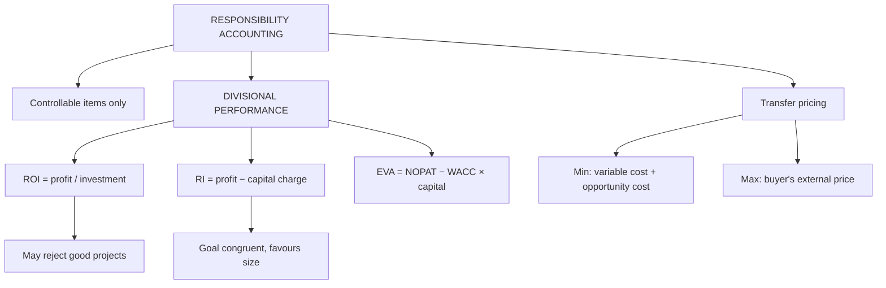

# SC-5: Responsibility Accounting and Divisional Performance Evaluation

Covers: the idea and principles of responsibility accounting, ROI, residual income and EVA with worked comparisons, why ROI and RI can disagree, and transfer pricing basics. **(syllabus)** The types of responsibility centre and their reports are in SR-3.

## Where this fits in the ESE

A 10-mark question on divisional performance usually gives investment and profit for two divisions and asks for ROI and RI with a recommendation. The ROI-versus-RI conflict example is the interpretation mark.

## Responsibility accounting

A system that collects, summarises and reports financial information **by responsibility centre**, so each manager is held accountable for items the manager can control. **(textbook)**

**Principles.**
1. Divide the organisation into responsibility centres with clear authority.
2. Hold managers accountable only for **controllable** items.
3. Set targets (budgets or standards) for each centre.
4. Report actual against target promptly and by exception.
5. Link evaluation and rewards to the report.

Variance analysis (SC-1 to SC-4) is its main tool: price variance goes to purchasing, usage and efficiency to production.

## Divisional performance measures

### Return on investment (ROI)

ROI = Divisional operating profit ÷ Divisional investment (capital employed) × 100

Du Pont form: ROI = Profit margin × Capital turnover. **Strengths:** simple, comparable across divisions of different size, one number. **Weakness:** a division with a high ROI may reject a project that is good for the company because it would lower the division's average (dysfunctional behaviour).

### Residual income (RI)

RI = Divisional operating profit − (Cost of capital × Divisional investment)

RI is a rupee amount. A division should accept any project with positive RI. **Strength:** better goal congruence. **Weakness:** favours large divisions (bigger capital gives bigger RI); needs a cost-of-capital rate.

### Economic Value Added (EVA)

EVA = NOPAT − (WACC × Capital employed). It is RI with adjustments (for example capitalising R&D) and a post-tax profit base. *Example:* NOPAT ₹2,40,000, WACC 12%, capital ₹15,00,000 gives EVA = 2,40,000 − 1,80,000 = **₹60,000**. **(textbook)**

## Worked example 1: ROI against RI (hypothetical)

A division has capital employed ₹10,00,000 and operating profit ₹2,00,000. The company's required rate of return is 15%. A new project needs ₹2,00,000 and will earn ₹36,000 a year.

| | Before | With project |
|---|---|---|
| Investment | 10,00,000 | 12,00,000 |
| Operating profit | 2,00,000 | 2,36,000 |
| **ROI** | **20.0%** | **19.67%** (2,36,000 ÷ 12,00,000) |
| Capital charge (15%) | 1,50,000 | 1,80,000 |
| **RI** | **50,000** | **56,000** |

- Project ROI = 36,000 ÷ 2,00,000 = **18%**, above the 15% required return.
- Project RI = 36,000 − (15% × 2,00,000) = 36,000 − 30,000 = **₹6,000**.

**Decision line.** The project earns 18% against a 15% required return, so it creates ₹6,000 of value and should be accepted. A manager judged on ROI would reject it because the divisional ROI falls from 20.0% to 19.67%. RI rises from ₹50,000 to ₹56,000, so an RI-based measure gives the right answer. This is the goal congruence argument for RI.

## Worked example 2: comparing two divisions (hypothetical)

Cost of capital 12%.

| | Division P | Division Q |
|---|---|---|
| Capital employed | 10,00,000 | 25,00,000 |
| Operating profit | 1,80,000 | 4,00,000 |
| **ROI** | **18.0%** | **16.0%** |
| Capital charge | 1,20,000 | 3,00,000 |
| **RI** | **60,000** | **1,00,000** |

**Reading.** P wins on ROI (18.0% against 16.0%) and Q wins on RI (₹1,00,000 against ₹60,000). Q earns more total value above the cost of capital because it is larger. Neither measure alone is enough: ROI shows efficiency in use of capital, RI shows absolute value created. Use both and judge against the division's size, risk and strategy.

## Transfer pricing basics

When one division sells to another, the **transfer price** determines each division's profit and affects decisions.

- **Minimum price (seller)** = Variable cost per unit + Opportunity cost (contribution lost by selling internally).
- **Maximum price (buyer)** = Lower of the net marginal revenue from the product and the external buying price.
- If minimum < maximum, transfer is good for the company. The actual price within the range decides the split of profit.

**Example (hypothetical).** Division A makes a component at variable cost ₹60. Division B can buy it externally at ₹80.
- If A has spare capacity: opportunity cost nil; minimum ₹60; maximum ₹80; transfer between ₹60 and ₹80.
- If A is at full capacity and can sell externally at ₹75 (net): minimum ₹75; transfer between ₹75 and ₹80.
- If B's external price were ₹70 and A is at full capacity: minimum ₹75 > maximum ₹70, so B should buy externally.

**Methods:** market price, cost-based (variable or full cost plus), negotiated, dual pricing. Transfer prices are also a source of ethical and tax issues (see FM-3).

## Behavioural implications

- Evaluation on controllable items only, or managers game the system.
- Short-term ROI pressure leads to cutting R&D, training or maintenance (SC-6).
- Divisions compete on transfer prices, harming goal congruence.
- Participation in setting targets improves acceptance.

## Traps

- Using total assets in one division and capital employed in another. Be consistent.
- Computing RI with a capital charge on profit instead of on investment.
- Recommending a division on ROI alone.
- Saying RI is always better: it favours large divisions.

## What to remember

- Responsibility accounting: control by centre, controllable items only.
- ROI = profit ÷ investment; RI = profit − required return on investment; EVA = NOPAT − WACC × capital.
- Project example: divisional ROI falls 20.0% to 19.67% but RI rises ₹50,000 to ₹56,000; accept (project ROI 18% above 15%).
- P: ROI 18%, RI ₹60,000; Q: ROI 16%, RI ₹1,00,000.
- Transfer price range: minimum (variable cost + opportunity cost) to maximum (buyer's external price).

## Concept map

## Flashcards
Q: Define responsibility accounting.
A: Reporting costs and revenues by responsibility centre so that each manager is held accountable for what the manager controls.

Q: ROI formula?
A: Divisional operating profit ÷ divisional investment × 100.

Q: Residual income formula?
A: Operating profit − (required rate of return × investment).

Q: Why may ROI lead to a wrong decision?
A: A manager with a high ROI may reject a project that earns more than the cost of capital but less than the division's current ROI.

Q: Project: ₹2,00,000 earning ₹36,000, required return 15%. RI?
A: 36,000 − 30,000 = ₹6,000, so accept.

Q: In that example, divisional ROI before and after?
A: 20.0% and 19.67%, although RI rises from ₹50,000 to ₹56,000.

Q: P and Q: which ranks higher on ROI and on RI?
A: P on ROI (18.0% vs 16.0%); Q on RI (₹1,00,000 vs ₹60,000).

Q: EVA formula?
A: NOPAT − (WACC × capital employed).

Q: Transfer price range for a division with spare capacity?
A: From the variable cost per unit up to the buyer's external purchase price.

Q: Weakness of RI?
A: It favours larger divisions and needs an agreed cost-of-capital rate.

## Sources
- BBA305-6 syllabus, Unit 4 (responsibility accounting and divisional performance evaluation)
- Arora, *Cost and Management Accounting*; Khan & Jain
- Previous: [[Management Accounting Unit 4 - SC-4 Integrated Variance Problem and Investigation]] · Next: [[Management Accounting Unit 4 - SC-6 Balanced Scorecard and KPIs]]
- [[Management Accounting Unit 4 - Performance Measurement MOC (Node Map)]]
