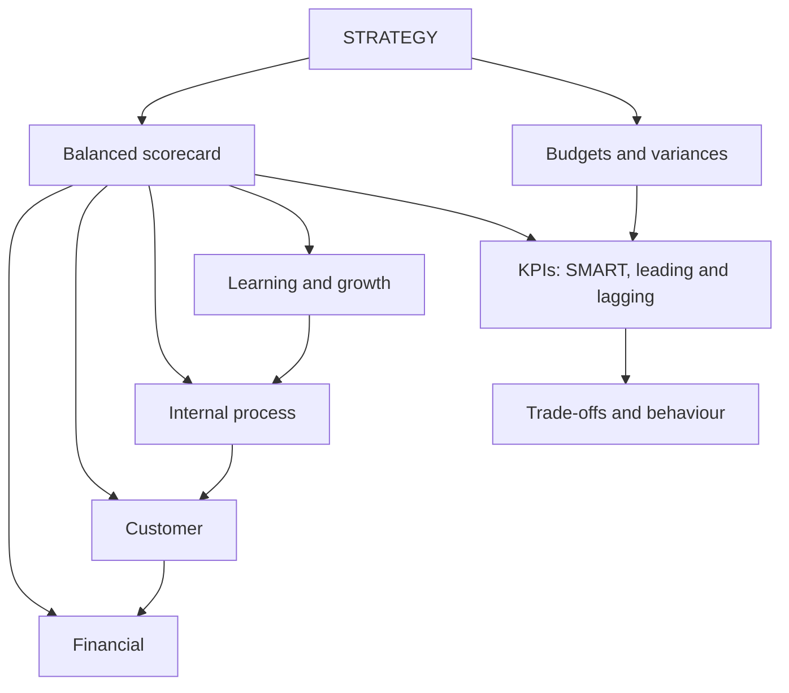

# SC-6: Balanced Scorecard, KPIs and the Link to Strategy

Covers: the four perspectives of the balanced scorecard, KPI design, how budgets and variances connect to strategy, short-term against long-term trade-offs and behavioural implications of measurement. **(syllabus)**

## Where this fits in the ESE

The balanced scorecard (BSC) is a predictable 5-mark or 10-mark theory answer and appears in the case as "suggest measures". The syllabus also names strategic use of information, short-term against long-term trade-offs and behavioural implications, so a good answer links measures to strategy and to behaviour.

## Balanced scorecard

A BSC (Kaplan and Norton) translates strategy into a balanced set of financial and non-financial measures across four perspectives. **(textbook)**

| Perspective | Key question | Example measures |
|---|---|---|
| Financial | How do we look to shareholders? | ROCE, EVA, revenue growth, cash flow |
| Customer | How do customers see us? | Customer satisfaction, on-time delivery, retention, market share |
| Internal business process | What must we excel at? | Defect rate, cycle time, yield, utilisation |
| Learning and growth | Can we keep improving? | Training hours, employee turnover, new-skill coverage, innovation rate |

**Cause-and-effect chain (strategy map).** Training and skills (learning) improve process quality (internal), which raises on-time delivery and satisfaction (customer), which raises revenue and ROCE (financial). Measures should be linked in a chain, not listed.

**Why "balanced":** between financial and non-financial, short- and long-term, lagging and leading, internal and external measures.

**Leading and lagging.** Lagging indicators report results (profit); leading indicators predict them (customer complaints, training hours, order backlog).

## Key performance indicators (KPIs)

A KPI is a measure tied to a critical success factor of the strategy. Good KPIs are **SMART**: specific, measurable, achievable, relevant, time-bound. Keep the number small (a handful per perspective), with an owner, a target, a frequency and a data source.

**Common KPIs by function (examples).** Production: yield, defect rate, OEE. Sales: sales growth, collection days. Finance: ROCE, current ratio, cash conversion. HR: attrition, training hours. Sustainability: emissions intensity, water use (Unit 5).

## Linking budgets, variances and metrics to strategy

1. Strategy sets objectives in each perspective.
2. **Budgets** convert them into targets and resource plans.
3. **Variances** (SC-1 to SC-4) explain deviations in cost and efficiency.
4. **KPIs and the scorecard** show whether the strategy is working; variances are measures within the internal process and financial perspectives.
5. Reviews feed back into strategy (revise targets, standards, plans).

## Worked example: weighted scorecard (hypothetical)

A manufacturer (fictional) assigns weights and scores each perspective by achievement against target, capped at 100%. For measures where lower is better, achievement = target ÷ actual.

| Perspective | KPI | Weight | Target | Actual | Achievement | Weighted score |
|---|---|---|---|---|---|---|
| Financial | ROCE | 30% | 18.0% | 16.5% | 16.5 ÷ 18 = 91.67% | 27.50 |
| Customer | On-time delivery | 25% | 95% | 92% | 92 ÷ 95 = 96.84% | 24.21 |
| Internal process | Defect rate (lower is better) | 25% | 2.0% | 2.5% | 2.0 ÷ 2.5 = 80.00% | 20.00 |
| Learning and growth | Training hours per employee | 20% | 40 | 44 | 110% capped at 100% | 20.00 |
| **Total** | | 100% | | | | **91.71** |

**Reading.** The overall score of **91.71** hides the weak spot: the internal-process defect rate (80% achievement) is the lowest and likely drives both delivery slippage and the ROCE gap. Learning and growth is on target, so the problem is not training volume; examine training quality, process design or supplier material. The scorecard directs attention; it does not give the answer.

## Short-term against long-term trade-offs

Managers judged on this year's profit can cut R&D, training, maintenance or marketing to meet it. *Example (hypothetical):* capital employed ₹10 crore and EBIT ₹1.8 crore give ROCE 18.0%. Cutting ₹20 lakh of discretionary R&D and training raises EBIT to ₹2.0 crore and ROCE to **20.0%** this year, while eroding the pipeline and skills that earn future profit. **Safeguards:** balanced scorecard measures, multi-year targets, rewards that include long-term and non-financial indicators.

## Behavioural implications of performance measurement

- **What gets measured gets done:** narrow measures cause gaming (rushing deliveries, cutting quality).
- **Unfair or uncontrollable measures** reduce motivation (hold managers to controllable items).
- **Too many KPIs** dilute focus.
- **Incentive links:** linking pay to a measure intensifies both effort and manipulation; combine financial, non-financial and ethical conduct.
- **Participation** in setting targets raises commitment.
- **Fit with strategy:** a cost leader and a differentiator need different scorecards.

## Limitations of the BSC

Time and cost to build; subjective weights; difficult to quantify cause-effect links; risk of too many measures; needs top-management commitment and regular revision.

## Traps

- Listing the four perspectives with no measure or linkage.
- Treating the BSC as a financial report. Its point is the non-financial, leading measures.
- A scorecard with 30 KPIs. Keep it short.
- Averaging achievements without weights or capping, which lets over-achievement hide a failure.

## What to remember

- Four perspectives: financial, customer, internal process, learning and growth, linked as a cause-and-effect chain.
- KPIs are SMART, few, with owners and targets; mix leading and lagging.
- Example score 91.71, with the defect rate (80%) the weak link.
- Short-term pressure can lift ROCE from 18.0% to 20.0% by cutting the future.
- Link: strategy, budget, variances, KPIs, review.

## Concept map

## Flashcards
Q: Name the four perspectives of the balanced scorecard.
A: Financial, customer, internal business process, learning and growth.

Q: What does the cause-and-effect chain of a BSC show?
A: How learning and growth improve internal processes, which improve customer outcomes, which improve financial results.

Q: What does SMART stand for in KPI design?
A: Specific, measurable, achievable, relevant, time-bound.

Q: Difference between leading and lagging indicators?
A: Lagging indicators report results (profit); leading indicators predict them (complaints, training hours).

Q: Scorecard example: achievement for defect rate target 2.0%, actual 2.5%?
A: 2.0 ÷ 2.5 = 80% (lower is better, so target over actual).

Q: Scorecard example: total weighted score?
A: 27.50 + 24.21 + 20.00 + 20.00 = 91.71.

Q: How can short-term profit targets harm the long term?
A: Managers may cut R&D, training or maintenance to lift this year's ROCE (18.0% to 20.0% in the example) at the cost of future earnings.

Q: Name two behavioural risks of performance measures.
A: Gaming (manipulating the measure) and demotivation from uncontrollable or unfair measures.

Q: How do variances connect to the balanced scorecard?
A: They are measures within the internal process and financial perspectives, explaining cost and efficiency deviations from standard.

## Sources
- BBA305-6 syllabus, Unit 4 (balanced scorecard and KPIs; linking performance measurement with strategy)
- Kaplan & Norton, balanced scorecard framework; Arora, *Cost and Management Accounting*
- Previous: [[Management Accounting Unit 4 - SC-5 Responsibility Accounting and Divisional Performance]] · Next: [[Management Accounting Unit 4 - SC-7 Unit 4 Exam Answers]]
- [[Management Accounting Unit 4 - Performance Measurement MOC (Node Map)]]
