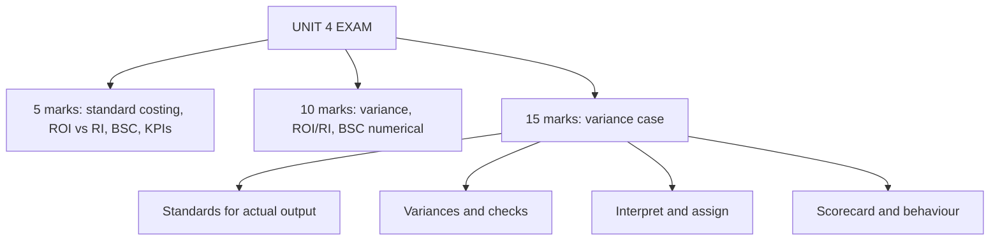

# SC-7: Unit 4 Exam Answers

Covers: a one-page variance formula sheet, 5-mark and 10-mark skeletons for Unit 4, and a 15-mark case layout with a model answer on variances and the balanced scorecard. **(syllabus)**

## Paper pattern

Section A: 3 questions with choice, 5 marks each. Section B: 2 questions with choice, 10 marks each. Section C: one compulsory 15-mark case. Unit 4 (10 hours) is the most likely source of a Section B numerical (variances or ROI/RI) and of the case.

## One-page variance sheet (sign: standard − actual, positive = favourable)

| Family | Variance | Formula |
|---|---|---|
| Material | Cost | Std cost of actual output − Actual cost |
| | Price | (SP − AP) × AQ |
| | Usage | (SQ − AQ) × SP |
| | Mix | (RSQ − AQ) × SP |
| | Yield | (SQ − RSQ) × SP |
| Labour | Cost | Std cost of actual output − Actual cost |
| | Rate | (SR − AR) × hours paid |
| | Efficiency | (SH − hours worked) × SR |
| | Idle time | Idle hours × SR |
| | Mix / Yield | (RSH − worked) × SR / (SH − RSH) × SR |
| Variable OH | Expenditure | (Actual hours × rate) − Actual VOH |
| | Efficiency | (SH − Actual hours) × rate |
| Fixed OH | Expenditure | Budgeted FOH − Actual FOH |
| | Volume | (SH − Budgeted hours) × rate |
| | Efficiency / Capacity / Calendar | (SH − AH) × rate / (AH − RBH) × rate / (RBH − BH) × rate |

**Checks:** Price + Usage = Cost; Mix + Yield = Usage; Rate + Efficiency + Idle = Labour cost; Expenditure + Efficiency = VOH total; Expenditure + Volume = FOH total; Efficiency + Capacity + Calendar = Volume.

## 5-mark skeletons

**1. Standard costing: meaning, advantages, limitations.** Definition (1), types of standard (1), advantages (2), limitations (1).

**2. Distinguish budgetary control and standard costing.** Table of five rows: basis (total vs unit), scope, use, variance, time.

**3. Explain material price and usage variance with formulas.** Both formulas (2), one example (2), causes and responsibility (1).

**4. Responsibility accounting.** Meaning, principles (controllable items), centres, reports.

**5. ROI vs residual income.** Formulas (2), advantages and weakness of each (2), the project-rejection example (1).

**6. Balanced scorecard.** Four perspectives (2), measures (1), cause-effect chain (1), benefit (1).

**7. KPIs.** Definition, SMART, leading and lagging, examples by function.

**8. Short-term vs long-term trade-offs in performance measurement.** Example (cutting R&D), effect, safeguards.

## 10-mark skeletons

**A. Material and labour variances numerical (SC-1, SC-2).**
1. Standards for actual output: SQ, SH, standard cost (1).
2. Material price, usage (and mix, yield if asked) with table (3).
3. Labour rate, idle time, efficiency (and mix, yield) with table (3).
4. Check: sub-variances equal totals (1).
5. Two lines of interpretation, including interdependence (2).

**B. Overhead variances numerical (SC-3).** Rates and bases (2); variable overhead pair with check (2); fixed overhead expenditure and volume with its split and check (4); interpretation (2).

**C. Divisional performance (SC-5).** ROI and RI for each division (4); contradiction between them (2); the project decision with project ROI and RI (2); recommendation (2).

**D. Balanced scorecard and strategy (SC-6).** Four perspectives with measures for a stated business (4); cause-and-effect chain (2); behavioural implications and short- vs long-term (3); limitations (1).

## 15-mark case layout

1. **Restate** the issue and the user in two lines (1).
2. **Compute** the variances needed, with the check (6).
3. **Interpret**: links between variances, controllability, who is responsible (3).
4. **Recommend**: what to investigate, whether to revise standards (2).
5. **Performance system**: suggest scorecard measures and behavioural cautions (3).

## Model answer (illustrative)

**Case.** Orchid Tools Ltd (fictional) has a standard cost per unit of material 4 kg at ₹25 = ₹100 and labour 3 hours at ₹40 = ₹120. It made 2,000 units. It bought and used 8,400 kg at ₹24 (₹2,01,600). Labour paid was 6,300 hours at ₹42 (₹2,64,600), including 200 idle hours. The purchase manager says he beat the price target; the production manager says the material was poor.

**1. Restate.** Find which variances explain the overrun and who owns them.

**2. Compute.**
- Standard: material 2,000 × 100 = ₹2,00,000 (SQ 8,000 kg); labour 2,000 × 120 = ₹2,40,000 (SH 6,000 hours); total ₹4,40,000.
- Actual: material ₹2,01,600; labour ₹2,64,600; total ₹4,66,200. Total variance = 4,40,000 − 4,66,200 = **₹26,200 A**.
- Hours worked = 6,300 − 200 = 6,100.

| Variance | Working | ₹ |
|---|---|---|
| Material price | (25 − 24) × 8,400 | 8,400 F |
| Material usage | (8,000 − 8,400) × 25 | 10,000 A |
| **Material cost** | 2,00,000 − 2,01,600 | **1,600 A** ✓ |
| Labour rate | (40 − 42) × 6,300 | 12,600 A |
| Idle time | 200 × 40 | 8,000 A |
| Labour efficiency | (6,000 − 6,100) × 40 | 4,000 A |
| **Labour cost** | 2,40,000 − 2,64,600 | **24,600 A** ✓ |

Checks: 8,400 − 10,000 = −1,600 ✓; 12,600 + 8,000 + 4,000 = 24,600 ✓; 1,600 + 24,600 = 26,200 ✓.

**3. Interpret.**
- The ₹8,400 price gain was cancelled by ₹10,000 of extra usage: 400 kg (5%) above the 8,000 kg standard. Both managers are partly right: cheaper material may be lower grade, causing the extra usage. The net material result is ₹1,600 A.
- Labour is 94% of the overrun (24,600 ÷ 26,200). The rate premium of ₹2 per hour (5%) suggests overtime or a wage settlement. Idle time of 200 hours (3.2% of hours paid) needs a cause: if the cheaper material delayed production, the purchase decision is linked to the idle time.
- Efficiency is a modest ₹4,000 A (100 hours, 1.7% over standard).

**4. Recommend.** Investigate idle time and the rate premium first (₹20,600 of the ₹26,200). Test the purchased material's quality against the usage overrun; consider revising the standard price only if the cheaper grade is to be kept. Hold the purchase and production managers jointly accountable for the material result, not separately.

**5. Performance system.** Scorecard measures: Financial: cost per unit, ROCE. Customer: on-time delivery. Internal process: material yield, idle hours, rework rate. Learning and growth: training hours, multi-skilling. Caution: if the purchase manager is rewarded only on price, he will buy cheap and push cost downstream; add quality and usage measures to his scorecard.

## Common mark-losers

- No standards for actual output computed first (SQ, SH).
- No check that sub-variances add up.
- Signs reversed, or F/A missing.
- Variances without an interpretation or a responsible manager.
- Balanced scorecard answers that list perspectives with no measures.

## What to remember

- Compute standards for actual output first; then variances; then check; then interpret.
- Link variances: price with usage, rate with efficiency and idle time.
- ROI vs RI and BSC answers need examples and a decision.
- Orchid: material ₹1,600 A (price 8,400 F, usage 10,000 A); labour ₹24,600 A (rate 12,600 A, idle 8,000 A, efficiency 4,000 A); total ₹26,200 A.

## Concept map

## Flashcards
Q: First step in any variance numerical?
A: Compute the standard quantity or hours for actual output (and the standard cost of actual output).

Q: Orchid: material price and usage variances?
A: ₹8,400 F and ₹10,000 A; net ₹1,600 A.

Q: Orchid: labour rate, idle and efficiency variances?
A: ₹12,600 A, ₹8,000 A and ₹4,000 A; net ₹24,600 A.

Q: Orchid: total variance and the labour share?
A: ₹26,200 A, of which labour is 94% (24,600 ÷ 26,200).

Q: Which variances should Orchid investigate first?
A: Idle time and the rate premium (₹20,600 of the ₹26,200).

Q: Why might the purchase manager's price gain be misleading?
A: Cheaper material can cause extra usage (400 kg here) or delays, so the net result is an adverse ₹1,600.

Q: Name the six variance checks.
A: Price + usage = cost; mix + yield = usage; rate + efficiency + idle = labour cost; VOH expenditure + efficiency = total; FOH expenditure + volume = total; efficiency + capacity + calendar = volume.

Q: Layout for a Unit 4 case?
A: Restate, compute with checks, interpret and assign, recommend, suggest scorecard measures with behavioural cautions.

## Sources
- BBA305-6 syllabus, Unit 4 and ESE pattern
- [[Management Accounting Unit 4 - SC-1 Standard Costing and Material Variances]] · [[Management Accounting Unit 4 - SC-2 Labour Variances]] · [[Management Accounting Unit 4 - SC-3 Overhead Variances]] · [[Management Accounting Unit 4 - SC-4 Integrated Variance Problem and Investigation]] · [[Management Accounting Unit 4 - SC-5 Responsibility Accounting and Divisional Performance]] · [[Management Accounting Unit 4 - SC-6 Balanced Scorecard and KPIs]]
- [[Management Accounting Unit 4 - Performance Measurement MOC (Node Map)]]
