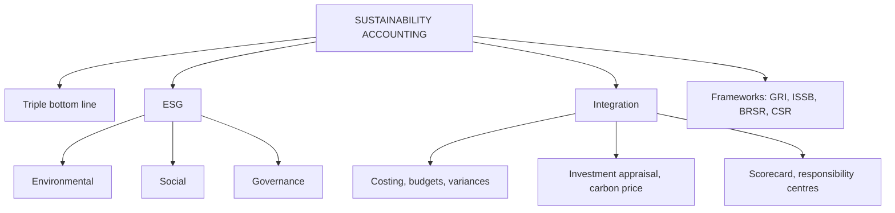

# SR-1: Sustainability Accounting, Concept, Scope and ESG Integration

Covers: what sustainability accounting is, the triple bottom line and ESG pillars, how ESG is built into management accounting tools, the main reporting frameworks in brief, and a worked example of the hidden cost of waste. **(syllabus)**

## Where this fits in the ESE

Unit 5 is CO5 and carries the "Sustainability" cross-cutting tag. Expect a 5-mark "Explain sustainability accounting and its scope" or "How can ESG be integrated into management accounting?" and a share of the 15-mark case. The theory answers are won with structure and one example.

## Concept

**Sustainability accounting** identifies, measures, analyses and reports the environmental, social and economic impacts of an organisation, for internal decisions and external stakeholders. Management accounting uses it to put numbers on things that conventional accounts ignore or bury in overheads. **(textbook)**

- **Triple bottom line:** people, planet, profit. Performance is judged on social and environmental results alongside financial.
- **ESG:** Environmental (emissions, energy, water, waste, biodiversity), Social (employees, safety, diversity, community, supply chain, customers), Governance (board, ethics, anti-corruption, transparency, risk management).
- **Sustainability vs financial accounting:** financial accounting records transactions in rupees for investors; sustainability accounting uses both monetary and physical units (tonnes, kilowatt-hours, litres, injury rates) and a wider set of stakeholders.

## Scope

1. **Environmental management accounting:** costs of energy, water, waste, emissions, compliance, remediation.
2. **Social accounting:** employee welfare, health and safety, training, community and CSR spend, human rights in the supply chain.
3. **Governance information:** ethics, board structure, controls.
4. **Sustainability performance indicators** (SR-2) and **reporting** (internal and external).
5. **Decision support:** investment appraisal with carbon prices, life cycle costing, sustainable product design.

## Integrating ESG into management accounting systems

| Management accounting tool | ESG integration |
|---|---|
| Costing | Separate environmental costs from general overhead; material flow cost accounting traces waste as a cost; life cycle costing |
| Budgeting | Environmental and social budgets (energy, waste, emissions, safety targets) next to financial budgets |
| Standard costing | Standards for energy per unit, scrap rate, water per unit |
| Variance analysis | Variances in waste, yield and energy use |
| Capital budgeting | Internal carbon price in appraisal; sustainability-linked benefits and risks |
| Performance measurement | Balanced scorecard with ESG measures; KPIs on emissions, safety, diversity |
| Responsibility accounting | Assign emission or waste targets to centres (SR-3, SR-4) |
| Pricing and product mix | Cost of environmental impact in pricing; products ranked by net value including externalities |
| Reporting | ESG data collection and assurance for BRSR / ISSB-type reports |

## Frameworks in brief

- **GRI (Global Reporting Initiative):** standards for reporting impacts on economy, environment and people.
- **SASB / ISSB (IFRS S1 and S2):** sustainability and climate-related disclosures for investors. **[VERIFY India adoption status]**
- **BRSR (Business Responsibility and Sustainability Report):** SEBI-mandated report for the top 1,000 listed companies by market capitalisation from FY 2022-23, with a core set of indicators phased in for assurance. **[VERIFY thresholds and phase-in]**
- **Companies Act 2013, s.135 (CSR):** companies above the thresholds spend at least 2% of average net profit of the preceding three years on CSR. **[VERIFY thresholds]**
- **UN SDGs** as the common goal map.

## Worked example: the hidden cost of waste (hypothetical)

A manufacturer (fictional) buys ₹5 crore of raw material a year. About 6% ends as waste. Waste handling and disposal cost ₹1,00,000 for each percentage point of waste. A process change cuts waste to 4%, with the same purchases.

**Step 1. Cost of waste now.**
- Material lost = 6% × 5,00,00,000 = ₹30,00,000.
- Handling = 6 × 1,00,000 = ₹6,00,000.
- Total = **₹36,00,000** (usually buried in product cost and overhead).

**Step 2. Cost of waste after the change.**
- Material lost = 4% × 5,00,00,000 = ₹20,00,000.
- Handling = 4 × 1,00,000 = ₹4,00,000.
- Total = **₹24,00,000**.

**Step 3. Saving** = 36,00,000 − 24,00,000 = **₹12,00,000** a year, 2.4% of material spend.

**Decision line.** Making waste visible as a cost (material flow cost accounting) shows a ₹12 lakh annual benefit that ordinary costing hides. Add the unmeasured gains: lower emissions, less landfill, lower regulatory risk. Sustainability and profitability align here.

## Traps

- Defining sustainability accounting as only environmental. It includes social and governance.
- Treating CSR spend as the whole of sustainability accounting.
- Citing frameworks without verifying thresholds and dates. Tag as [VERIFY] if not sure.
- Presenting ESG as a pure cost. Waste, energy and risk reductions have a financial return.

## What to remember

- Sustainability accounting: environmental, social and economic impact, measured in money and physical units.
- ESG: Environmental, Social, Governance; triple bottom line: people, planet, profit.
- Integrate into costing, budgeting, variances, investment appraisal, scorecards and reporting.
- Waste example: ₹36,00,000 now, ₹24,00,000 after, saving ₹12,00,000.
- Frameworks to name: GRI, ISSB, BRSR, CSR (s.135), SDGs.

## Concept map

## Flashcards
Q: Define sustainability accounting.
A: Identifying, measuring, analysing and reporting the environmental, social and economic impacts of an organisation for decisions and stakeholders.

Q: What does ESG stand for and what does each pillar cover?
A: Environmental (emissions, energy, water, waste), Social (people, safety, community), Governance (board, ethics, controls).

Q: What is the triple bottom line?
A: People, planet and profit: social, environmental and financial performance.

Q: How do sustainability and financial accounting differ in units?
A: Financial uses rupees; sustainability uses rupees plus physical units such as tonnes, kWh, litres and injury rates.

Q: Name three ways to integrate ESG into management accounting.
A: Separate environmental costs in costing, set environmental budgets and standards, and use an internal carbon price in investment appraisal (also scorecards and responsibility centres).

Q: Waste example: total cost of waste at 6%?
A: ₹30,00,000 material + ₹6,00,000 handling = ₹36,00,000.

Q: Waste example: annual saving when waste falls to 4%?
A: 36,00,000 − 24,00,000 = ₹12,00,000.

Q: Which Indian report is SEBI-mandated for top listed companies?
A: The Business Responsibility and Sustainability Report (BRSR) [VERIFY thresholds].

Q: What does Companies Act s.135 require?
A: Eligible companies to spend at least 2% of average net profit of the last three years on CSR [VERIFY thresholds].

## Sources
- BBA305-6 syllabus, Unit 5 (sustainability accounting concept, scope, integration of ESG)
- Hansen & Mowen, *Cost Management*; Arora; GRI, ISSB, SEBI BRSR circulars **[VERIFY dates and thresholds]**
- Previous: [[Management Accounting Unit 4 - SC-7 Unit 4 Exam Answers]] · Next: [[Management Accounting Unit 5 - SR-2 Environmental and Social Costs and Sustainability Indicators]]
- [[Management Accounting Unit 5 - Sustainability and Responsibility MOC (Node Map)]]
