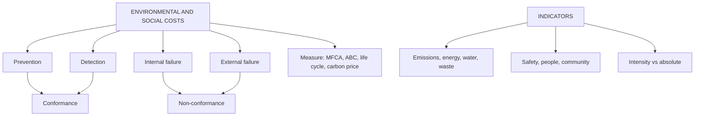

# SR-2: Environmental and Social Costs, and Sustainability Performance Indicators

Covers: classifying environmental costs, identifying and measuring environmental and social costs, sustainability indicators (emissions, energy, water, waste, safety, people), and worked examples on an environmental cost report, emission intensity and an internal carbon price. **(syllabus)**

## Where this fits in the ESE

This is the most numerical node of Unit 5. A 5-mark or 10-mark question may ask to classify and compute an environmental cost report or an intensity ratio. The classification and the break-even carbon price are the points most likely to be tested.

## Environmental costs

The four-way classification (Hansen and Mowen) **(textbook)**:

| Category | Meaning | Examples |
|---|---|---|
| Prevention | Costs to avoid environmental damage | Cleaner technology, environmental training, supplier screening, ISO 14001 |
| Detection (appraisal) | Costs to find damage or check compliance | Monitoring, audits, testing, reporting |
| Internal failure | Waste handled before release | Waste treatment, disposal, rework, scrap |
| External failure | Damage after release into the environment | Clean-up, fines, remediation, compensation, lost goodwill |

Prevention and detection are the **cost of conformance**; internal and external failure are the **cost of non-conformance**. Raising prevention spending usually lowers failure costs by more.

**Private vs societal costs.** Private costs are paid by the firm. **Externalities** (air pollution, health effects) fall on society. Management accounting identifies them to see future liability.

## Social costs

Employee welfare and wages, health and safety, training and development, community spend and CSR, product safety, supply-chain labour standards, and costs of social failures (accidents, strikes, litigation, loss of licence to operate). **(textbook)**

## Identifying and measuring

1. **Identify** environmental and social costs hidden in overheads (energy, waste, compliance, safety).
2. **Trace** them to products or processes: direct tracing, activity-based costing, material flow cost accounting (tracks material in physical and monetary terms, showing waste as a cost).
3. **Life cycle costing:** include costs from design through use to disposal.
4. **Value externalities (where needed):** avoided cost, replacement cost, damage cost, or a shadow price per unit (for example an internal carbon price).
5. **Social value:** social return on investment (SROI) compares the monetised social benefit with the spend. **[VERIFY method details if the faculty teaches a specific one]**
6. **Report** with units and a trend; keep the measurement method consistent.

## Sustainability performance indicators

| Area | Indicator |
|---|---|
| Emissions | GHG in tCO₂e: Scope 1 (direct), Scope 2 (purchased energy), Scope 3 (value chain); intensity per ₹ crore of revenue |
| Energy | kWh per unit; share of renewable energy |
| Water | Withdrawal per unit; % recycled |
| Waste | Waste per unit; % recycled or reused |
| Safety | Lost-time injury frequency rate, fatalities |
| People | Training hours per employee, attrition, gender diversity, pay ratio |
| Community | CSR spend as % of net profit, beneficiaries |
| Governance | Board independence, ethics complaints resolved, supplier code compliance |
| Financial link | Environmental cost as % of sales, green capex, energy cost savings |

**Absolute vs intensity.** Absolute emissions show total impact; intensity shows efficiency and lets you compare firms of different size. Growth can raise absolute emissions while intensity falls.

## Worked example 1: environmental cost report (hypothetical)

A plant (fictional) records its environmental costs for the year against sales of ₹60,00,000.

| Category | Cost (₹) | % of total | % of sales |
|---|---|---|---|
| Prevention | 1,20,000 | 20.0% | 2.0% |
| Detection | 80,000 | 13.3% | 1.3% |
| Internal failure | 1,50,000 | 25.0% | 2.5% |
| External failure | 2,50,000 | 41.7% | 4.2% |
| **Total** | **6,00,000** | **100%** | **10.0%** |

Conformance cost = 1,20,000 + 80,000 = ₹2,00,000 (33.3%); non-conformance = 1,50,000 + 2,50,000 = ₹4,00,000 (66.7%).

**Proposal.** Spend an extra ₹1,00,000 on prevention (cleaner process), expected to cut failure costs by ₹3,00,000.
- New total = 6,00,000 + 1,00,000 − 3,00,000 = ₹4,00,000, or 6.7% of sales.
- Net saving = 3,00,000 − 1,00,000 = **₹2,00,000**.

**Decision line.** Two-thirds of environmental cost is failure cost. Shifting money to prevention returns ₹3 of failure cost avoided for each ₹1 spent. Approve, and track the failure costs to confirm the saving. The external failure figure understates true societal cost.

## Worked example 2: emission intensity (hypothetical)

| | Last year | This year |
|---|---|---|
| Scope 1 (tCO₂e) | 3,300 | 3,000 |
| Scope 2 (tCO₂e) | 5,500 | 5,000 |
| **Total (tCO₂e)** | **8,800** | **8,000** |
| Revenue (₹ crore) | 220 | 250 |
| **Intensity (tCO₂e per ₹ crore)** | **40.0** | **32.0** |

- Absolute change = (8,000 − 8,800) ÷ 8,800 = **−9.1%**.
- Intensity change = (32 − 40) ÷ 40 = **−20.0%**.
- Revenue grew (250 − 220) ÷ 220 = **13.6%**.

**Interpretation.** Revenue grew 13.6% while emissions fell 9.1%: the company has decoupled growth from emissions. State both measures, because intensity alone could hide rising absolute emissions in another year. Scope 3 is not included; disclose that.

## Worked example 3: internal carbon price in an investment choice (hypothetical)

Two machines serve the same purpose. Option 1: annual cost ₹40 lakh, emits 1,200 tCO₂e. Option 2: annual cost ₹44 lakh, emits 600 tCO₂e. The internal carbon price is ₹5,000 per tCO₂e.

| | Option 1 | Option 2 |
|---|---|---|
| Annual cost (₹ lakh) | 40 | 44 |
| Emissions (tCO₂e) | 1,200 | 600 |
| Carbon charge at ₹5,000 (₹ lakh) | 60 | 30 |
| **Carbon-adjusted cost (₹ lakh)** | **100** | **74** |

Extra cost of Option 2 = 4 lakh for 600 t saved, so the **break-even carbon price** = 4,00,000 ÷ 600 = **₹667 per tCO₂e**.

**Decision line.** Option 2 wins by ₹26 lakh a year at ₹5,000 per tonne. It also wins at any carbon price above ₹667, so the choice is robust to the exact price used. The carbon price is an internal planning assumption, not a payment.

## Traps

- Putting detection costs under failure. Detection is conformance.
- Quoting intensity without absolute emissions, or the reverse.
- Treating the internal carbon charge as an accounting expense in the statutory books.
- Forgetting scope boundaries (Scope 3 excluded).
- Calling a failure cost avoided a "profit" without verifying it.

## What to remember

- Four environmental cost categories; conformance (prevention + detection) vs non-conformance (internal + external failure).
- Cost report: ₹6,00,000, 10% of sales, 66.7% failure cost; the proposal saves ₹2,00,000.
- Emissions: 8,800 to 8,000 t (−9.1%); intensity 40 to 32 (−20.0%) while revenue is +13.6%.
- Carbon price: Option 2 adjusted cost 74 vs 100 lakh; break-even ₹667 per tonne.
- Indicators span emissions, energy, water, waste, safety, people, community and governance.

## Concept map

## Flashcards
Q: Name the four categories of environmental cost.
A: Prevention, detection (appraisal), internal failure and external failure.

Q: Which categories are costs of conformance?
A: Prevention and detection; internal and external failure are costs of non-conformance.

Q: Environmental cost report: total and percentage of sales?
A: ₹6,00,000, 10% of sales of ₹60,00,000.

Q: In that report, what share is failure cost?
A: (1,50,000 + 2,50,000) ÷ 6,00,000 = 66.7%.

Q: Extra ₹1,00,000 prevention cuts failure cost by ₹3,00,000. Net saving?
A: ₹2,00,000.

Q: Scopes 1, 2 and 3 of the GHG Protocol?
A: Scope 1 direct emissions; Scope 2 purchased energy; Scope 3 other value-chain emissions.

Q: Emission example: change in absolute emissions and intensity?
A: Absolute −9.1% (8,800 to 8,000 t); intensity −20.0% (40 to 32 t per ₹ crore).

Q: What is material flow cost accounting?
A: Tracking material flows in physical and monetary terms so waste is costed as a loss of material, energy and handling.

Q: Carbon example: carbon-adjusted cost of Option 1 and Option 2?
A: ₹100 lakh and ₹74 lakh at ₹5,000 per tonne.

Q: Break-even carbon price in the example?
A: ₹4,00,000 extra cost ÷ 600 tonnes saved = ₹667 per tCO₂e.

## Sources
- BBA305-6 syllabus, Unit 5 (environmental and social costs; sustainability performance indicators)
- Hansen & Mowen, *Cost Management*; GHG Protocol; GRI standards
- Previous: [[Management Accounting Unit 5 - SR-1 Sustainability Accounting Concept and ESG Integration]] · Next: [[Management Accounting Unit 5 - SR-3 Responsibility Accounting and Responsibility Centres]]
- [[Management Accounting Unit 5 - Sustainability and Responsibility MOC (Node Map)]]
