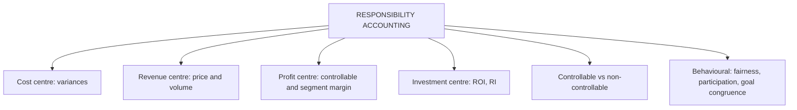

# SR-3: Responsibility Accounting and Responsibility Centres

Covers: objectives and design of responsibility accounting, the four centre types with their measures, controllable and non-controllable items, performance reports with worked examples, and behavioural aspects. **(syllabus)** SC-5 covers ROI, RI and transfer pricing; this node covers the centre structure and reports.

## Where this fits in the ESE

A 5-mark "Explain responsibility centres" is near certain in Unit 5; a 10-mark question may add a performance report. The syllabus lists cost, revenue, profit and investment centres by name.

## Concept and objectives

Responsibility accounting assigns accounting information to the **manager who can control it**, so performance is measured by what the manager can influence. **(textbook)**

**Objectives:** define who is accountable for what; give each manager a target; report variances promptly; motivate through feedback; support delegation and decentralisation; align local goals with company strategy.

## The four centres

| Centre | Manager controls | Measure of performance | Example |
|---|---|---|---|
| **Cost centre** | Costs only | Actual vs budgeted (flexed) controllable cost; variances | Maintenance, HR, production department |
| **Revenue centre** | Revenue only | Actual vs budgeted sales; price and volume variances | Regional sales office |
| **Profit centre** | Revenue and costs | Profit or contribution; segment margin | Product line, branch, business unit |
| **Investment centre** | Revenue, costs and investment | ROI, residual income, EVA | Division with capital authority |

*Standard cost centres* (output has a known standard) are measured by variances; *discretionary cost centres* (R&D, advertising) cannot be tied to output and are controlled by budgets and judgement.

## Controllable and non-controllable items

A cost is controllable by a manager if the manager can influence it through own decisions in the period. Allocated head-office charges, depreciation of assets the manager did not choose and uncontrollable price changes are usually non-controllable. Report the two groups separately so the manager is judged on the controllable group. Controllability depends on level: a cost uncontrollable by a supervisor may be controllable by the plant head.

## Worked example 1: a cost centre report (hypothetical)

Maintenance department, budget flexed to actual workload.

| Controllable cost | Budget (₹) | Actual (₹) | Variance (₹) |
|---|---|---|---|
| Labour | 3,00,000 | 3,10,000 | 10,000 A |
| Supplies | 1,20,000 | 1,15,000 | 5,000 F |
| Power | 80,000 | 86,000 | 6,000 A |
| **Total controllable** | **5,00,000** | **5,11,000** | **11,000 A** |
| Head-office charge (non-controllable) | 1,00,000 | 1,00,000 | nil |

**Reading.** The manager is judged on the ₹11,000 adverse variance (2.2% of the budget: 11,000 ÷ 5,00,000), driven by labour and power. The head-office charge is reported but not charged to the manager's performance. Investigate power (7.5% over budget: 6,000 ÷ 80,000).

## Worked example 2: a revenue centre (hypothetical)

Budget: 20,000 units at ₹50 = ₹10,00,000. Actual: 19,000 units at ₹52 = ₹9,88,000.

| Variance | Working | ₹ |
|---|---|---|
| Sales price | (52 − 50) × 19,000 | 38,000 F |
| Sales volume (revenue basis) | (19,000 − 20,000) × 50 | 50,000 A |
| **Total** | 9,88,000 − 10,00,000 | **12,000 A** ✓ |

**Reading.** Higher prices were achieved but volume fell: price increases may have lost customers. A revenue centre should also be judged on margin or collections to avoid selling at any price.

## Worked example 3: a profit centre segment report (hypothetical, ₹ lakh)

| | ₹ lakh |
|---|---|
| Sales | 50 |
| Variable cost | 28 |
| **Contribution** | **22** |
| Controllable fixed cost | 6 |
| **Controllable margin** (manager's performance) | **16** |
| Traceable but non-controllable fixed cost | 5 |
| **Segment margin** (the segment's performance) | **11** |
| Allocated common head-office cost | 3 |
| **Net profit after allocations** | **8** |

**Reading.** Judge the **manager** on the controllable margin (₹16 lakh); judge the **segment** on the segment margin (₹11 lakh, which shows whether it should continue); allocated common costs (₹3 lakh) are shown last and not used for decisions. A segment with a positive segment margin contributes to common costs even if the net figure is low.

## Investment centre

The manager controls investment as well as revenue and cost. Measure with ROI, RI or EVA (SC-5). Typical issues: short-term ROI pressure, under-investing, transfer pricing disputes.

## Behavioural aspects of responsibility accounting

| Issue | Effect | Remedy |
|---|---|---|
| Uncontrollable items charged | Resentment, gaming | Separate controllable from non-controllable |
| Blame culture | Hides information | Use variances to learn, not punish |
| Goal incongruence | Centres optimise locally | Link measures to company strategy; shared KPIs |
| Narrow measures | Cost cuts hurt quality or the long term | Balanced measures (SC-6) |
| Lack of participation | Targets not accepted | Participative target setting |
| Slack | Padded budgets | Challenge, benchmark, ZBB |
| Reports late or unclear | Little control value | Timely, simple, exception-based |

## Traps

- Charging allocated head-office cost into the manager's controllable result.
- Using ROI for a cost centre or a revenue centre.
- Judging the segment on the manager's measure, or the reverse.
- Forgetting that a centre's type depends on authority, not on name.

## What to remember

- Four centres: cost (costs), revenue (sales), profit (profit), investment (ROI/RI).
- Judge managers only on controllable items; report non-controllable items separately.
- Cost centre example: controllable variance ₹11,000 A on ₹5,00,000.
- Revenue centre: price ₹38,000 F, volume ₹50,000 A, net ₹12,000 A.
- Profit centre: controllable margin ₹16 lakh; segment margin ₹11 lakh; after allocations ₹8 lakh.

## Concept map

## Flashcards
Q: Define responsibility accounting.
A: Assigning costs, revenues and performance reports to the managers who control them, so each is evaluated on what the manager can influence.

Q: Name the four responsibility centres and a measure for each.
A: Cost (variance), revenue (sales variance), profit (profit or contribution), investment (ROI or RI).

Q: What is a discretionary cost centre?
A: One whose output cannot be tied to inputs by a standard (R&D, advertising), controlled by budget and judgement.

Q: Cost centre example: controllable variance?
A: Budget 5,00,000, actual 5,11,000: ₹11,000 A.

Q: Revenue centre example: price and volume variances?
A: Price ₹38,000 F; volume ₹50,000 A; net ₹12,000 A.

Q: Profit centre example: controllable margin and segment margin?
A: ₹16 lakh and ₹11 lakh (₹8 lakh after allocated common cost).

Q: Why separate controllable from non-controllable items?
A: To judge managers fairly and avoid resentment and gaming.

Q: Which measures does an investment centre use?
A: ROI, residual income and EVA.

Q: Name two behavioural problems of responsibility accounting.
A: Blame culture (information hidden) and goal incongruence (centres optimise locally).

## Sources
- BBA305-6 syllabus, Unit 5 (responsibility accounting, responsibility centres, behavioural aspects)
- Arora, *Cost and Management Accounting*; Khan & Jain
- Previous: [[Management Accounting Unit 5 - SR-2 Environmental and Social Costs and Sustainability Indicators]] · Next: [[Management Accounting Unit 5 - SR-4 Strategy Link Long-Term Value and Ethical Decisions]]
- [[Management Accounting Unit 5 - Sustainability and Responsibility MOC (Node Map)]]
