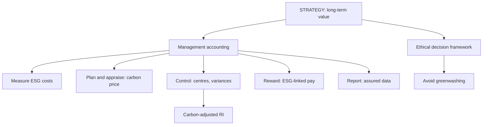

# SR-4: Linking Sustainability and Responsibility Accounting with Strategy, Long-Term Value and Ethics

Covers: how management accounting supports sustainable business models, the use of financial and non-financial information, building ESG into responsibility centre evaluation (carbon-adjusted residual income), sustainability-linked incentives, and an ethical decision framework. **(syllabus)**

## Where this fits in the ESE

This node is the integration piece of Unit 5 and the likely core of the 15-mark case: compute a measure with and without an ESG charge, show the ranking changes, and recommend with an ethical lens.

## Role of management accounting in sustainable business models

A sustainable business model creates value for shareholders, customers, employees, community and the environment over the long term. Management accounting contributes by **(textbook)**:

1. **Measuring** environmental and social costs and benefits that the ledger ignores (SR-2).
2. **Planning** with sustainability budgets and targets; scenario analysis for climate and regulation.
3. **Appraising investments** with a carbon price, life cycle costs and risk adjustments.
4. **Controlling** through variances (waste, energy) and responsibility centre targets.
5. **Rewarding** managers on balanced financial and ESG measures.
6. **Reporting** reliable ESG data to boards, lenders and regulators.

## Financial and non-financial information together

Planning and control need both:
- **Financial:** costs, revenues, ROI, RI, cash flow, capex.
- **Non-financial:** emissions, energy, safety, customer satisfaction, employee engagement.

The link is a **value driver chain**: reduced waste (non-financial) lowers material cost and disposal cost (financial); better safety lowers lost-time and insurance cost; strong governance lowers risk of fines. Show the chain, not two separate lists. The balanced scorecard (SC-6) with an ESG layer is the standard tool.

## Long-term value creation

Short-term profit can be raised by deferring maintenance, ignoring emissions or squeezing suppliers, while creating liabilities. Long-term value uses multi-year targets, risk-adjusted appraisal and stakeholder measures. Integrated reporting links strategy, performance and the six capitals (financial, manufactured, intellectual, human, social and relationship, natural). **(textbook)**

## Worked example: carbon-adjusted residual income (hypothetical)

Verdant Industries (fictional) has two divisions. The cost of capital is 12%. The internal carbon price is ₹1,500 per tCO₂e (illustrative). Figures in ₹ lakh.

| | Alpha | Beta |
|---|---|---|
| Capital employed | 800 | 500 |
| Operating profit | 120 | 80 |
| Emissions (tCO₂e) | 4,000 | 500 |

**Step 1. ROI and conventional RI.**

| | Alpha | Beta |
|---|---|---|
| ROI | 120 ÷ 800 = **15.0%** | 80 ÷ 500 = **16.0%** |
| Capital charge (12%) | 96 | 60 |
| **RI** | **24** | **20** |

**Step 2. Carbon charge.**
- Alpha: 4,000 × 1,500 = ₹60,00,000 = **60 lakh**.
- Beta: 500 × 1,500 = ₹7,50,000 = **7.5 lakh**.

**Step 3. Carbon-adjusted RI = RI − carbon charge.**

| | Alpha | Beta |
|---|---|---|
| RI | 24 | 20 |
| Carbon charge | (60) | (7.5) |
| **Carbon-adjusted RI** | **(36)** | **12.5** |

**Step 4. Break-even carbon price.** Alpha's RI of ₹24 lakh is wiped out at a carbon price of 24,00,000 ÷ 4,000 = **₹600 per tCO₂e**. Beta's at 20,00,000 ÷ 500 = ₹4,000.

**Decision line.** On conventional RI, Alpha (24) ranks above Beta (20); on ROI, Beta (16.0%) ranks above Alpha (15.0%). With the carbon charge, Alpha creates **negative** value (−₹36 lakh) and Beta adds ₹12.5 lakh. Alpha's value creation depends on emissions being free; any carbon price above ₹600 per tonne turns it negative. Recommend: reduce Alpha's emissions (the abatement is worth up to ₹1,500 per tonne to the company), revisit investment in Alpha, and base the incentive on carbon-adjusted RI. The carbon price is an internal planning assumption; test the result at ₹600 and ₹3,000 per tonne.

## Sustainability-linked incentives

- Include a **weighted ESG KPI** (for example 20% of variable pay) with measurable targets.
- Use **leading** and **lagging** measures; avoid a single gameable number.
- Require **assurance** or internal audit of ESG data.
- Do not reward cost cuts that raise safety or environmental risk.

## Ethical decision-making framework

1. **Identify the facts** and stakeholders affected.
2. **Identify the ethical issue and the principle at risk** (integrity, credibility, objectivity, public interest).
3. **List the options** and their consequences for each stakeholder, short and long term.
4. **Apply tests:** legal compliance; company code; would it survive public disclosure; fairness.
5. **Decide and act**, escalating internally if pressured (FM-3 ladder).
6. **Document and review.**

**Greenwashing** (overstating sustainability performance) breaches credibility and may attract regulatory action. Consistent measurement, boundaries, and verification are the safeguards. **[VERIFY applicable guidelines on misleading environmental claims]**

## Traps

- Presenting sustainability as separate from strategy and budgets.
- Using ROI alone to compare divisions with different emission loads.
- Treating the internal carbon price as a regulatory payment.
- Linking bonuses to ESG numbers that managers can manipulate without assurance.

## What to remember

- Management accounting measures, plans, appraises, controls, rewards and reports sustainability.
- Financial and non-financial information joined in a value driver chain.
- Alpha: RI 24, carbon charge 60, carbon-adjusted RI (36); Beta: RI 20, charge 7.5, adjusted 12.5.
- Ranking flips; Alpha's break-even carbon price is ₹600 per tonne.
- Ethical decision: facts, issue, options, tests, act, document.

## Concept map

## Flashcards
Q: Name three contributions of management accounting to a sustainable business model.
A: Measuring environmental and social costs, appraising investments with a carbon price, and linking rewards to balanced ESG and financial measures.

Q: Why combine financial and non-financial information?
A: Non-financial drivers (waste, safety, emissions) cause financial results; a value driver chain links them.

Q: Alpha and Beta: conventional RI?
A: Alpha ₹24 lakh and Beta ₹20 lakh.

Q: Alpha and Beta: carbon charges at ₹1,500 per tonne?
A: Alpha 4,000 t = ₹60 lakh; Beta 500 t = ₹7.5 lakh.

Q: Alpha and Beta: carbon-adjusted RI?
A: Alpha −₹36 lakh; Beta ₹12.5 lakh.

Q: At what carbon price does Alpha's RI become zero?
A: ₹24,00,000 ÷ 4,000 = ₹600 per tCO₂e.

Q: How does the ranking change when the carbon charge is included?
A: Alpha leads on RI (24 vs 20) but trails badly after the charge (−36 vs 12.5).

Q: Name two safeguards for ESG-linked incentives.
A: Independent assurance of the data and a mix of leading and lagging measures so no single number can be gamed.

Q: What is greenwashing and why does it matter?
A: Overstating environmental performance; it breaches credibility and invites regulatory and reputational risk.

## Sources
- BBA305-6 syllabus, Unit 5 (sustainable business models, long-term value creation, linking with strategy, ethical decision-making)
- Hansen & Mowen; integrated reporting framework **[VERIFY]**; applicable guidelines on misleading environmental claims **[VERIFY]**
- Previous: [[Management Accounting Unit 5 - SR-3 Responsibility Accounting and Responsibility Centres]] · Next: [[Management Accounting Unit 5 - SR-5 Unit 5 Exam Answers]]
- [[Management Accounting Unit 5 - Sustainability and Responsibility MOC (Node Map)]]
