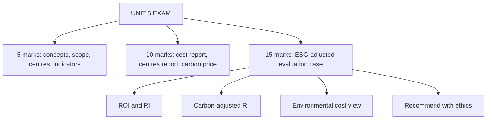

# SR-5: Unit 5 Exam Answers

Covers: 5-mark and 10-mark skeletons for Unit 5 and a 15-mark case layout with a model answer combining an environmental cost report, ROI/RI and a carbon-adjusted measure. **(syllabus)**

## Paper pattern

Section A: 3 questions with choice, 5 marks each. Section B: 2 questions with choice, 10 marks each. Section C: one compulsory 15-mark case. Unit 5 (10 hours) is the newest and least predictable unit: expect theory in Sections A and B, and a case that mixes responsibility centres with an ESG angle.

## 5-mark skeletons

**1. Define sustainability accounting and explain its scope.** Definition (1), triple bottom line and ESG (1), scope list (2), one example (1).

**2. How can ESG be integrated into management accounting systems?** Pick five tools from the SR-1 table, one line each on what changes.

**3. Environmental costs and their classification.** Four categories with an example each; conformance vs non-conformance.

**4. Sustainability performance indicators.** Emissions (with scopes), energy, water, waste, safety, people, governance; absolute vs intensity.

**5. Responsibility accounting: concept and objectives.** Definition, principle of controllability, objectives (4).

**6. Types of responsibility centres.** Four centres in a table: manager controls, measure, example.

**7. Behavioural aspects of responsibility accounting.** Four issues with a remedy each (SR-3 table).

**8. Role of management accounting in sustainable business models.** Six roles (SR-4), a value driver chain example.

## 10-mark skeletons

**A. Environmental cost report with decision (SR-2).**
1. Classify costs into the four categories (3).
2. Totals, percentages of cost and sales, conformance vs non-conformance (3).
3. Evaluate a prevention proposal with net saving (2).
4. Decision line and limitation (2).

**B. Responsibility centres with reports (SR-3).** Centres and measures (3); one performance report with variance and interpretation (5); behavioural cautions (2).

**C. Sustainability, strategy and long-term value (SR-1, SR-4).** Concept and ESG (2); integration into tools (3); financial and non-financial links (2); example (2); limitations (1).

**D. Carbon price and appraisal (SR-2, SR-4).** Compute carbon-adjusted cost or RI (4); break-even carbon price (2); interpretation (2); caveat that the price is a planning assumption (2).

## 15-mark case layout

1. **Context** in two lines: who, which measure currently used, what the question is (1).
2. **Compute conventional measures** (ROI, RI) (3).
3. **Compute the ESG-adjusted measure** (carbon charge, adjusted RI, break-even price) (3).
4. **Environmental cost view** if data given: categories, failure share, proposal (3).
5. **Interpret**: ranking change, controllable items, behaviour (2).
6. **Recommend** with ethics and incentive design (2).
7. **Limitations** (1).

## Model answer (illustrative)

**Case.** Pinewood Paper Mills (fictional) judges two divisions on ROI. Cost of capital 10%. The board adopts an internal carbon price of ₹2,000 per tCO₂e for planning (an assumption). Division X: capital employed ₹600 lakh, operating profit ₹96 lakh, emissions 3,000 t; environmental costs ₹60 lakh (prevention 8, detection 4, internal failure 18, external failure 30). Division Y: capital ₹400 lakh, operating profit ₹56 lakh, emissions 300 t. The board asks which division creates more value and what to do.

**1. Context.** Rank divisions on conventional and ESG-adjusted value; propose action.

**2. Conventional measures.**

| | X | Y |
|---|---|---|
| ROI | 96 ÷ 600 = **16.0%** | 56 ÷ 400 = **14.0%** |
| Capital charge at 10% | 60 | 40 |
| **RI (₹ lakh)** | **36** | **16** |

**3. ESG-adjusted.**

| | X | Y |
|---|---|---|
| Carbon charge (₹ lakh) | 3,000 × 2,000 = 60 | 300 × 2,000 = 6 |
| **Carbon-adjusted RI (₹ lakh)** | 36 − 60 = **(24)** | 16 − 6 = **10** |
| Break-even carbon price | 36,00,000 ÷ 3,000 = **₹1,200 per t** | 16,00,000 ÷ 300 = **₹5,333 per t** |

**4. Environmental cost view for X.**
- Prevention 8 and detection 4 = 12 (20%, conformance); internal failure 18 and external failure 30 = 48 (80%, non-conformance). Total 60.
- Proposal: spend an extra ₹10 lakh on prevention to cut failure cost by ₹25 lakh. Net saving = 25 − 10 = **₹15 lakh**; new environmental cost = 60 + 10 − 25 = ₹45 lakh.

**5. Interpret.** X leads on ROI and RI, but its value depends on emissions being free: any carbon price above ₹1,200 per tonne turns RI negative, and the planning price of ₹2,000 gives −₹24 lakh. Y creates positive value even at ₹2,000 and stays positive up to ₹5,333. Eighty percent of X's environmental cost is failure cost, so abatement is also a cost-saving route. X's manager would reject emission reduction that lowers ROI unless the measure includes the carbon cost.

**6. Recommend.**
1. Replace ROI with carbon-adjusted RI for divisional evaluation, with the carbon price reviewed annually and sensitivity-tested at ₹1,000 and ₹3,000.
2. Approve X's prevention proposal (net ₹15 lakh).
3. Link 20% of divisional management's variable pay to assured ESG KPIs (emissions intensity, waste, safety), with multi-year targets to avoid short-term gaming.
4. Report environmental cost by category to the board and disclose the carbon-price assumption.
5. Ethics: do not shift emissions to suppliers or hold back data to protect the ranking.

**7. Limitations.** The carbon price is an assumption; only emissions are priced; one-year data; Scope 3 excluded; the failure-cost saving is an estimate.

## Common mark-losers

- Theory answers with no example or number.
- Ranking on ROI alone.
- Treating the internal carbon charge as a statutory expense.
- Listing centres without a measure for each.
- No recommendation in the case.

## What to remember

- Theory skeletons: define, scope or types, example, limitation.
- Environmental cost: classify, percentages, conformance vs failure, proposal net saving.
- Case: conventional measure, ESG-adjusted measure, break-even price, ranking change, recommend.
- Pinewood: X ROI 16.0%, RI 36, adjusted (24); Y ROI 14.0%, RI 16, adjusted 10; X proposal saves ₹15 lakh.

## Concept map

## Flashcards
Q: Layout for a 15-mark Unit 5 case?
A: Context, conventional measures, ESG-adjusted measure, environmental cost view, interpretation, recommendation, limitations.

Q: Pinewood: X's and Y's ROI?
A: X 16.0% (96 ÷ 600) and Y 14.0% (56 ÷ 400).

Q: Pinewood: X's and Y's conventional RI at 10%?
A: X ₹36 lakh and Y ₹16 lakh.

Q: Pinewood: carbon-adjusted RI at ₹2,000 per tonne?
A: X −₹24 lakh (36 − 60) and Y ₹10 lakh (16 − 6).

Q: Pinewood: break-even carbon price for X?
A: 36,00,000 ÷ 3,000 = ₹1,200 per tCO₂e.

Q: Pinewood: failure share of X's environmental cost?
A: (18 + 30) ÷ 60 = 80%.

Q: Pinewood: net saving from the prevention proposal?
A: 25 − 10 = ₹15 lakh; new environmental cost ₹45 lakh.

Q: Which safeguards go with ESG-linked pay?
A: Assured data, multi-year targets and a mix of leading and lagging measures.

Q: Is the internal carbon price a tax?
A: No. It is an internal planning assumption used to price externalities in decisions.

## Sources
- BBA305-6 syllabus, Unit 5 and ESE pattern
- [[Management Accounting Unit 5 - SR-1 Sustainability Accounting Concept and ESG Integration]] · [[Management Accounting Unit 5 - SR-2 Environmental and Social Costs and Sustainability Indicators]] · [[Management Accounting Unit 5 - SR-3 Responsibility Accounting and Responsibility Centres]] · [[Management Accounting Unit 5 - SR-4 Strategy Link Long-Term Value and Ethical Decisions]]
- [[Management Accounting Unit 5 - Sustainability and Responsibility MOC (Node Map)]]
