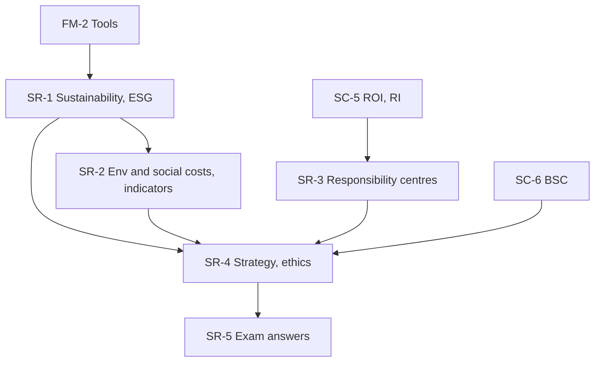

# Management Accounting Unit 5: Sustainability Accounting and Responsibility Accounting, node map

ESE: 50 marks, Section A 3 × 5, Section B 2 × 10, Section C one compulsory 15-mark case. Unit 5 is CO5 (evaluate sustainability and responsibility accounting by integrating ESG and responsibility centre performance). Mostly theory with short numericals; the case is likely to combine ROI/RI with an ESG charge. All examples are **hypothetical figures**.

## Nodes

| Node | Topic | Deps | Minutes | Exam focus |
|---|---|---|---|---|
| SR-1 | Sustainability Accounting Concept and ESG Integration | FM-2 | 30 | yes |
| SR-2 | Environmental and Social Costs and Sustainability Indicators | SR-1 | 40 | yes |
| SR-3 | Responsibility Accounting and Responsibility Centres | SC-5 | 35 | yes |
| SR-4 | Strategy Link, Long-Term Value and Ethical Decisions | SR-1 to SR-3, SC-6 | 35 | yes |
| SR-5 | Unit 5 Exam Answers | SR-1 to SR-4 | 35 | yes |

Total reading time: about 175 minutes.

## Dependency graph

## Headline numbers to know

- Waste: ₹36,00,000 at 6% falls to ₹24,00,000 at 4%; saving ₹12,00,000.
- Environmental cost report ₹6,00,000 (10% of sales; 66.7% failure cost); prevention proposal saves ₹2,00,000.
- Emissions 8,800 to 8,000 t (−9.1%); intensity 40 to 32 (−20.0%); revenue +13.6%.
- Carbon price: Option 2 adjusted ₹74 lakh vs ₹100 lakh; break-even ₹667 per tonne.
- Centre reports: cost centre ₹11,000 A; revenue centre price ₹38,000 F, volume ₹50,000 A; profit centre controllable ₹16 lakh, segment ₹11 lakh.
- Alpha/Beta: carbon-adjusted RI (₹36 lakh) vs ₹12.5 lakh; Alpha break-even ₹600 per tonne.
- Pinewood: X RI 36, adjusted (24); Y 16, adjusted 10; proposal saves ₹15 lakh.

## Links
- [[Management Accounting MOC]]
